# Formação Prática Módulo Configuração Geral

| | |
|---|---|
| **Vídeo** | [youtu.be/7UlDwks9BgQ](https://www.youtube.com/watch?v=7UlDwks9BgQ) |
| **Canal** | Officegest (canal oficial) |
| **Apresentador** | Pedro Jordão (o nome vem da fala; não aparece escrito no ecrã) |
| **Gravado em** | **2021-08-12** (data da formação no painel de entrada e na agenda do ecrã) |
| **Publicado em** | 2022-10-17 |
| **Duração** | 1:22:45 |
| **Processado em** | 2026-10-02 |
| **Fonte do texto** | Legendas automáticas do YouTube (pt), com muitos erros, **corrigidas pelos ecrãs**. Os nomes de menus e campos abaixo foram lidos nos screenshots |
| **Ecrãs** | 176 capturados em [`ecras/`](ecras/) (168 automáticos e 8 pedidos à mão); os mais úteis estão embutidos abaixo |
| **Versão do OfficeGest** | **vr 3.039** (rodapé do menu), em ambiente "Demonstração" (`democomercial.officegest.com`, empresa "Guisoft"). As séries de documentos foram mostradas noutra demo, `demooficinas.officegest.com` ("Empresa Oficinas Demo") |

> ⚠️ **Vídeo com 5 anos.** Foi publicado em outubro de 2022, mas a sessão foi gravada em **agosto de 2021**. Tudo o que está abaixo descreve o OfficeGest **como era em agosto de 2021, na versão 3.039**. Trate cada afirmação como **hipótese**, com a forma "segundo a formação de 2021-08", até ser confirmada no sistema atual. Os screenshots servem para comparar: se o ecrã de hoje for diferente, houve mudança.
>
> ❓ = ponto que nem a fala nem o ecrã deixam claro.

> 🔗 **Vídeos relacionados já dissertados:** esta é a formação mais antiga da série de 2021. A [Formação Prática Módulo Financeira](../formacao-pratica-modulo-financeira/dissertacao.md) (2021-08-31, v3.042) aprofunda as contas bancárias, as caixas e a caixa do colaborador, que aqui só são referidas. A [Formação Prática Módulo Contabilidade](../formacao-pratica-modulo-contabilidade/dissertacao.md) (2021-09-07, v3.043) trata dos parâmetros da contabilidade. O [Webinar #2 de 2020](../webinar-2-contabilidade-officegest/dissertacao.md) mostrava o menu "Importação E-fatura" sem o abrir; **este vídeo abre-o** (secção 2).

---

## Resumo

É uma formação gratuita da OfficeGest Academia sobre a **configuração de base** da aplicação: o que se prepara uma vez, quando se começa a usar o OfficeGest, e que depois condiciona todos os documentos e todos os utilizadores. O apresentador insiste em dois pontos: quase tudo isto **pode ser alterado pelo próprio cliente**, sem pedir ao suporte; e muitas chamadas ao suporte vêm de três ou quatro opções mal preenchidas (o logótipo, a série predefinida, a data limite da série, o prazo para anular documentos).

A ordem é esta:

1. **Dados da Empresa:** identificação, textos e imagens que saem nos documentos, e credenciais para falar com a AT.
2. **Importação E-fatura:** comparar o que está no Portal das Finanças com o que está registado no OfficeGest.
3. **Parâmetros:** valores por defeito, avisos, segurança, campos obrigatórios e outras opções gerais.
4. **Séries de documentos:** criar uma série, e os três cuidados na passagem de ano.
5. **Parâmetros de Vendas, Compras e CRM.**
6. **Email, referências multibanco e RGPD.**
7. **Tabelas de Apoio:** geográficas, organizacionais, de recursos humanos e financeiras.
8. **Grupos de permissões:** o que cada utilizador pode ver e fazer.
9. **Ficha do colaborador:** acesso (login, palavra-passe, IP, horário) e definições (série, caixa, armazém).
10. **Pedido de suporte** a partir da aplicação.

A regra que atravessa a sessão: **a ficha do colaborador manda primeiro; os Parâmetros só valem quando a ficha diz "Por Defeito"** (secção 9.3).

### Onde fica cada coisa (versão 3.039)

- **Configurações** → Dados da Empresa · **Parâmetros** · Campos Extra · Teclas de atalho · Validações · Documentos / Impressão · Importar · Templates de E-mail · Configurador de Relatórios
- **Configurações → Dados da Empresa**, separadores **Geral** · **Documentos** · **Comunicação AT**
- **Configurações → Parâmetros**, separadores Valores p/ Defeito · Avisos · Segurança · Outros · Vendas · Compras · CRM · Contratos assistência · Subscrições · SEPA · Loja Online · Fidelização · Recursos Humanos · Bancos · Assiduidade · EMail · API's · Tickets · eGAR · RGPD. Só aparecem os separadores dos módulos ativos; cada formação de módulo explica o seu
- **Comunicações AT** → Exportar SAFT-PT · Inventário · Intrastat · **Importação E-fatura**
- **Tabelas de Apoio → Geográficos** → Códigos Postais · Zonas · Concelhos · Distritos
- **Tabelas de Apoio → Organizacionais** → Armazéns · Setores · Postos / Terminais / Caixas · Departamentos · Modos de Expedição · Categorias de anexos
- **Tabelas de Apoio → Recursos Humanos** → Categorias · Especialidades · **Privilégios**
- **Tabelas de Apoio → Financeiros** → Moedas · **Séries de Documentos** · IVA · Razões de Isenção IVA · Prazos de Pagamento · Modos de Pagamento · Tipos de Movimento de Caixa · Bancos · Contas Bancárias
- **Entidades → Colaboradores** (ficha, separadores **Definições** e **Acesso Web**)
- **Ajuda** → Manual · Registo de Alterações · **Suporte**

---

## 1. Dados da Empresa (≈ 02:45–12:10)

**Caminho:** Configurações → **Dados da Empresa**.

### 1.1 Separador Geral

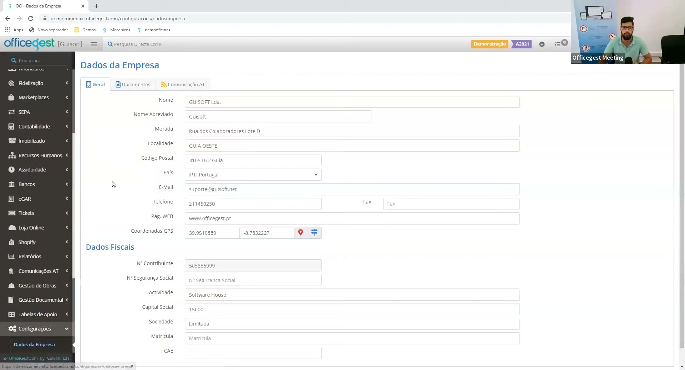

| Grupo | Campos |
|---|---|
| Identificação | Nome, Nome Abreviado, Morada, Localidade, Código Postal, País, E-Mail, Telefone, Fax, Pág. WEB, Coordenadas GPS |
| **Dados Fiscais** | Nº Contribuinte (bloqueado), Nº Segurança Social, Actividade, Capital Social, Sociedade, Matrícula, CAE |

- É a informação do **cabeçalho dos documentos** (nome, morada, email, telefone).
- **Regra:** alterar estes dados **não muda os documentos já emitidos**. Uma fatura já emitida imprime-se sempre com os dados que a empresa tinha nessa altura; a alteração só vale para os documentos emitidos depois.
- O **Nº Segurança Social** interessa a quem tem o módulo de Recursos Humanos (para o ficheiro da Segurança Social).
- A **Matrícula** é, por norma, o número de contribuinte. O **CAE** escolhe-se de uma lista ❓ (o apresentador diz que os CAE se criam noutro sítio, mas não o mostra).

### 1.2 Separador Documentos

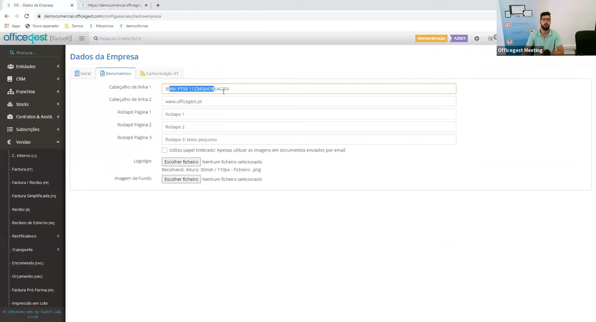

| Campo | Onde sai no documento impresso |
|---|---|
| Cabeçalho de linha 1 e 2 | Por baixo dos dados da empresa, no topo. Usa-se, por exemplo, para o IBAN e o site |
| Rodapé Página 1 e 2 | Na parte de baixo, por cima da tabela de totais ❓ |
| Rodapé Página 3 | Por cima do bloco "Local Carga / Local Descarga". Texto mais pequeno |
| **Logotipo** | Para quem não usa papel timbrado. O ecrã recomenda: altura 30 mm / 110 px, ficheiro **.png** |
| **Imagem de Fundo** | Uma imagem do tamanho da folha inteira (tem de ser ajustada antes de carregar) |
| **Utilizo papel timbrado: Apenas utilizar as imagens em documentos enviados por email** | Ver abaixo |

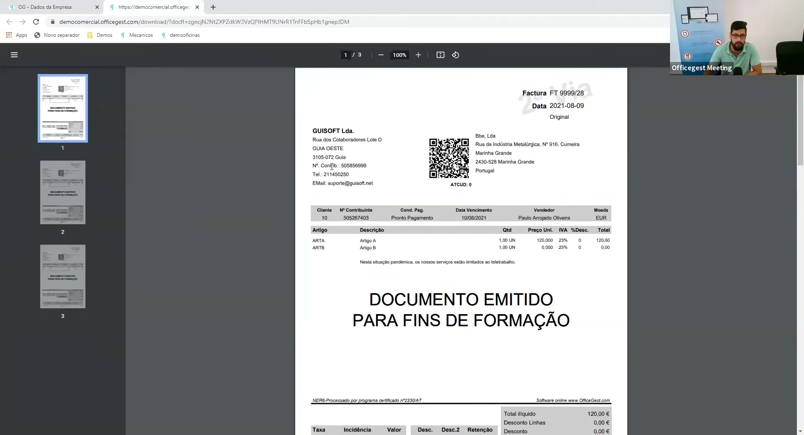

- **Porquê PNG:** nas faturas e recibos, uma imagem noutro formato ainda sai; **nos relatórios não sai**. Por isso recomenda-se sempre PNG.
- **Papel timbrado:** quem imprime em papel timbrado mas quer enviar por email um PDF "igual ao papel" carrega o timbrado digitalizado como imagem de fundo e liga a opção. Ao **imprimir**, o OfficeGest ignora a imagem; ao **enviar por email**, inclui-a.
- Se um texto do cabeçalho ficar demasiado comprido e sair mal alinhado, o apresentador diz para contactar o suporte, que ajusta o tamanho da letra.
- Na demo os campos estavam vazios; o apresentador preencheu-os como exemplo mas **não gravou**, por isso não se vê uma fatura com os textos impressos.

### 1.3 Separador Comunicação AT

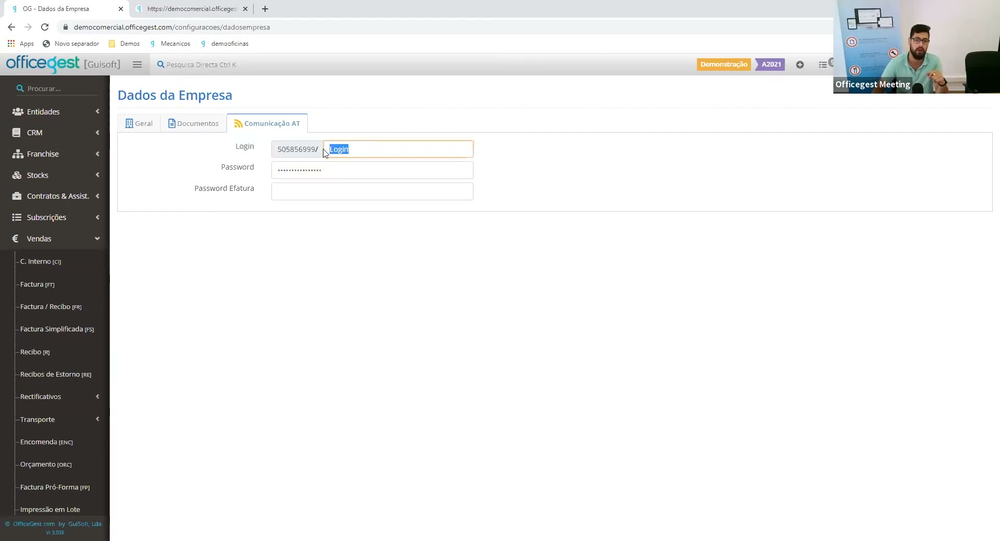

| Campo | Para que serve |
|---|---|
| **Login** | O ecrã já mostra o NIF da empresa seguido de "/"; escreve-se a seguir o **número do subutilizador** criado no Portal das Finanças |
| **Password** | A palavra-passe **desse subutilizador** (não é a palavra-passe principal da empresa) |
| **Password Efatura** | A palavra-passe com que a empresa **entra no Portal das Finanças**. Serve a Importação E-fatura (secção 2) |

**Como se cria o subutilizador**, segundo a fala: no Portal das Finanças, *Todos os Serviços* → procurar **Gestão de Utilizadores** → criar um novo utilizador e dar-lhe uma palavra-passe. O portal atribui-lhe um número (1 para o primeiro, 2 para o segundo, e assim por diante); é esse número que entra no campo Login. O Login e a Password servem para a **comunicação das guias** (documentos de transporte) à AT.

## 2. Importação E-fatura (≈ 12:10–14:10)

**Caminho:** Comunicações AT → **Importação E-fatura**. O ecrã chama-se **Registos AT**.

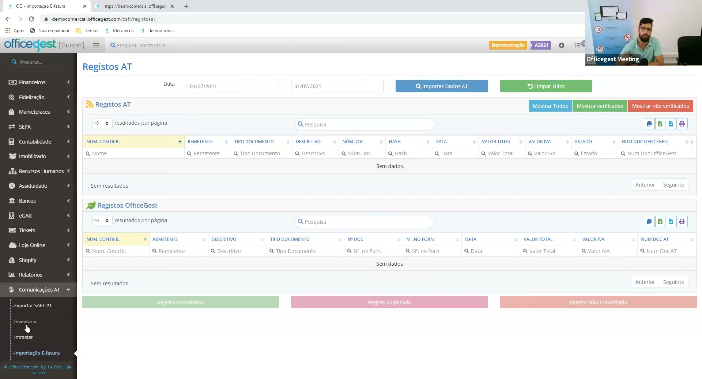

O apresentador chama-lhe um "validador": compara os documentos que estão **no Portal das Finanças (e-Fatura)** com os que estão **registados no OfficeGest**. Diz que muitos clientes não sabem que existe e que está disponível para todos.

**O que se vê no ecrã:**

- Um intervalo de **Data** (no exemplo, 01/07/2021 a 31/07/2021) e os botões **Importar Dados AT** e **Limpar Filtro**.
- Filtros **Mostrar Todos**, **Mostrar verificados** e **Mostrar não verificados**.
- Duas listas:

| Lista | Colunas |
|---|---|
| **Registos AT** | Num. Contrib., Remetente, Tipo Documento, Descritivo, Núm.Doc., Hash, Data, Valor Total, Valor IVA, Estado, **Num Doc OfficeGest** |
| **Registos OfficeGest** | Num. Contrib., Remetente, Descritivo, Tipo Documento, Nº Doc., **Nº. no Forn.**, Data, Valor Total, Valor IVA, **Num Doc AT** |

- Uma legenda de três cores: **Registo Encontrado** (verde), **Registo Duplicado** (rosa) e **Registo Não Encontrado** (vermelho).

**O que a fala acrescenta** (não foi demonstrado: a demo não tinha a palavra-passe e as duas listas estavam vazias, "Sem dados"):

- Faz-se o **mapeamento** entre os documentos do portal e os do OfficeGest, para ver se falta registar alguma coisa.
- Quando um documento está na AT e **não existe no OfficeGest**, a linha tem um botão **"+"** que **cria o documento**: cria a entidade se ela não existir e preenche o **cabeçalho**. **As linhas (artigos) têm de ser preenchidas pelo utilizador** ❓ (a fala refere a escolha de um artigo a usar na criação, sem se perceber como).

> **Leitura do ecrã:** a coluna **"Nº. no Forn."** (número no fornecedor) e a criação automática da entidade indicam que as duas listas são de **documentos de compra**, ou seja, as faturas que os fornecedores comunicaram à AT com o NIF da empresa. A fala não o diz com estas palavras ❓.

## 3. Parâmetros (≈ 14:10–29:10)

**Caminho:** Configurações → **Parâmetros**. O ecrã chama-se "Configuração".

### 3.1 Valores p/ Defeito

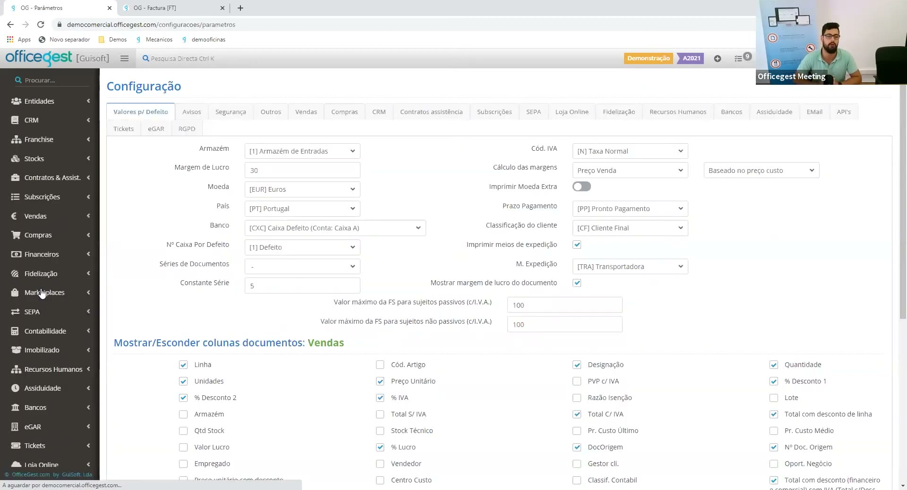

Os valores que a aplicação assume quando nada mais específico foi dito. Na demo:

| Campo | Valor |
|---|---|
| Armazém | [1] Armazém de Entradas |
| Margem de Lucro | 30 |
| Moeda / País | [EUR] Euros / [PT] Portugal |
| Banco | [CXC] Caixa Defeito (Conta: Caixa A) |
| Nº Caixa Por Defeito | [1] Defeito |
| **Séries de Documentos** | "-" (vazio) no início; mais tarde, [9999] Formação |
| Constante Série | 5 ❓ (não explicado) |
| Cód. IVA | [N] Taxa Normal |
| Cálculo das margens | Preço Venda, "Baseado no preço custo" |
| Imprimir Moeda Extra | desligado |
| Prazo Pagamento | [PP] Pronto Pagamento |
| Classificação do cliente | [CF] Cliente Final |
| Imprimir meios de expedição / M. Expedição | ligado / [TRA] Transportadora |
| Mostrar margem de lucro do documento | ligado |
| Valor máximo da FS para sujeitos passivos (c/I.V.A.) | 100 |
| Valor máximo da FS para sujeitos não passivos (c/I.V.A.) | 100 |

**Mostrar/Esconder colunas documentos** (uma lista para Vendas, outra para Compras): escolhe-se que colunas aparecem nas **linhas** de um documento novo.

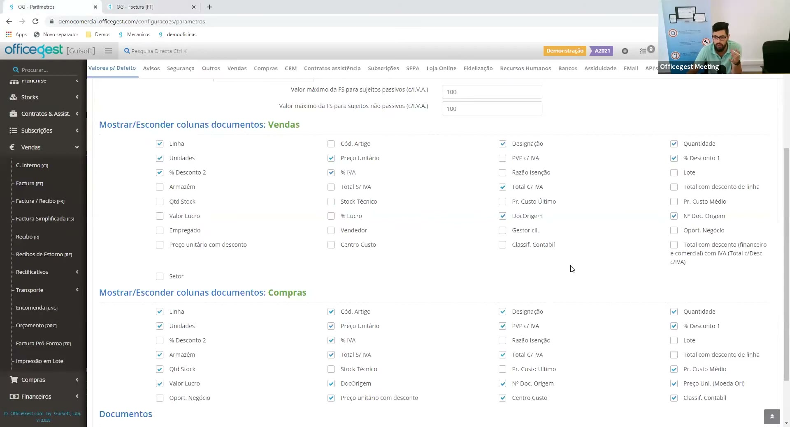

- Opções vistas: Linha, Cód. Artigo, Designação, Quantidade, Unidades, Preço Unitário, PVP c/ IVA, % Desconto 1 e 2, % IVA, Razão Isenção, Lote, Armazém, Total S/ IVA, Total C/ IVA, Total com desconto de linha, Qtd Stock, Stock Técnico, Pr. Custo Último, Pr. Custo Médio, Valor Lucro, % Lucro, DocOrigem, Nº Doc. Origem, Empregado, Vendedor, Gestor cli., Oport. Negócio, Preço unitário com desconto, Centro Custo, Classif. Contabil, Setor.
- No vídeo ligaram-se "Total com desconto de linha" e "% Lucro"; depois de gravar e **voltar a entrar na aplicação**, as colunas novas apareceram na fatura.
- Vale para todos os utilizadores. O que cada um **pode ver** (por exemplo, margens) controla-se nos privilégios (secção 8).

### 3.2 Avisos

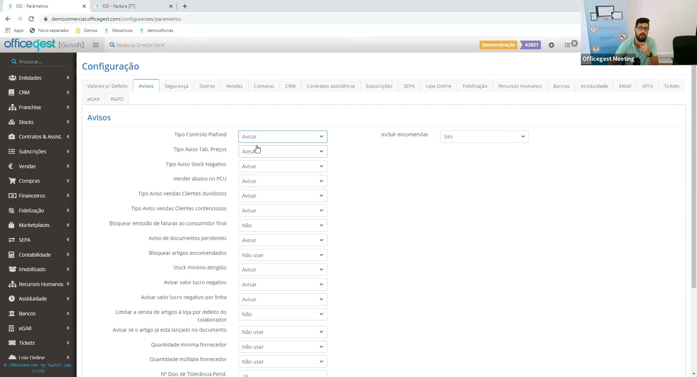

Cada linha é uma situação de risco, e para cada uma escolhe-se o comportamento. Segundo a fala há três níveis: **não usar**, **avisar** (mostra a mensagem mas deixa continuar) e **impedir** (não deixa gravar). No ecrã veem-se "Avisar", "Não usar" e "Não"; a opção de impedir não chegou a ser aberta ❓.

| Aviso | Valor na demo |
|---|---|
| Tipo Controlo Plafond | Avisar (Incluir encomendas: Sim) |
| Tipo Aviso Tab. Preços | Avisar |
| Tipo Aviso Stock Negativo | Avisar |
| **Vender abaixo no PCU** | Avisar |
| Tipo Aviso vendas Clientes duvidosos | Avisar |
| Tipo Aviso vendas Clientes contenciosos | Avisar |
| Bloquear emissão de faturas ao consumidor final | Não |
| Aviso de documentos pendentes | Avisar |
| Bloquear artigos encomendados | Não usar |
| Stock mínimo atingido | Avisar |
| Avisar valor lucro negativo / por linha | Avisar |
| Limitar a venda de artigos à loja por defeito do colaborador | Não |
| Avisar se o artigo já está lançado no documento | Não usar |
| Quantidade mínima fornecedor / múltipla fornecedor | Não usar |
| Nº Dias de Tolerância Pend. | 15 ❓ (valor cortado no ecrã) |

Exemplo dito: um artigo comprado a 5 e vendido a 3. Com "Avisar", aparece a mensagem e a venda segue. Com "impedir", o documento não grava; ou se sobe o preço, ou alguém muda o parâmetro.

### 3.3 Segurança

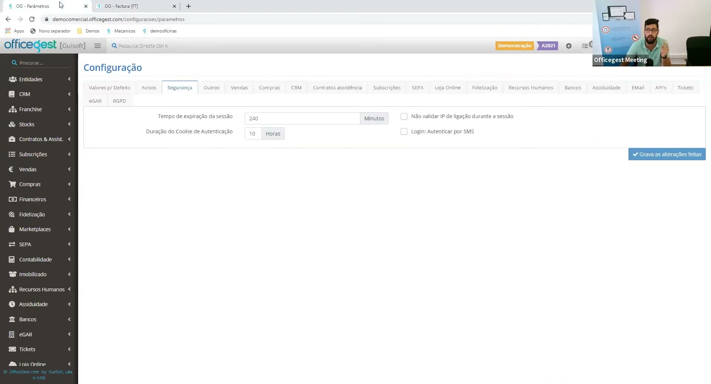

| Campo | Valor na demo |
|---|---|
| Tempo de expiração da sessão | 240 Minutos |
| Duração do Cookie de Autenticação | 10 Horas |
| Não validar IP de ligação durante a sessão | desligado |
| Login: Autenticar por SMS | desligado |

- O tempo de expiração conta o tempo **sem uso**. Passado esse tempo a sessão cai, **em todas as páginas abertas**.
- **Conselho para não perder trabalho:** se suspeitar que a sessão caiu enquanto preenchia um documento, **não mexa nessa página**. Abra um **novo separador** do navegador, entre de novo no OfficeGest, e só depois volte à página original e grave.

### 3.4 Outros

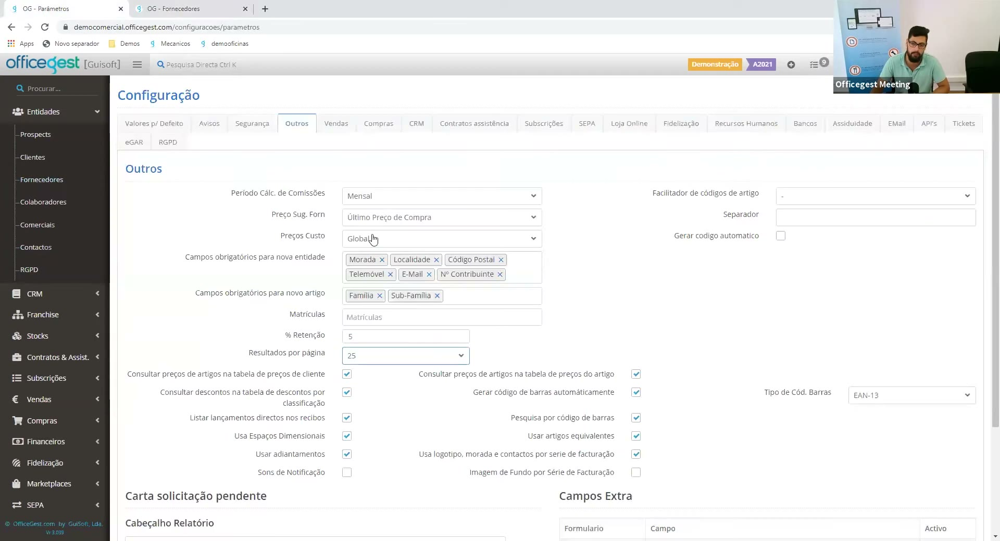

| Campo | Valor na demo | Nota |
|---|---|---|
| Período Cálc. de Comissões | Mensal | |
| Preço Sug. Forn | Último Preço de Compra | |
| Preços Custo | Global | |
| **Campos obrigatórios para nova entidade** | Morada, Localidade, Código Postal, Telemóvel, E-Mail, Nº Contribuinte | Ver abaixo |
| **Campos obrigatórios para novo artigo** | Família, Sub-Família | O código e a designação são sempre obrigatórios e não aparecem aqui |
| Matrículas | vazio | Lista de matrículas ❓ (a fala liga-a à identificação das viaturas nos documentos) |
| **% Retenção** | 5 | Ver abaixo |
| Resultados por página | 25 | Linhas por página nas listas |
| Consultar preços de artigos na tabela de preços de cliente / do artigo | ligados | |
| Consultar descontos na tabela de descontos por classificação | ligado | |
| **Listar lançamentos directos nos recibos** | ligado | Apresentada como opção recente |
| Usa Espaços Dimensionais, Usar adiantamentos, Usar artigos equivalentes | ligados | |
| Gerar código de barras automáticamente, Pesquisa por código de barras | ligados | Tipo de Cód. Barras: EAN-13 |
| **Usa logotipo, morada e contactos por serie de facturação** | ligado | Ver secção 4 |
| **Imagem de Fundo por Série de Facturação** | desligado | Ver secção 4 |
| Sons de Notificação | desligado | |

Mais abaixo, no mesmo separador: **Carta solicitação pendente**, **Cabeçalho Relatório** e **Campos Extra** (não abertos).

**Campos obrigatórios, demonstrados.** Ao criar um cliente só com o contribuinte, a aplicação recusa e marca a vermelho os campos em falta, com "Este campo é necessário.".

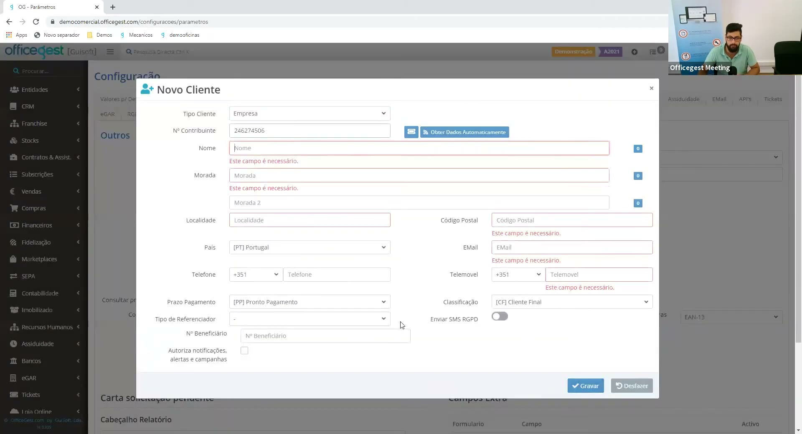

**Retenção na fonte: duas camadas.** A **% Retenção** dos Parâmetros é a percentagem geral. Cada cliente ou fornecedor pode ter a sua, na ficha, em **Dados Financeiros**. A aplicação lê **primeiro a ficha da entidade**; só se lá estiver a zero é que usa a dos Parâmetros.

## 4. Séries de documentos (≈ 27:30–35:50)

**Caminho:** Tabelas de Apoio → Financeiros → **Séries de Documentos**.

Uma empresa pode ter várias séries de faturação. O exemplo dito é uma empresa com duas áreas de negócio (construção civil e cabeleireiro) no mesmo OfficeGest: cada área tem a sua série, e cada série pode sair com **morada, contactos, logótipo e imagem de fundo próprios**. Para isso ligam-se nos Parâmetros → Outros as opções "Usa logotipo, morada e contactos por serie de facturação" e "Imagem de Fundo por Série de Facturação".

> Atenção ao limite dito pelo apresentador: as séries separam os **documentos**, não os **dados**. As duas áreas veem os mesmos artigos e as mesmas entidades.

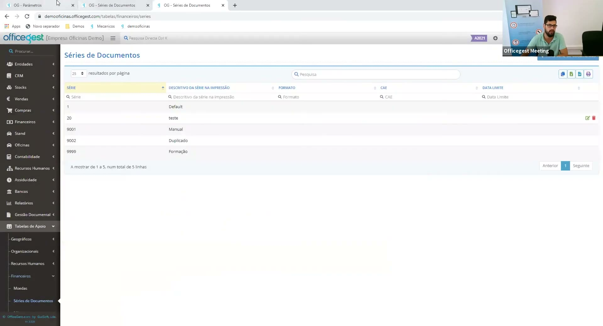

A lista tem as colunas Série, Descritivo da série na impressão, Formato, CAE e **Data Limite**. Na demo: 1 Default, 20 teste, 9001 Manual, 9002 Duplicado, 9999 Formação.

### 4.1 Nova série

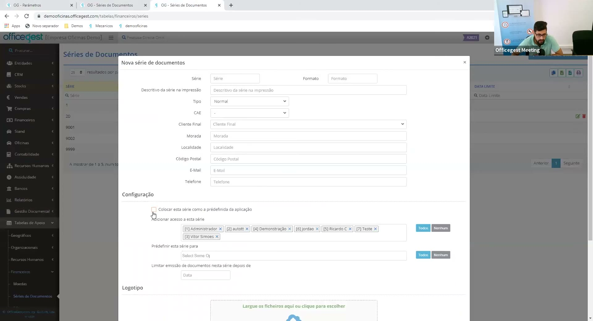

| Campo | Para que serve |
|---|---|
| Série, Formato, Descritivo da série na impressão | Identificação |
| Tipo | "Normal" no exemplo |
| CAE, Cliente Final | |
| Morada, Localidade, Código Postal, E-Mail, Telefone | **Substituem** nos documentos desta série os Dados da Empresa (só com a opção da secção 3.4 ligada) |
| **Colocar esta série como a prédefinida da aplicação** | Ao gravar, passa a ser a série dos Parâmetros → Valores p/ Defeito |
| **Adicionar acesso a esta série** | Os colaboradores que a podem usar. Vem preenchido com **todos**; botões Todos / Nenhum |
| **Prédefinir esta série para** | Os colaboradores para quem passa a ser a série por omissão |
| **Limitar emissão de documentos nesta série depois de** | Uma data. Depois dela, a série não aceita documentos |
| Logotipo, Imagem de Fundo | Imagens próprias da série |

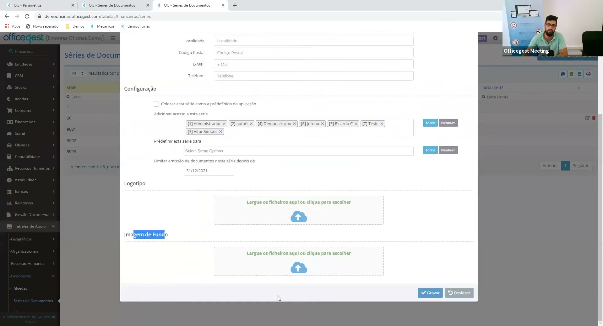

### 4.2 Os três cuidados na passagem de ano

São, segundo o apresentador, a origem de muitas chamadas ao suporte:

1. **"Colocar esta série como a prédefinida da aplicação".** Quem cria em dezembro a série do ano seguinte e deixa esta opção ligada começa **de imediato** a faturar na série nova, sem dar por isso. Desligar, se a série for para usar só mais tarde.
2. **"Adicionar acesso a esta série".** Retirar quem não deve usá-la.
3. **"Limitar emissão de documentos nesta série depois de".** Na série do ano que acaba, pôr **31/12**. No dia seguinte a aplicação recusa ("data limite atingida") e obriga a usar a série nova. Sem esta data, alguém fatura em janeiro na série velha, e **a OfficeGest não pode apagar esses documentos**.

## 5. Parâmetros de Vendas, Compras e CRM (≈ 35:50–43:50)

### 5.1 Vendas

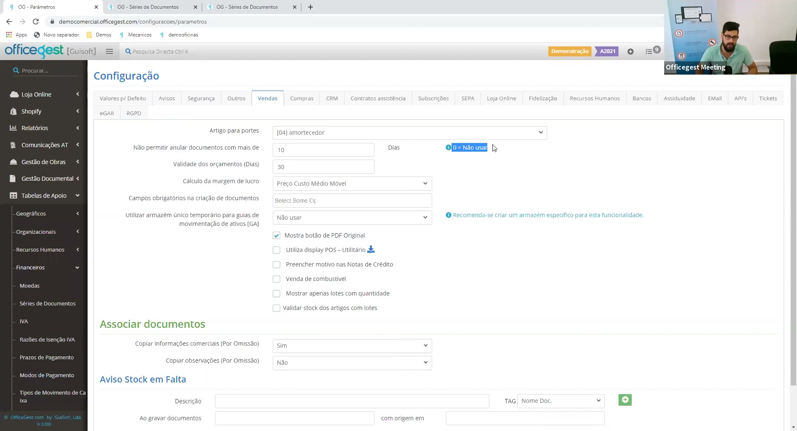

| Campo | Valor na demo |
|---|---|
| Artigo para portes | [04] amortecedor (dados de demonstração) |
| **Não permitir anular documentos com mais de** | **10** Dias. A nota ao lado diz "0 = Não usar" |
| Validade dos orçamentos (Dias) | 30 |
| Cálculo da margem de lucro | Preço Custo Médio Móvel |
| Campos obrigatórios na criação de documentos | vazio (o exemplo dito é o centro de custo) |
| Utilizar armazém único temporário para guias de movimentação de ativos [GA] | Não usar |
| Mostra botão de PDF Original | ligado |
| Utiliza display POS – Utilitário | desligado |
| **Preencher motivo nas Notas de Crédito** | desligado |
| Venda de combustível, Mostrar apenas lotes com quantidade, Validar stock dos artigos com lotes | desligados |
| **Associar documentos:** Copiar informações comerciais (Por Omissão) / Copiar observações (Por Omissão) | Sim / Não |
| **Aviso Stock em Falta** | Descrição, TAG, "Ao gravar documentos … com origem em" (não explicado) |

**O prazo para anular documentos.** Vem de base com 10 dias (vale também para as compras ❓). Passado o prazo, o botão de anular deixa de aparecer. Quem precisar de anular um documento mais antigo pode pôr **0**, anular, e **voltar a pôr 10 a seguir**.

> **Aviso do apresentador:** o prazo existe por causa do **SAF-T**. Um documento que já foi comunicado à AT não deve ser anulado; se for, é preciso **exportar e submeter de novo o SAF-T** desse mês no Portal das Finanças. Quem puser o parâmetro a zero "tem de saber o que está a fazer".

**Motivo das notas de crédito.** Com a opção ligada, cada nota de crédito obriga a escolher um motivo, de uma lista criada pela empresa. Serve para depois analisar porque se emitiram.

### 5.2 Compras

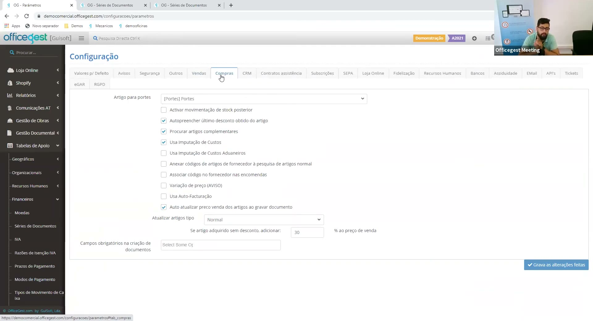

Artigo para portes ([Portes] Portes) e uma lista de opções: Activar movimentação de stock posterior · **Autopreencher último desconto obtido do artigo** (ligado) · **Procurar artigos complementares** (ligado) · **Usa Imputação de Custos** (ligado) · Usa Imputação de Custos Aduaneiros · Anexar códigos de artigos de fornecedor à pesquisa de artigos normal · Associar código no fornecedor nas encomendas · Variação de preço (AVISO) · Usa Auto-Facturação · **Auto atualizar preco venda dos artigos ao gravar documento** (ligado; "Atualizar artigos tipo: Normal"; "Se artigo adquirido sem desconto, adicionar: 30 % ao preço de venda") · Campos obrigatórios na criação de documentos.

O apresentador passou por este separador sem explicar cada opção.

### 5.3 CRM

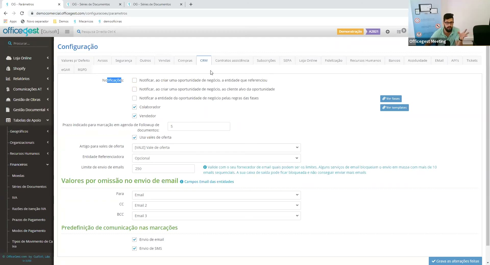

- **Notificações** ao criar uma oportunidade de negócio (à entidade que referenciou, ao cliente, ao colaborador, ao vendedor), com botões "Ver fases" e "Ver templates".
- Prazo indicado para marcação em agenda de Followup de documentos: 5.
- Usa vales de oferta; Artigo para vales de oferta; Entidade Referenciadora.
- **Limite de envio de emails: 250.** O ecrã avisa: "Valide com o seu fornecedor de email quais podem ser os limites. Alguns serviços de email bloqueiam o envio em massa com mais de 10 emails sequenciais." Se o limite do fornecedor for ultrapassado, **a caixa de saída pode ficar bloqueada**.
- **Valores por omissão no envio de email:** Para = Email, CC = Email 2, BCC = Email 3 (os três campos de email da ficha da entidade).
- **Predefinição de comunicação nas marcações:** Envio de email e Envio de SMS. Decidem se, ao criar uma marcação, as caixas "Notificar por email" e "Notificar por sms" já vêm marcadas. Vários clientes pediram para as desligar: quando a marcação é feita **com o cliente presente**, o aviso não faz sentido. Com a opção desligada, o utilizador ainda pode marcar a caixa em cada marcação.

## 6. Email, referências multibanco e RGPD (≈ 43:50–53:35)

### 6.1 EMail

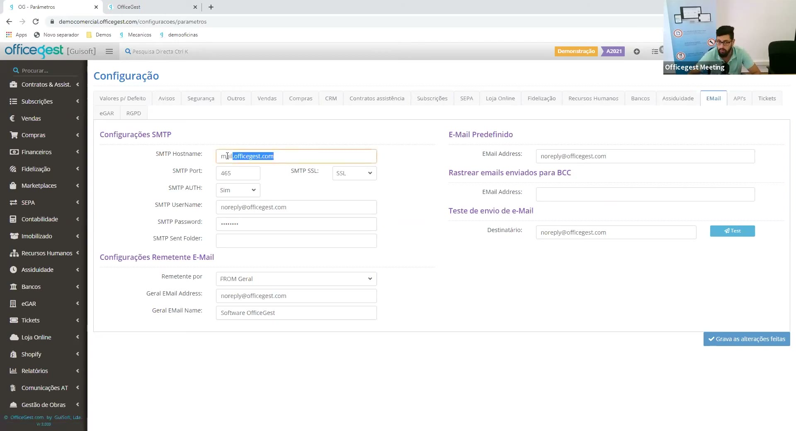

A OfficeGest **não fornece o email**: a empresa usa a sua própria conta para enviar documentos. Pedem-se os dados do servidor de envio (SMTP Hostname, Port, SSL, AUTH, UserName, Password, Sent Folder), o **remetente** (endereço e nome que o cliente vê), um endereço para **rastrear em BCC** os emails enviados, e há um botão **Test** para enviar um email de teste.

### 6.2 API's → Referências MB

O separador **API's** tem os sub-separadores **SMS**, **Referências MB**, **Shopify**, **Assinatura Digital** e **APP Mobile**.

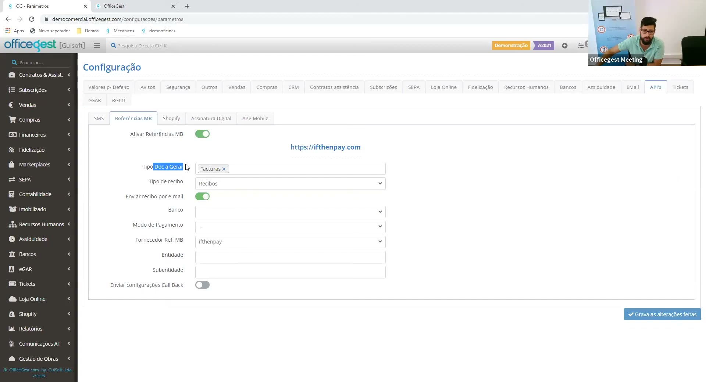

| Campo | Valor no exemplo |
|---|---|
| Ativar Referências MB | ligado |
| Tipo Doc a Gerar | Facturas (podem escolher-se vários tipos) |
| Tipo de recibo | Recibos |
| Enviar recibo por e-mail | ligado |
| Banco, Modo de Pagamento | por preencher |
| Fornecedor Ref. MB | **ifthenpay** (o único disponível em 2021) |
| Entidade, Subentidade | por preencher |
| Enviar configurações Call Back | desligado |

- É preciso ter **conta aberta na ifthenpay**.
- Com isto ligado, as faturas saem com uma referência multibanco. Quando o cliente paga, o OfficeGest **cria o recibo sozinho e envia-o por email**, sem intervenção de ninguém.
- O sub-separador SMS só tem uma opção, para validar se o serviço está configurado; não estava ativo na demo.

### 6.3 RGPD

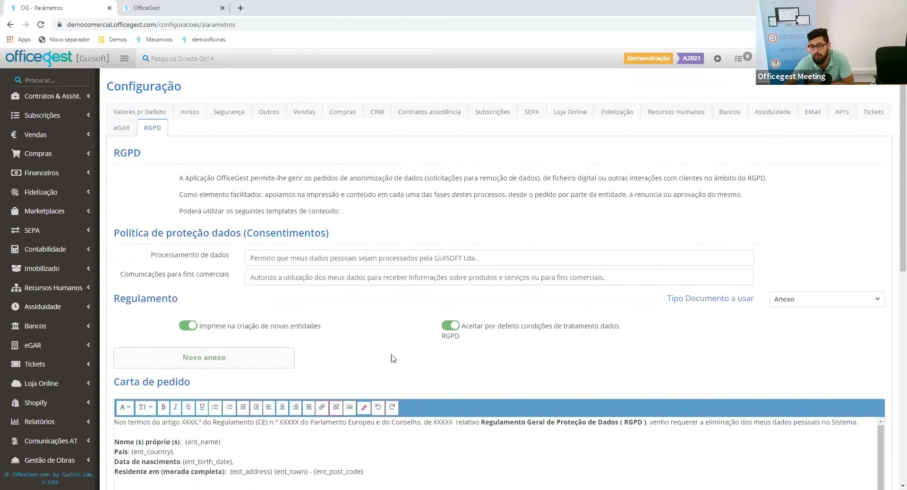

- **Política de proteção dados (Consentimentos):** dois textos, "Processamento de dados" e "Comunicações para fins comerciais".
- **Regulamento:** o **Tipo Documento a usar** é **Modelo** (um texto escrito no próprio OfficeGest) ou **Anexo** (um ficheiro da empresa). Opções: "Imprime na criação de novas entidades" e "Aceitar por defeito condições de tratamento dados RGPD".
- Modelos de texto para a **Carta de pedido**, o **Pedido aceite** e o **Indeferimento** (pedidos de eliminação de dados), e um **Template SMS**.

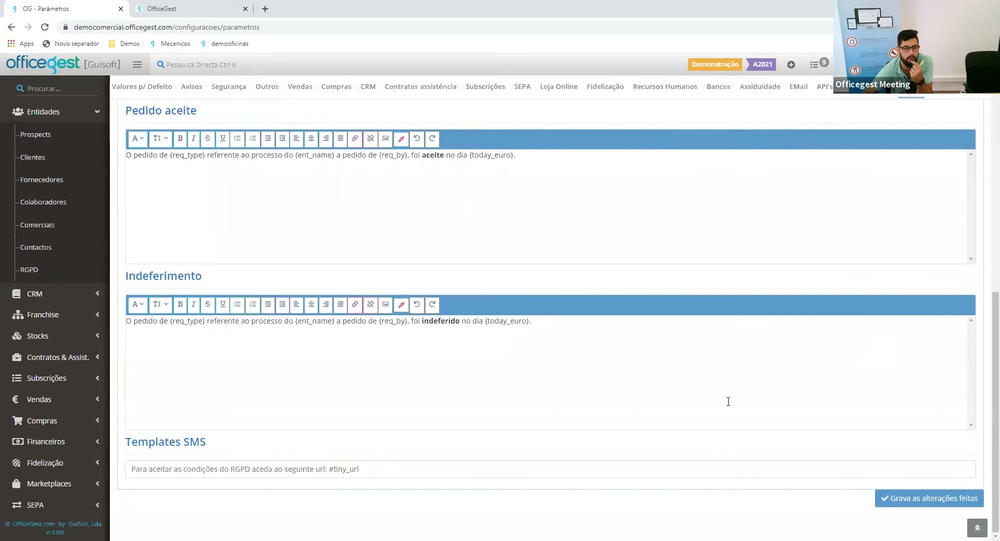

**Três formas de recolher a assinatura do cliente:**

1. **Em papel:** imprimir o regulamento (modelo ou anexo) ao criar a entidade, e o cliente assina.
2. **Na app (Android):** o cliente criado no OfficeGest aparece na aplicação do telemóvel ou tablet do balcão; assina no ecrã e a ficha fica atualizada. O apresentador aponta para um vídeo de 3 minutos no canal ("Demonstração da APP - Autorização RGPD").
3. **Por SMS:** na criação do cliente liga-se **Enviar SMS RGPD**. O cliente recebe uma ligação, escolhe o que autoriza, assina no telemóvel e a ficha fica atualizada. **É a forma que o apresentador recomenda.**

## 7. Tabelas de Apoio (≈ 53:35–1:05:00)

São as listas que alimentam os campos de escolha no resto da aplicação.

| Grupo | Tabelas | Onde se usam |
|---|---|---|
| **Geográficos** | Códigos Postais, Zonas, Concelhos, Distritos | Fichas das entidades. Na demo, as Zonas são PT1 Região Norte … PT7 Arquipélago Madeira |
| **Organizacionais** | Armazéns, Setores, Postos / Terminais / Caixas, Departamentos, Modos de Expedição, Categorias de anexos | Stocks, caixas e organização interna |
| **Recursos Humanos** | Categorias, Especialidades, **Privilégios** | Ficha do colaborador. Apesar do nome, **não é o módulo de Recursos Humanos** |
| **Financeiros** | Moedas, Séries de Documentos, IVA, Razões de Isenção IVA, Prazos de Pagamento, Modos de Pagamento, Tipos de Movimento de Caixa, Bancos, Contas Bancárias | Documentos e pagamentos |

**Postos / Terminais / Caixas.** Uma linha por caixa física. Na demo: 1 Defeito, 2 Caixa PVP, 3 Caixa Feiras e Eventos, 4 Caixa Geral, todas na conta [CXC] Caixa Defeito. O detalhe está na [formação de financeira](../formacao-pratica-modulo-financeira/dissertacao.md).

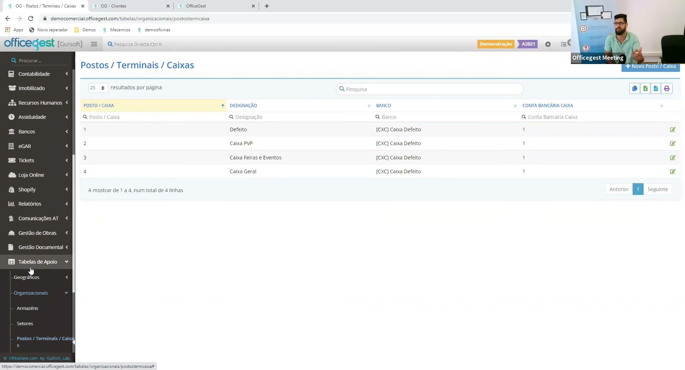

**Departamentos.** Cada um tem Designação, Responsável e **Centro de custo**.

**IVA.** As taxas já vêm criadas (normal, intermédia e reduzida, do continente, Açores e Madeira, e isenta), cada uma com um "código de IVA por defeito". Não é preciso criar nenhuma.

**Razões de Isenção IVA.**

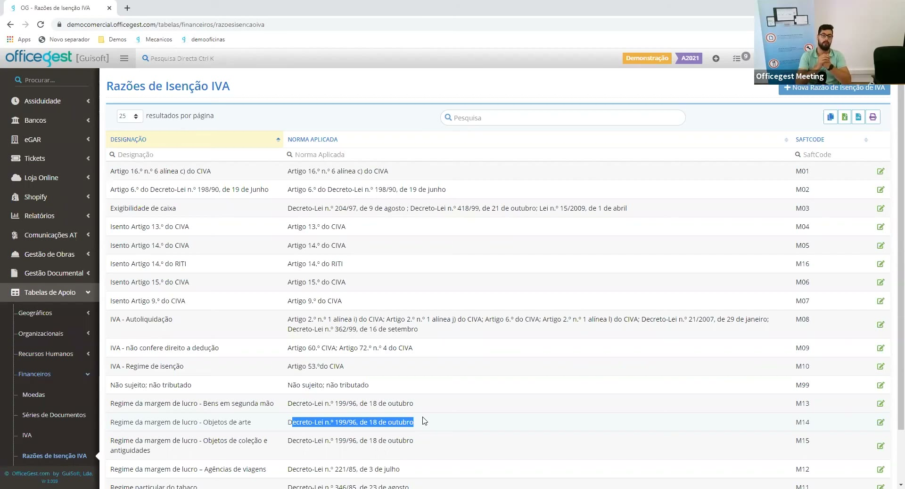

- Cada razão tem Designação, **Norma aplicada** e **SaftCode** (M01, M02 … M16, M99).
- **Regra dita:** a lista contém **todas e só** as razões que a AT aceita, e a OfficeGest atualiza-a quando a lei muda. **Não se devem criar razões novas.**
- Se o contabilista indicar um artigo de lei que não se encontra, procurar pelo texto da norma ou contactar o suporte: um decreto-lei pode estar enquadrado numa das razões existentes.

**Tipos de Movimento de Caixa.** O ecrã abriu vazio; o apresentador diz que este menu deve ser retirado ❓.

**Bancos e Contas Bancárias.** Só referidos; remete para a formação de bancos.

## 8. Grupos de permissões (≈ 57:10–1:01:15)

**Caminho:** Tabelas de Apoio → Recursos Humanos → **Privilégios**. O ecrã chama-se **Grupos de Permissões**.

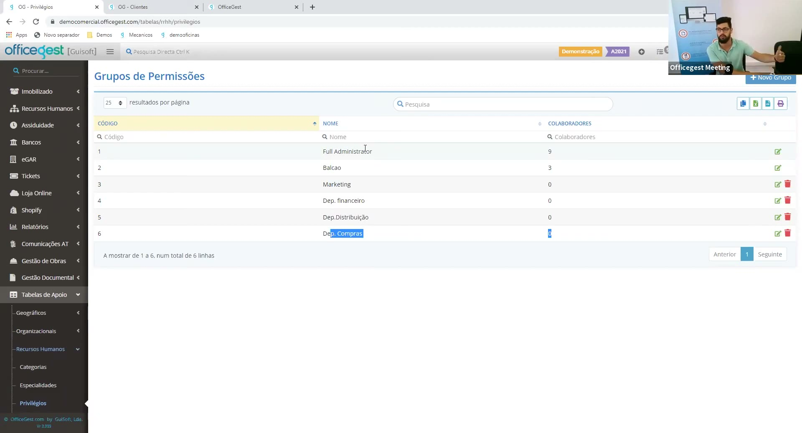

Na demo há seis grupos: Full Administrator (9 colaboradores), Balcao (3), Marketing, Dep. financeiro, Dep.Distribuição e Dep. Compras.

- Um grupo pode ser para **um só colaborador** ou para **um departamento inteiro**.
- **Um colaborador só pode ter um grupo.** Quem trabalha em três departamentos precisa de um quarto grupo que junte as permissões dos três.

Dentro do grupo, as permissões estão organizadas como o **menu da aplicação**: um bloco por módulo.

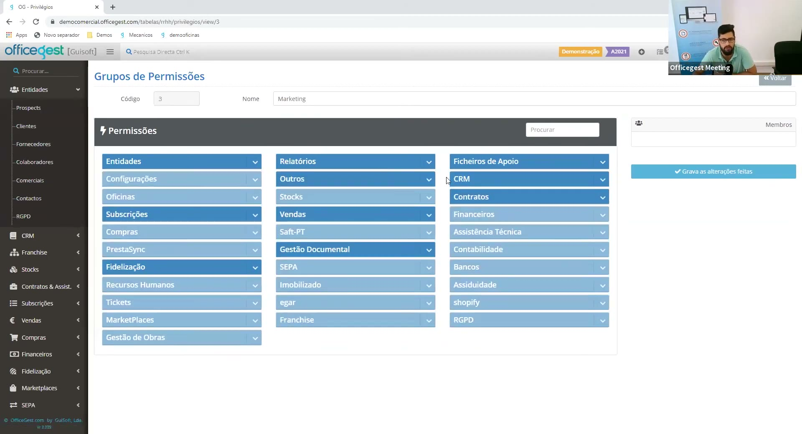

Blocos vistos: Entidades, Configurações, Oficinas, Subscrições, Compras, PrestaSync, Fidelização, Recursos Humanos, Tickets, MarketPlaces, Gestão de Obras, Relatórios, Outros, Stocks, Vendas, Saft-PT, Gestão Documental, SEPA, Imobilizado, egar, Franchise, Ficheiros de Apoio, CRM, Contratos, Financeiros, Assistência Técnica, Contabilidade, Bancos, Assiduidade, shopify, RGPD.

Cada bloco abre em **árvore**: menu → submenu → ação → separadores da ficha.

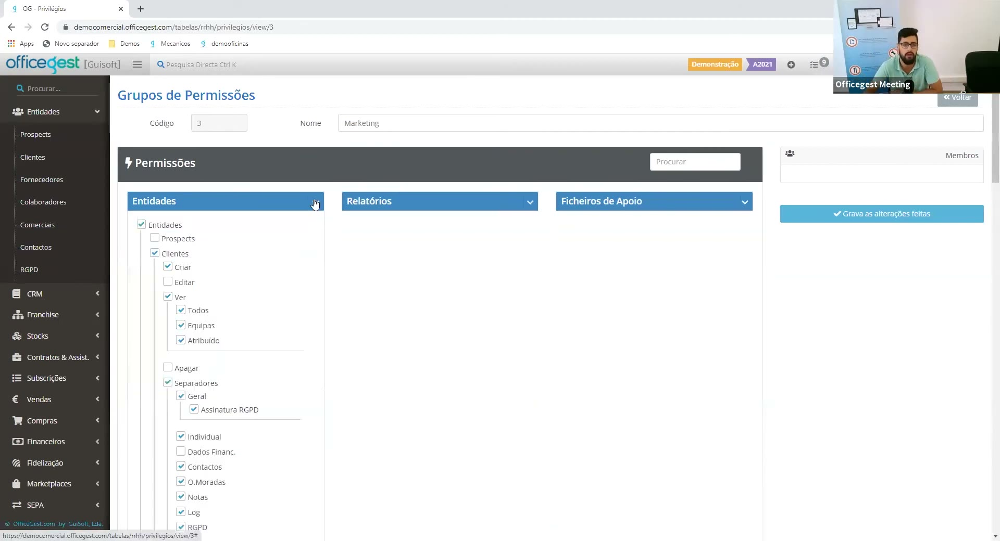

No exemplo (grupo Marketing): acesso a Entidades, **sem** Prospects; em Clientes pode **Criar** e **Ver** (Todos, Equipas, Atribuído), mas **não Editar nem Apagar**; dos separadores da ficha do cliente vê Geral, Individual, Contactos, O.Moradas, Notas, Log e RGPD, mas **não vê Dados Financ.**

**Dois passos:** (1) criar o grupo, dar-lhe nome e marcar as permissões; (2) atribuí-lo ao colaborador, na ficha, em **Acesso Web → Privilégios**. Quando o colaborador recarregar a página, os menus sem permissão desaparecem. À direita do grupo há uma lista de **Membros**.

## 9. Ficha do colaborador (≈ 1:05:00–1:17:40)

**Caminho:** Entidades → **Colaboradores** → ficha. Separadores: Geral · Recursos Humanos · Adicional · Dados Financeiros · Marcações · Contactos · Campos Extra · Tickets · Anexos · **Definições** · **Acesso Web** · Dashboard · RGPD.

### 9.1 Acesso Web

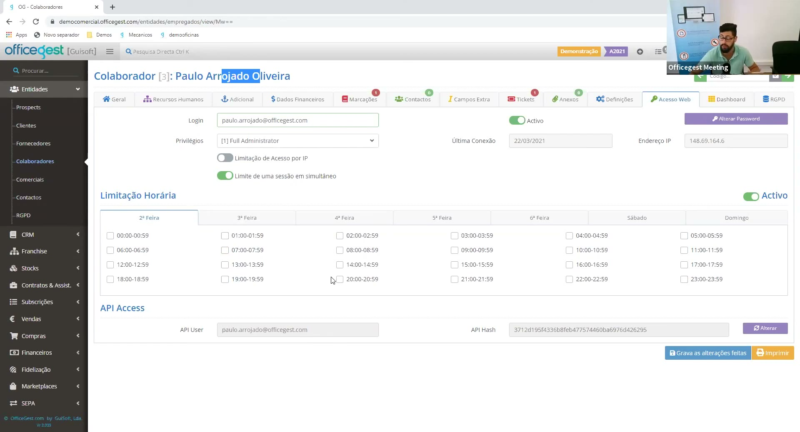

| Campo | O que faz |
|---|---|
| **Login** / Activo | O nome de utilizador com que o colaborador entra |
| **Alterar Password** | Abre uma janela para escrever uma palavra-passe nova, ou **Gerar** uma. No primeiro acesso, o colaborador é obrigado a escolher a sua |
| **Privilégios** | O grupo de permissões (secção 8) |
| Última Conexão, Endereço IP | Informação do último acesso |
| **Limitação de Acesso por IP** | O colaborador só entra a partir do endereço indicado (por exemplo, o das instalações). Fora dali, não entra |
| **Limite de uma sessão em simultâneo** | O mesmo utilizador não pode estar aberto em dois sítios ao mesmo tempo |
| **Limitação Horária** | Uma grelha por dia da semana (2ª Feira … Domingo) e por hora (00:00-00:59 … 23:00-23:59). O colaborador só entra nas horas marcadas |
| **API Access** | **API User** (igual ao login) e **API Hash**, com botão **Alterar**. Não foi explicado |

- **Palavra-passe esquecida:** se a empresa tiver mais do que um utilizador, **outro utilizador** entra, abre a ficha do colega e altera a palavra-passe. Só com um único utilizador é que é preciso contactar a OfficeGest.
- **Conselho do apresentador:** **um colaborador por pessoa**, cada um com o seu grupo de permissões e, se fizer sentido, com limite de uma sessão. Tudo o que cada utilizador cria, altera ou apaga fica registado em seu nome. Com um utilizador partilhado por cinco pessoas, "não se sabe quem foi".

### 9.2 Definições

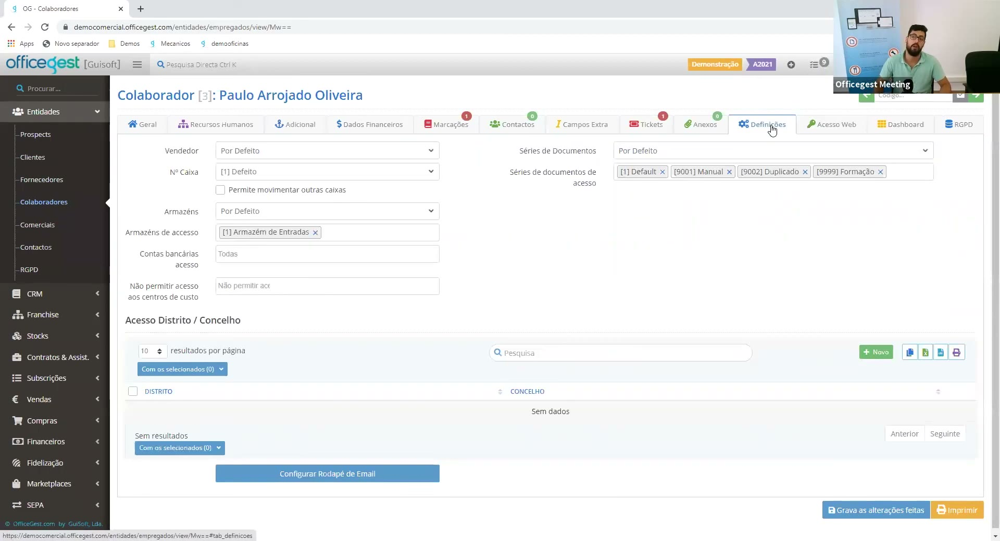

| Campo | Valor no exemplo |
|---|---|
| Vendedor | Por Defeito |
| **Nº Caixa** | [1] Defeito |
| **Permite movimentar outras caixas** | desligado |
| Armazéns / Armazéns de accesso | Por Defeito / [1] Armazém de Entradas |
| Contas bancárias acesso | Todas |
| Não permitir acesso aos centros de custo | vazio |
| **Séries de Documentos** | Por Defeito |
| **Séries de documentos de acesso** | [1] Default, [9001] Manual, [9002] Duplicado, [9999] Formação |
| Acesso Distrito / Concelho | vazio (não explicado) |
| Configurar Rodapé de Email | botão (não aberto) |

Há uma diferença entre **acesso** e **predefinição**:

- **Séries de documentos de acesso:** as séries que o colaborador pode usar e cujos documentos pode ver.
- **Séries de Documentos:** a série que lhe aparece já escolhida ao criar um documento.

### 9.3 A regra "primeiro a ficha, depois os Parâmetros"

Para a série, a caixa, o armazém e as contas bancárias, a aplicação procura **primeiro na ficha do colaborador**. Se lá estiver **"Por Defeito"**, vai buscar o valor a **Configurações → Parâmetros → Valores p/ Defeito**.

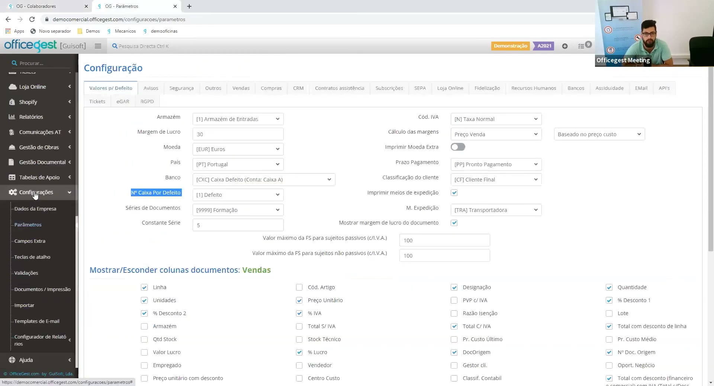

| Situação | Como configurar |
|---|---|
| Uma só área de negócio, uma só série | Deixar tudo "Por Defeito" na ficha e pôr a série nos Parâmetros. Não é preciso mais nada |
| Duas áreas de negócio, uma série para cada | Os Parâmetros só guardam **uma** série, por isso não chegam. Em cada ficha: predefinir a série da área do colaborador e **retirar-lhe o acesso** à série da outra |
| Várias caixas | Igual: escolher na ficha a caixa do colaborador. Com "Permite movimentar outras caixas" desligado, só mexe na dele |

## 10. Pedido de suporte (≈ 1:20:00–1:22:00)

**Caminho:** Ajuda → **Suporte**.

- O formulário **Novo Pedido** tem Empresa, Tipo, Nome Contacto, E-Mail, Telefone, Assunto, Mensagem e anexos. Cria um *ticket*; a lista **Pedidos** (Apenas abertos / Todos) guarda o histórico e as respostas.
- **Cuidado apontado:** o E-Mail do pedido é o da **ficha do colaborador** que o faz. O colaborador administrador criado com a plataforma vem com um endereço fictício; se ninguém o corrigir, a resposta do suporte vai para um email que não existe.
- O menu Ajuda tem ainda **Manual** e **Registo de Alterações**.

## O que foi anunciado como futuro

Dito em agosto de 2021. **Falta verificar se existe hoje.**

- Os vídeos destas formações ficariam disponíveis no site da OfficeGest e **dentro do menu Ajuda** da aplicação.
- O menu **Tipos de Movimento de Caixa** seria retirado ❓.
- Para as referências multibanco só havia a **ifthenpay**; o apresentador refere outros fornecedores muito usados que ainda não estavam disponíveis ❓ (os nomes não se percebem).

A descrição do vídeo promete também "Automatismos, Notificações e Alarmística", "Relatórios de Gestão", "Multi-Filial", "Regras de Acesso por Armazém" e "controlo de caixa e bancos por filial". **A palavra "filial" não aparece na sessão**: o que foi mostrado é o acesso por série, caixa, armazém e conta bancária em cada colaborador (secção 9). Não foram mostrados relatórios.

---

## O que este vídeo pode responder no projeto winners-group

Perguntas consultadas em 2026-10-02 (revisão; a versão anterior era de 2026-10-02, feita com leitura parcial) em: `docs/dependencias-externas.md`, `docs/pendentes.md` e `contabilidade/processo-atual/perguntas-em-aberto.md` do projeto `C:\projetos\winners-group`, lidos por inteiro, mais o registo de vídeos `docs/fontes-videos.md`. A tabela é o retrato desse dia: se as perguntas mudarem, pede-se nova revisão.

Tudo o que está na coluna do meio é **segundo a formação de 2021-08 (versão 3.039)** e continua **por confirmar no OfficeGest atual**. Os instantes entre parênteses são ecrãs guardados em [`ecras/`](ecras/).

> ⚠️ **Este vídeo ainda não consta do registo de vídeos do projeto** (`docs/fontes-videos.md` tem três linhas; esta pasta não é nenhuma delas). As notas do projeto sobre a "Importação E-fatura" foram escritas **sem** o que este vídeo mostra.

| Pergunta (código e texto no projeto) | O que o vídeo mostra | O que ficou por ver |
|---|---|---|
| **OG-9** — O OfficeGest tem um importador do e-Fatura? | **É o ponto mais importante deste vídeo.** O menu *Comunicações AT → Importação E-fatura* é **aberto** ([12:28](ecras/12-28.jpg)). O ecrã chama-se **Registos AT** e tem duas listas, "Registos AT" e "Registos OfficeGest", um botão **Importar Dados AT** por intervalo de datas, filtros de verificados e não verificados e a legenda Encontrado / Duplicado / Não Encontrado. A lista do OfficeGest tem a coluna **"Nº. no Forn."**, o que aponta para **documentos de compra**. Segundo a fala, um documento da AT que falte no OfficeGest **cria-se a partir da linha** (entidade e cabeçalho; as linhas ficam por preencher), e a ferramenta está "disponível para todos os clientes". ⚠️ **Divergência com o projeto:** o projeto regista que a entrada "não foi aberta nem explicada" e que não se sabe o que importa. | Na demo as duas listas estavam **vazias**: não se viu o emparelhamento a funcionar nem o critério. A fala não diz "compras" com estas palavras ❓. |
| **OG-9**, existência hoje | — | ⚠️ **Divergência com o projeto:** a exploração da demo de 30/09/2026 não encontrou nenhum importador. Ou o menu foi retirado, ou não está no pacote dessa demo, ou depende de a palavra-passe estar preenchida. |
| **AT-1** — Existe forma suportada e automatizável de obter a lista do e-Fatura? | Segundo o vídeo, o próprio OfficeGest vai buscá-la, com a **Password Efatura** guardada em *Dados da Empresa → Comunicação AT* ([11:45](ecras/11-45.jpg)). | Se a importação se pode agendar ou só corre ao carregar no botão. |
| **AT-4** — Como são guardadas as credenciais do Portal das Finanças? | O OfficeGest guarda **duas**: a de um **subutilizador** do portal (para comunicar guias) e a **palavra-passe principal** (para o e-Fatura) ([11:45](ecras/11-45.jpg)). | Se a Winners tem acesso como contabilista certificado: **não responde**. |
| **C-3** — O que conta como divergência? Há tolerância de valor e de data? | Do lado da ferramenta: três estados (**Encontrado**, **Duplicado**, **Não Encontrado**) e, nas duas listas, as colunas que se comparam: contribuinte, número do documento, data, valor total e valor do IVA ([12:28](ecras/12-28.jpg)). | O critério do emparelhamento e as tolerâncias **não foram mostrados**. O que a Winners aceita é pergunta para a Winners. |
| **C-12** — A equipa verifica o ATCUD? | A lista da AT tem uma coluna **Hash**; não há coluna de ATCUD (o vídeo é de 2021). A chave visível do lado do OfficeGest é o **"Nº. no Forn."** ([12:28](ecras/12-28.jpg)). | Se hoje o ecrã usa o ATCUD. |
| **C-21** — O OfficeGest exporta para Excel/CSV? A equipa já usa alguma folha para conferir? | As duas listas do ecrã *Registos AT* têm botões de copiar, **Excel**, **CSV** e imprimir ([12:28](ecras/12-28.jpg)): o resultado da comparação pode sair para uma folha. | — |
| **C-2** — "Classificar por artigos" é atribuir a conta SNC ou o artigo? | Nas colunas que se podem mostrar nas **linhas** de um documento de venda ou de compra existem **"Classif. Contabil"** e **"Centro Custo"** ([14:22](ecras/14-22.jpg), lista completa na secção 3.1). Quem regista a compra pode ver a classificação linha a linha. | As colunas não foram ligadas no vídeo. |
| **C-5** — O que é o ficheiro de performance? | Centros de custo fora da contabilidade: coluna "Centro Custo" nas linhas, centro de custo como **campo obrigatório** dos documentos, um centro de custo por **departamento**, e "Não permitir acesso aos centros de custo" na ficha do colaborador ([1:11:12](ecras/1-11-12.jpg)). | Se as oficinas os usam. |
| **C-9** — Que impostos são registados no fecho? | Só a **retenção na fonte**: a percentagem vem primeiro da ficha do fornecedor (*Dados Financeiros*) e só depois dos Parâmetros (5 % na demo). | O resto: **não responde**. |
| **C-24** — A equipa usa o lançamento automático ou lança à mão? | Não fala de lançamentos. Toca na **viragem do ano**, que o projeto juntou a esta pergunta: a série nova cria-se sem a tornar predefinida, e a série velha fica com **data limite 31/12**. Documentos emitidos na série errada não se apagam. | — |
| **API-2** — Como se ativa o acesso à API v1? | A ficha de cada colaborador, em *Acesso Web*, tem um bloco **API Access** com **API User** e **API Hash** e um botão *Alterar* ([1:10:30](ecras/1-10-30.jpg)). | O bloco **não foi explicado**. Que a v1 use este par em vez da palavra-passe é uma **suposição** de quem escreveu, a confirmar no teste API-3. |
| **API-1** — Como se aponta a API para uma oficina específica? | **Não responde.** A única pista é que a credencial da API é **por colaborador**. | — |
| **OG-10** — Que funcionalidades estão licenciadas e em uso? | Os separadores dos *Parâmetros* só aparecem para os **módulos ativos** (fala, ≈ 14:15–14:45); a demo comercial tinha, entre outros, Recursos Humanos, **Bancos** e **SEPA** ([14:22](ecras/14-22.jpg)). Os grupos de permissões têm um bloco por módulo, incluindo **Oficinas**, **Contabilidade**, **Bancos** e **Gestão Documental** ([1:00:30](ecras/1-00-30.jpg)). Dá uma forma de ver, numa conta, que módulos estão ativos. | O que a Winners tem. |
| **OG-6** — As oficinas têm o módulo DMS (OCR) licenciado? | **Gestão Documental** continua no menu em 2021 e é um bloco de permissões ([1:00:30](ecras/1-00-30.jpg)). | Nunca é aberta. |
| **OG-7** — Existe um tenant de testes (sandbox)? | Não responde à pergunta. Mostra que em 2021 havia **duas demos** públicas, uma comercial e uma **de oficinas** (`demooficinas.officegest.com`, "Empresa Oficinas Demo"), usada para as séries (≈ 30:00). A demo do projeto é a do pacote Contabilidade, sem os menus de oficinas. | Se a demo de oficinas ainda existe e se tem API. |
| **COM-1** — Que canal usa cada oficina para falar com a Winners? | Não responde à pergunta. Do lado da ferramenta: o email sai pela conta da própria empresa, com **limite de envios** (250 na demo) e risco de bloqueio; há SMS e modelos de email. | O WhatsApp visto na demo de 2026 **não aparece** neste vídeo. |
| **C-16** — O processamento salarial é feito no OfficeGest? | **Não responde.** Só o campo *Nº Segurança Social* nos Dados da Empresa, que serve o ficheiro da Segurança Social do módulo de Recursos Humanos. | — |
| **OG-3**, **C-26**, **C-27**, **B-1**, **B-2** — reconciliação, movimentos sem documento, Fecho de TPA, extratos | **Não responde.** Os separadores *Bancos* e *SEPA* dos Parâmetros não foram abertos. | — |
| **D-3** — Que funcionalidades nativas a Winners já usa? | A juntar ao inventário: *Importação E-fatura*, prazo para anular documentos, referências multibanco, grupos de permissões. | O uso é pergunta para a Winners. |
| Sem código: **regra do risco irreversível** (citada nas notas do projeto) | Um documento só se anula até **10 dias** depois de emitido (parâmetro; 0 desliga) ([36:47](ecras/36-47.jpg)). O apresentador liga-o ao SAF-T: anular um documento já comunicado obriga a **submeter de novo o SAF-T** desse mês. | Se o prazo vale também para as compras ❓. |
| Sem código: **item 11 da lista "Daniel → Winners"** de `docs/pendentes.md` (abrir o menu Comunicações AT) | Passa a saber-se o que procurar: o ecrã "Registos AT", o botão "Importar Dados AT" e, nos Dados da Empresa, o separador "Comunicação AT" com o campo "Password Efatura". | — |

As restantes perguntas em aberto (OG-4, OG-5, OG-8, API-3, AT-2, AT-3, D-1, D-2, C-18, C-19 e as perguntas de volume e de âmbito) não são tocadas por este vídeo.

**Perguntas sugeridas** (o vídeo levanta, o projeto ainda não tem):

- O acesso único da Winners é **um utilizador por pessoa** ou partilhado? Que grupo de permissões tem? Com um utilizador partilhado, perde-se o registo de quem fez o quê (≈ 1:08:35–1:10:00).
- As oficinas usam **referências multibanco**? Com elas, o recibo é criado sozinho quando o cliente paga ([48:13](ecras/48-13.jpg)), e há recebimentos que ninguém registou à mão.
- Em cada oficina, a **"Password Efatura"** está preenchida? Quem a pôs lá e quem a atualiza quando muda no portal?
- Qual é o **prazo para anular documentos** em cada oficina, e alguém o põe a zero?

**A rever no texto acima** (não corrigido nesta revisão, que só mexe na ligação): a secção 2 não refere os botões de exportação (Excel, CSV) das duas listas nem a frase de que a ferramenta está disponível para todos os clientes; a secção 9.1 diz que o bloco API Access "não foi explicado" mas não avisa que o ecrã embutido mostra um API Hash de demonstração.

O projeto winners-group **não foi editado**: é ele que decide o que absorve.

## Pontos a verificar no sistema atual

- [ ] **Existe hoje o menu *Comunicações AT → Importação E-fatura*?** O que importa (compras, vendas, ambas)? Como emparelha (NIF + número? valor? ATCUD)? (OG-9, C-3, C-12)
- [ ] O separador **Comunicação AT** dos Dados da Empresa ainda tem "Password Efatura"? Está preenchida nas oficinas? (AT-4)
- [ ] O botão de criar o documento a partir da linha da AT existe? Cria um rascunho ou um documento final?
- [ ] O **API Hash** da ficha do colaborador é a credencial da API v1? (API-2)
- [ ] O prazo para **anular documentos** continua nos Parâmetros → Vendas? Qual é o valor em cada oficina?
- [ ] As séries das oficinas têm **data limite** preenchida? Como foi feita a última passagem de ano?
- [ ] Os utilizadores são **um por pessoa**? Que grupos de permissões existem?
- [ ] A opção de **impedir** (e não só avisar) existe nos Avisos? Quais estão ativos nas oficinas?
- [ ] Os separadores dos Parâmetros são os mesmos na versão atual (a demo de 2026 é a 4.156)?
- [ ] O menu Tipos de Movimento de Caixa ainda existe?
- [ ] A importação do e-Fatura pode ser **agendada**, ou só corre quando alguém carrega em "Importar Dados AT"? (AT-1)
- [ ] As listas do ecrã *Registos AT* ainda exportam para **Excel e CSV**? (C-21)
- [ ] Que separadores de módulo aparecem nos Parâmetros da conta da Winners, e que blocos nos grupos de permissões? Diz que módulos estão ativos. (OG-10)
- [ ] As colunas **"Classif. Contabil"** e **"Centro Custo"** estão ligadas nas linhas das compras das oficinas? (C-2, C-5)
- [ ] A demo de oficinas (`demooficinas.officegest.com`) ainda existe? (OG-7)

## Limites desta versão

- Os **ecrãs** são a fonte mais fiável dos nomes e dos valores. A **explicação** do porquê vem de legendas automáticas com muitos erros; onde a fala não era clara, ficou a marca ❓. Há **13 pontos** marcados; os que mais pesam são os da Importação E-fatura (o que importa e como se criam as linhas).
- A **Importação E-fatura** foi mostrada **vazia**. Sabe-se como é o ecrã; não se sabe como se comporta com dados.
- Os textos de cabeçalho e rodapé **não foram gravados** na demo, por isso a posição exata de cada um no documento vem da fala e do gesto do apresentador, não de um documento impresso.
- Não foram abertos: os separadores de Parâmetros dos módulos (Contratos assistência, Subscrições, SEPA, Loja Online, Fidelização, Recursos Humanos, Bancos, Assiduidade, Tickets, eGAR), os sub-separadores Shopify, Assinatura Digital e APP Mobile, e os menus Campos Extra, Teclas de atalho, Validações, Documentos / Impressão, Importar, Templates de E-mail e Configurador de Relatórios.
- As séries foram mostradas numa **segunda demo** (oficinas, mesma versão), porque a primeira não deixava criar séries.
- Os ecrãs de [`ecras/`](ecras/) são de contas de demonstração públicas. Alguns mostram endereços de email de utilizadores de demonstração e o API Hash de um deles; **nenhum desses valores foi copiado para este texto**.
- Os últimos cinco minutos são perguntas e respostas sem perguntas; não há conteúdo.
