# Formação Prática Módulo Contabilidade

| | |
|---|---|
| **Vídeo** | [youtu.be/dwB0syVcAvg](https://www.youtube.com/watch?v=dwB0syVcAvg) |
| **Canal** | Officegest (canal oficial) |
| **Apresentador** | Pedro Jordão (o nome vem da fala, e é o mesmo apresentador do webinar de 2020; não aparece escrito no ecrã) |
| **Gravado em** | **2021-09-07** (data no diapositivo de abertura e nas datas dos ecrãs) |
| **Publicado em** | 2022-10-17 |
| **Duração** | 1:27:31 |
| **Processado em** | 2026-10-02 |
| **Fonte do texto** | Legendas automáticas do YouTube (pt), com muitos erros, **corrigidas pelos ecrãs**. Os nomes de menus e campos abaixo foram lidos nos screenshots |
| **Ecrãs** | 217 capturados em [`ecras/`](ecras/); os mais úteis estão embutidos abaixo |
| **Versão do OfficeGest** | **vr 3.043** (rodapé do menu), em ambiente "Demonstração" (`contabilidade.demo.officegest.com`), exercícios A2021 e A2022 |

> ⚠️ **Vídeo com 5 anos.** Foi publicado em outubro de 2022, mas a sessão foi gravada em **setembro de 2021**. Tudo o que está abaixo descreve o OfficeGest **como era em setembro de 2021, na versão 3.043**. Trate cada afirmação como **hipótese**, com a forma "segundo a formação de 2021-09", até ser confirmada no sistema atual. Os screenshots servem para comparar: se o ecrã de hoje for diferente, houve mudança.
>
> ❓ = ponto que nem a fala nem o ecrã deixam claro.

> 🔁 **Este vídeo atualiza o [Webinar #2: Contabilidade OfficeGest](../webinar-2-contabilidade-officegest/dissertacao.md) (2020-06, v2.220).** A secção ["O que mudou desde o webinar de 2020"](#o-que-mudou-desde-o-webinar-de-2020) lista as diferenças. O webinar de 2020 continua a ser a melhor fonte para o botão de contabilização na própria fatura, para o SAF-T e para as taxonomias, que aqui só são mencionados de passagem.

---

## Resumo

É uma formação gratuita da OfficeGest Academia sobre o **módulo de contabilidade**, feita como demonstração ao vivo na conta de demonstração. A primeira metade repete, com mais detalhe, a **parametrização da contabilidade geral** que já estava no webinar de 2020. A segunda metade traz o que é novo: **declarações** (periódica de IVA e Modelo 10), **contabilidade analítica** por centro de custo e **reencaminhamento de contas**.

O fio condutor da parametrização é dito pelo apresentador: são **três configurações de base** para os documentos passarem sozinhos para a contabilidade.

1. **Contas nas contas bancárias** (em que conta entra um recebimento e sai um pagamento).
2. **Contas das entidades** (clientes e fornecedores, criadas automaticamente).
3. **Contas dos artigos** (a classificação de artigos, por taxa de IVA e por mercado).

Depois vêm, por esta ordem:

4. Os **parâmetros** da contabilidade (diários, documentos, classificação por série, IVA, inventário permanente e outros).
5. Os **exercícios**: criar o ano novo, mudar os colaboradores de exercício, fechar meses e ligar a integração automática.
6. Os **lançamentos**: em lote, manuais, recorrentes e a transferência de contas.
7. Os **apuramentos** de IVA, de resultados e do custo das mercadorias vendidas (CMV).
8. As **declarações**: periódica de IVA e Modelo 10.
9. Os **centros de custo** e a **contabilidade analítica**.
10. O **reencaminhamento de contas** (autoliquidação e IVA do gasóleo a 50 %).
11. Os **relatórios** e os **mapas**.

### Onde fica cada coisa (versão 3.043)

O menu lateral **Contabilidade** tem:

- Plano de Contas · Lançamentos · **Lançamentos em lote** · **Apuramento de resultados/I.V.A.** · **Apuramento do CMV** · **Centros de Custo** · **Declarações** · Exportar
- **Declarações** → Declaração periódica · Declaração Modelo 10 · Declaração Modelo 22 de IRC · Declaração recapitulativa de IVA
- **Ficheiros de Apoio** → Exercícios · Documentos · Diário · Apuramento · Classificação de Artigos · Mercados · **Reencaminhamento de contas** · Reencaminhamento de centros de custo · Lançamentos recorrentes · Taxonomias · **Parâmetros**

Fora dele ficam:

- **Configurações → Parâmetros** (separadores Valores p/ Defeito, Avisos, Segurança, Outros, Vendas, Compras, Subscrições, **Recursos Humanos**, Bancos, Assiduidade, EMail, API's, RGPD)
- **Tabelas de Apoio → Financeiros → Contas Bancárias**
- **Stocks → Artigos** (ficha do artigo, separador Contabilidade) e **Stocks → Ficheiros de Apoio → Famílias**
- **Entidades → Fornecedores** (ficha, separador Dados Financeiros)
- **Relatórios → Contabilidade** → Balancetes · Extractos · Balanço · Demonstração de resultados · **Fluxos de caixa** · **Centros de Custo** · Plano de Contas · Mapa estado da conta · Mapas · **Mapas analíticos** · Log lançamentos
- **Relatórios → Automáticos**
- **Comunicações AT** (exportação do SAF-T)
- **Ajuda** → Manual · Registo de Alterações · Suporte · Backup · Termos e Condições

---

## 1. Onde se configura, e a ligação aos Recursos Humanos (≈ 02:00–04:15)

A regra geral do OfficeGest, segundo a fala: as configurações de um módulo fazem-se em **dois sítios**. Um é o menu **Configurações → Parâmetros**, que tem um separador por módulo. O outro é o menu de **Ficheiros de Apoio** dentro do próprio módulo. A contabilidade usa ainda as **Tabelas de Apoio**.

No separador **Recursos Humanos** de Configurações → Parâmetros há uma secção **Contabilidade**. Só interessa a quem usa o módulo de Recursos Humanos: define as contas que o **lançamento dos vencimentos** vai movimentar.

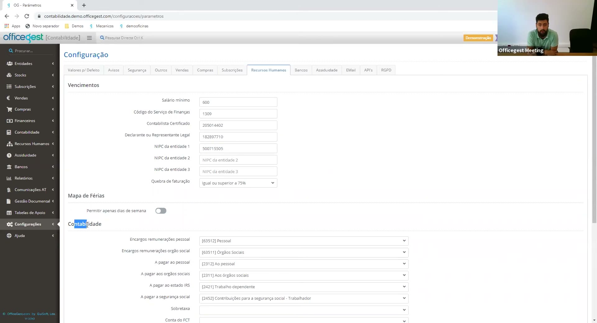

| Campo | Conta no exemplo |
|---|---|
| Encargos remunerações pessoal | [63512] Pessoal |
| Encargos remunerações orgão social | [63511] Órgãos Sociais |
| A pagar ao pessoal | [2312] Ao pessoal |
| A pagar aos orgãos sociais | [2311] Aos órgãos sociais |
| A pagar ao estado IRS | [2421] Trabalho dependente |
| A pagar a segurança social | [2452] Contribuições para a segurança social - Trabalhador |
| Sobretaxa · Conta do FCT | (vazias) |

Segundo a fala, as contas das remunerações em si configuram-se "dentro de cada remuneração" no módulo de Recursos Humanos ❓ (esse ecrã não foi mostrado). Mais à frente, o ecrã de lançamentos em lote mostra os **recibos de vencimento** (RVE) como documentos a lançar, com o Diário [60] Diversos e o Documento [81] Salários.

## 2. Contas bancárias (≈ 04:15–07:00)

**Caminho:** Tabelas de Apoio → Financeiros → **Contas Bancárias**.

- A conta da contabilidade define-se **por conta bancária**, e não por modo de pagamento. Cada conta bancária tem um **Nº Conta Contabilidade (Recebimentos)** e um **Nº Conta Contabilidade (Pagamentos)**.
- Quando um documento tem um recebimento ou um pagamento associado, o movimento vai para a conta configurada na conta bancária usada.
- A **caixa** também é uma conta bancária (marcada como "Conta Caixa") e tem de ter as suas contas. É para ela que vão os recebimentos em numerário.

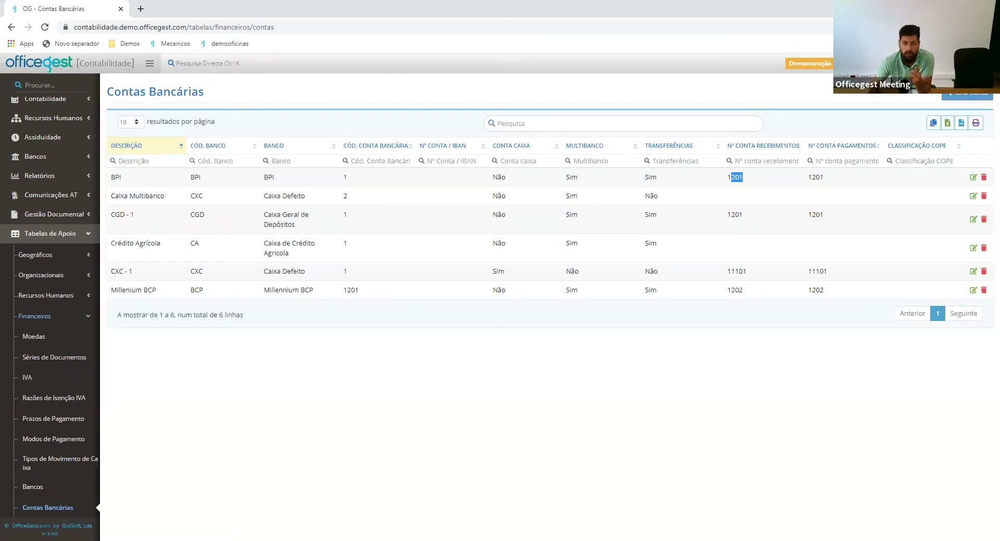

| Descrição | Cód. Banco | Conta Caixa | Multibanco | Transferências | Nº conta recebimentos | Nº conta pagamentos |
|---|---|---|---|---|---|---|
| BPI | BPI | Não | Sim | Sim | 1201 | 1201 |
| Caixa Multibanco | CXC | Não | Sim | Não | — | — |
| CGD - 1 | CGD | Não | Sim | Sim | 1201 | 1201 |
| Crédito Agrícola | CA | Não | Sim | Sim | — | — |
| CXC - 1 | CXC | **Sim** | Não | Não | 11101 | 11101 |
| Millenium BCP | BCP | Não | Sim | Sim | 1202 | 1202 |

Na ficha da conta bancária aparecem ainda as opções "Assumir esta conta bancária como gestão de caixa / balcão", "Conta Bancária Multibanco" e "Conta bancária para transferências", e uma secção **COPE** com "Classificação Estatística".

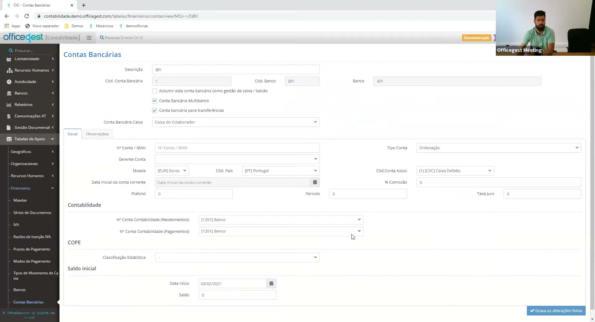

## 3. Contas de clientes e fornecedores (≈ 07:00–13:30)

São dois passos, como em 2020.

**Passo 1. Contabilidade → Ficheiros de Apoio → Parâmetros**, separador **Contas**.

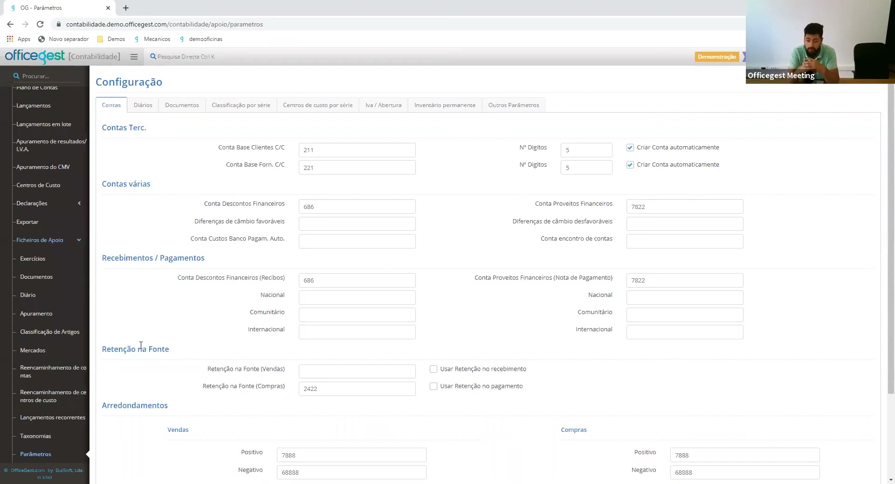

| Secção | Campos e valores no exemplo |
|---|---|
| **Contas Terc.** | Conta Base Clientes C/C = **211** · Conta Base Forn. C/C = **221** · Nº Dígitos = **5** em ambas · **Criar Conta automaticamente** ligado em ambas |
| **Contas várias** | Conta Descontos Financeiros = 686 · Conta Proveitos Financeiros = 7822 · Diferenças de câmbio favoráveis e desfavoráveis · Conta Custos Banco Pagam. Auto. · Conta encontro de contas (vazias) |
| **Recebimentos / Pagamentos** | Conta Descontos Financeiros (Recibos) = 686 · Conta Proveitos Financeiros (Nota de Pagamento) = 7822 · linhas Nacional, Comunitário e Internacional (vazias) |
| **Retenção na Fonte** | Retenção na Fonte (Vendas) (vazia) · Retenção na Fonte (Compras) = **2422** · opções "Usar Retenção no recebimento" e "Usar Retenção no pagamento" |
| **Arredondamentos** | Vendas e Compras: Positivo = 7888 · Negativo = 68888 |

- A conta de retenção na fonte é **sempre a mesma**, seja qual for o fornecedor ou o cliente.
- Segundo a fala, estas contas já vêm preenchidas numa plataforma nova.
- **Como se forma a conta do terceiro:** conta base do mercado + o número da entidade na gestão, completado com zeros até ao número de dígitos. O exemplo dito é a base 21111 com 5 dígitos e o cliente 30, que dá 2111100030. No ecrã vê-se, mais à frente, o fornecedor 2 com a conta **[2211100002]**.

**Passo 2. Contabilidade → Ficheiros de Apoio → Mercados.** Os mercados já vêm criados; falta só indicar a **conta base por mercado**.

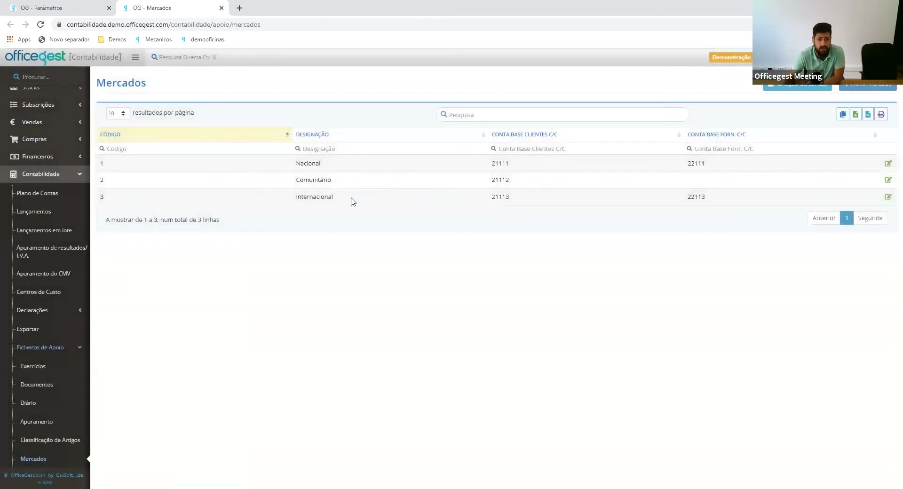

| Mercado | Conta Base Clientes C/C | Conta Base Forn. C/C |
|---|---|---|
| Nacional | 21111 Clientes Nacionais | 22111 Fornecedores Nacionais |
| Comunitário | 21112 Clientes Comunitários | (vazia no exemplo) |
| Internacional | 21113 | 22113 |

O mercado de cada entidade vem do **país** da sua ficha.

**Entidades que já existiam sem conta.** É o caso de quem já usava o OfficeGest e ativa agora a contabilidade. No ecrã Mercados há o botão **Criação de contas**: escolhe-se **Clientes** e/ou **Fornecedores** e o intervalo de datas dos documentos emitidos, e carrega-se em **Criar contas**. O sistema pede confirmação, com o aviso de que **a operação é irreversível**, e no fim diz quantas contas criou.

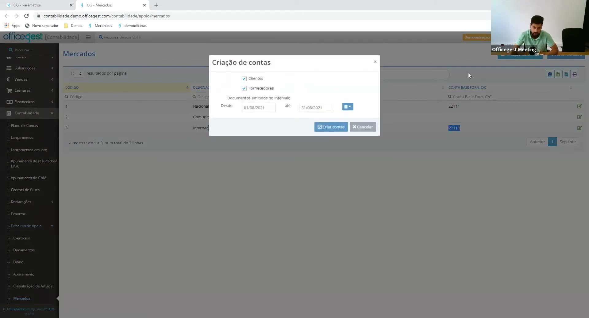

Na ficha do fornecedor, separador **Dados Financeiros**, o campo **Nº Conta Contabilidade** mostra a conta atribuída e tem ao lado o botão **Criar Conta** (ver a imagem na secção 9).

## 4. Parâmetros da contabilidade (≈ 13:30–22:00)

O ecrã **Contabilidade → Ficheiros de Apoio → Parâmetros** tem oito separadores: **Contas** (secção 3) · **Diários** · **Documentos** · **Classificação por série** · **Centros de custo por série** · **Iva / Abertura** · **Inventário permanente** · **Outros Parâmetros**.

### 4.1 Diários e Documentos

Cada tipo de documento da gestão fica associado a um **Documento** e a um **Diário** da contabilidade. É para aí que o lançamento automático vai.

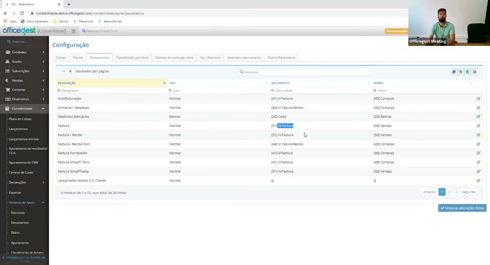

| Designação (gestão) | Tipo | Documento | Diário |
|---|---|---|---|
| Autofacturação | Normal | [41] V/Factura | [40] Compras |
| Compras / Despesas | Normal | [44] V/ Fatura-Recibo | [40] Compras |
| Depósitos Bancários | Bancos | [20] Caixa | [30] Bancos |
| Factura | Normal | [51] N/Factura | [50] Vendas |
| Factura / Recibo | Normal | [51] N/Factura | [50] Vendas |
| Factura / Recibo Forn. | Normal | [44] V/ Fatura-Recibo | [40] Compras |
| Factura Fornecedor | Normal | [41] V/Factura | [40] Compras |
| Factura Simplif. Forn. | Normal | [41] V/Factura | [40] Compras |
| Factura Simplificada | Normal | [51] N/Factura | [50] Vendas |
| Lançamento directo C/C Cliente | Normal | (vazio) | (vazio) |

(São 26 linhas ao todo; o ecrã mostra as 10 primeiras.)

- Pode mudar-se o documento e o diário de cada linha.
- Não é obrigatório usar os diários e os documentos de origem. Em **Ficheiros de Apoio → Documentos** e **→ Diário** podem editar-se, apagar-se e criar-se outros.
- O separador **Diários** permite, segundo a fala, definir diários **por mercado** nas vendas e nas compras ❓ (o ecrã não foi capturado).

### 4.2 Classificação por série

Serve as empresas com **várias áreas de negócio**, em que cada área tem a sua série de faturação e as suas contas. A ficha do artigo só aceita **uma** classificação, e este separador resolve isso: diz que, **numa dada série**, a classificação de origem do artigo é trocada por outra.

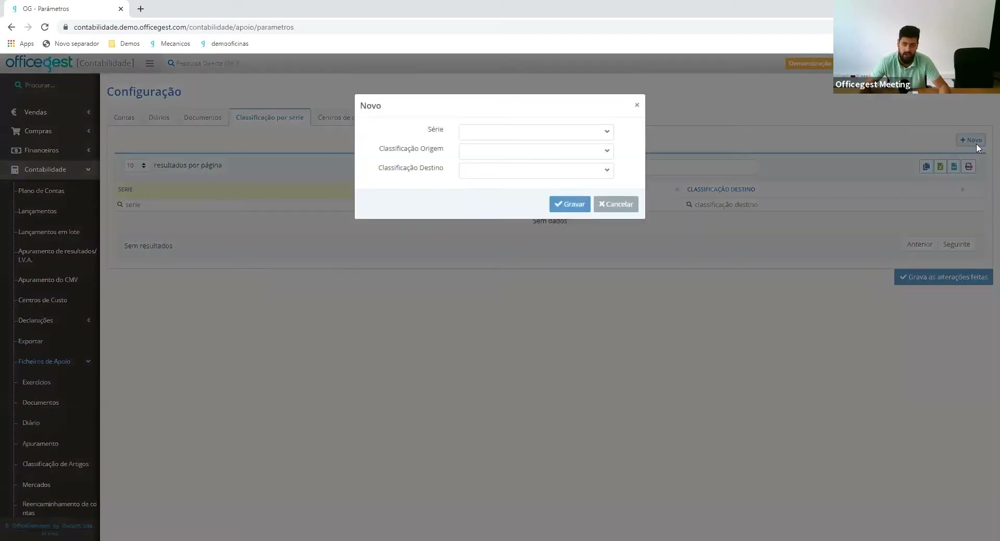

A regra tem três campos: **Série**, **Classificação Origem** e **Classificação Destino**. O exemplo dito: na série X, um artigo classificado como "Mercadorias" passa a ser lançado pela classificação Y. Fora dessa série, o artigo segue a classificação da sua ficha.

### 4.3 Centros de custo por série

Mesma ideia: uma regra com **Nº Série** e **Centro de Custo**. Tudo o que for faturado nessa série fica com esse centro de custo.

### 4.4 Iva / Abertura

Segundo a fala, é aqui que se define a **periodicidade do IVA** (mensal ou trimestral) ❓ (o separador não foi mostrado aberto na captura).

### 4.5 Inventário permanente

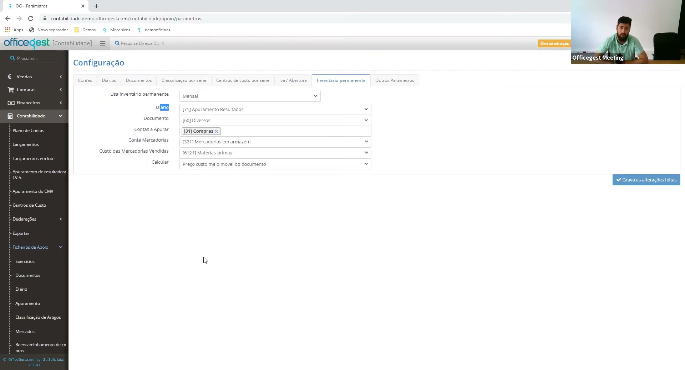

| Campo | Valor no exemplo |
|---|---|
| Usa inventário permanente | **Mensal** (as opções são: Não usar · Usar no lançamento do documento · Mensal) |
| Diário | [71] Apuramento Resultados |
| Documento | [60] Diversos |
| Contas a Apurar | [31] Compras |
| Conta Mercadorias | [321] Mercadorias em armazém |
| Custo das Mercadorias Vendidas | [6121] Matérias-primas |
| Calcular | Preço custo meio movel do documento |

Os campos abaixo da primeira linha só aparecem quando a opção é "Mensal". Com "Mensal", o apuramento faz-se no ecrã **Apuramento do CMV** (secção 7).

### 4.6 Outros Parâmetros

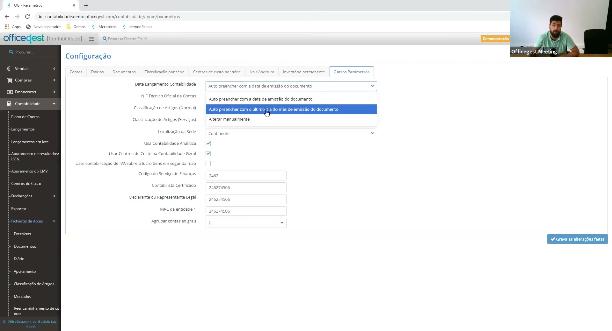

| Campo | O que faz |
|---|---|
| **Data Lançamento Contabilidade** | Três opções: **Auto preencher com a data de emissão do documento** (o normal) · **Auto preencher com o último dia do mês de emissão do documento** (todos os documentos do mês ficam lançados no último dia) · **Alterar manualmente** |
| NIF Técnico Oficial de Contas | NIF do contabilista |
| **Classificação de Artigos (Normal)** | Classificação proposta ao criar um artigo do tipo Normal. No exemplo: [1] Mercadorias |
| **Classificação de Artigos (Serviços)** | Classificação proposta ao criar um artigo do tipo Serviços. No exemplo: [43] Prestação de Serviços |
| Localização da Sede | Continente |
| **Usa Contabilidade Analítica** | Liga a contabilidade analítica (secção 10) |
| **Usar Centros de Custo na Contabilidade Geral** | Leva o centro de custo para os lançamentos da contabilidade geral |
| Usar contabilização de IVA sobre o lucro bens em segunda mão | Para o regime da margem. Sem esta opção, a margem de lucro "fica escondida" e o lançamento não a considera |
| Código do Serviço de Finanças · Contabilista Certificado · Declarante ou Representante Legal · NIPC da entidade 1 | Dados usados nas declarações |
| **Agrupar contas ao grau** | Grau com que o Plano de Contas abre agrupado |

O **Plano de Contas** abre, de facto, agrupado ao grau 2 (contas de dois dígitos), com um botão verde em cada linha para abrir as subcontas. O grau pode mudar-se no próprio ecrã.

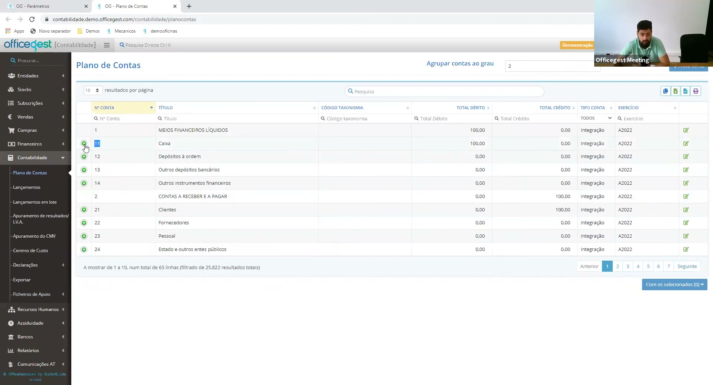

## 5. Classificação de artigos (≈ 22:00–33:00)

É a classificação do artigo que gera o movimento contabilístico. **Um artigo sem classificação, ou com uma classificação sem conta para aquela taxa de IVA e aquele mercado, não é lançado**: o sistema diz que falta a conta.

**Caminho:** Contabilidade → Ficheiros de Apoio → **Classificação de Artigos**. Também se chega lá escrevendo o nome na pesquisa do menu.

### 5.1 A regra: por taxa de IVA e por mercado

Cada classificação tem **uma linha por taxa de IVA e por mercado**. O formulário tem a **Classificação**, o **IVA** e três separadores: **Vendas**, **Compras** e **Inventário permanente**.

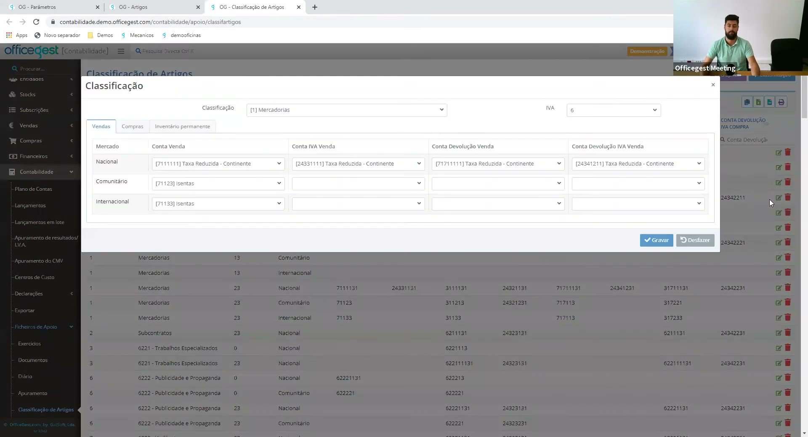

*Exemplo no ecrã (Mercadorias, 6 %, Vendas):*

| Mercado | Conta Venda | Conta IVA Venda | Conta Devolução Venda | Conta Devolução IVA Venda |
|---|---|---|---|---|
| Nacional | [7111111] Taxa Reduzida - Continente | [24331111] Taxa Reduzida - Continente | [71711111] Taxa Reduzida - Continente | [24341211] Taxa Reduzida - Continente |
| Comunitário | [71123] Isentas | — | — | — |
| Internacional | [71133] Isentas | — | — | — |

O separador **Compras** tem as mesmas quatro colunas para a compra. O separador **Inventário permanente** tem, por mercado, a **Conta Mercadorias** e o **Custo das Mercadorias Vendidas**.

A lista mostra, na conta de demonstração, classificações de mercadorias e também **classificações por conta de gasto**: "Subcontratos", "6221 - Trabalhos Especializados", "6222 - Publicidade e Propaganda", e uma "[10] 6241 - Eletricidade" usada numa família. São 128 linhas no total.

### 5.2 Criar uma classificação nova: uma taxa de cada vez

- No formulário, escolhe-se **Nova** no campo Classificação, escreve-se a **Designação** e escolhe-se a taxa de **IVA**.
- **Não dá para criar a classificação para todas as taxas de uma vez.** Ao gravar, ficam criadas três linhas (Nacional, Comunitário, Internacional) **só para a taxa escolhida**.
- Para as outras taxas, repete-se o processo, mas em vez de "Nova" escolhe-se **a classificação já criada** e muda-se a taxa.
- Se um artigo com esta classificação for vendido a uma taxa que não foi configurada, o lançamento não é feito.

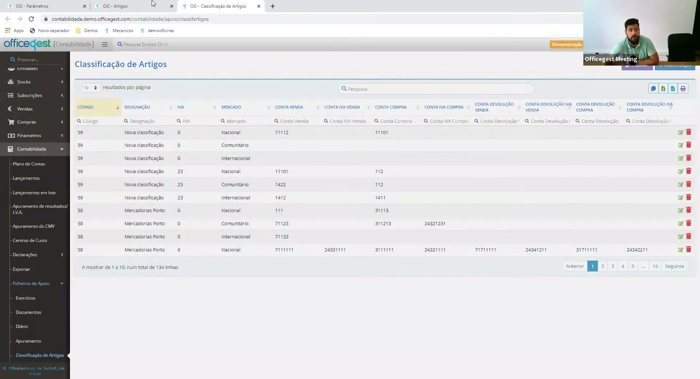

### 5.3 Atribuir a classificação ao artigo: três níveis

**1. Na ficha do artigo**, separador **Contabilidade**, campo **Classificação do artigo**. O ecrã mostra logo todas as contas que essa classificação usa, por IVA e mercado.

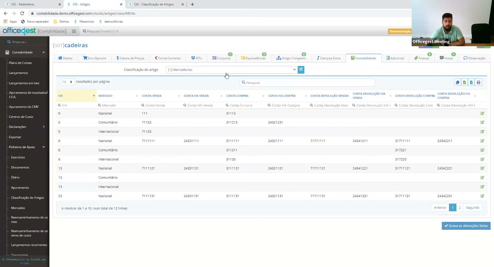

**2. Por tipo de artigo (o valor por omissão).** Os artigos dividem-se em **Normal** (mercadoria, movimenta stock), **Serviços** e **Contabilístico** (os botões no topo da lista de artigos são Normal · Serviços · Contabilístico · Todos). Em Parâmetros → Outros Parâmetros define-se a classificação proposta para os tipos **Normal** e **Serviços**. Para o tipo Contabilístico não há valor por omissão, porque cada artigo desses tem uma classificação própria (os exemplos ditos são eletricidade, água, transportes).

**3. Por família.** Em **Stocks → Ficheiros de Apoio → Famílias**, cada família, sub-família e sub-sub-família tem um campo **Classificação do artigo**. Um artigo criado nessa família fica com essa classificação. Serve para quem tem vários serviços com contas diferentes.

![Editar Família "Eletricidade" com a classificação [10] 6241 - Eletricidade](ecras/32-05.jpg)

> **Regra importante:** a classificação por família (e por tipo) **só vale para os artigos criados depois** de ela ser configurada. Os artigos que já existem não são alterados.

## 6. Exercícios (≈ 33:00–38:45)

**Caminho:** Contabilidade → Ficheiros de Apoio → **Exercícios**.

A lista mostra, por exercício, os doze **meses** (cada um com o estado **Aberto** e a opção **Integrar**), os **Colaboradores** que estão nesse exercício e a coluna **Fechado**. O exercício em que o utilizador está aparece a verde, com a etiqueta **"Exerc. Corrente"**.

### 6.1 Criar o exercício seguinte

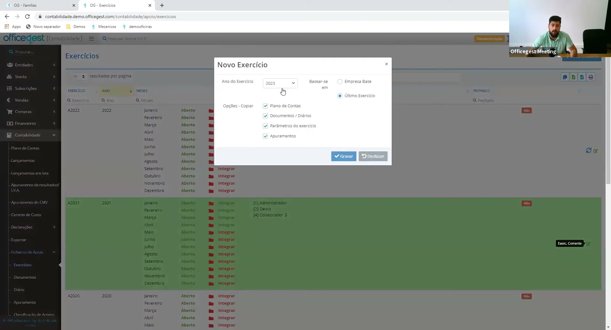

O **Novo Exercício** pede o **Ano do Exercício**, a base (**Empresa Base** ou **Último Exercício**) e o que copiar: **Plano de Contas** · **Documentos / Diários** · **Parâmetros do exercício** · **Apuramentos**.

- É possível criar o exercício antes de o ano começar.
- **A cópia é feita uma vez.** Depois de criado o exercício novo, qualquer conta ou classificação criada no exercício antigo **não aparece** no novo: tem de se criar nos dois.

### 6.2 Mudar os colaboradores de exercício

Cada utilizador trabalha num exercício. Ao criar o ano novo, é preciso **passar todos os colaboradores** para ele: edita-se o exercício (ícone do lápis) e acrescentam-se os colaboradores no campo **Colaboradores**. O mesmo ecrã tem o interruptor **Fechado** e um campo de **Observações**.

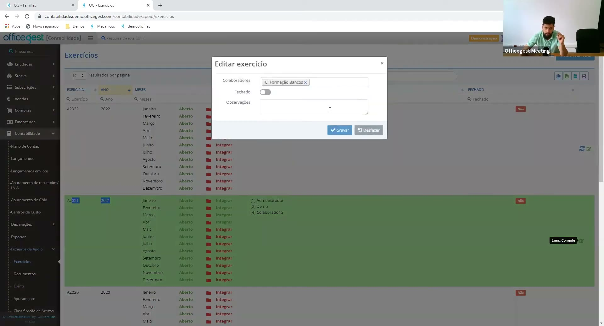

> **Porque importa:** com a criação automática de contas ligada, se um utilizador que ainda está no exercício antigo criar uma entidade, **a conta fica criada no plano de contas do exercício antigo**, e não no atual.

### 6.3 Fechar meses e integrar

- Cada mês pode ser **fechado** (clicando no ícone da pasta). Num mês fechado não entra mais nada.
- A opção **Integrar** de cada mês liga a **integração automática**: uma vez por dia, o sistema lança sozinho os documentos da gestão que ainda não estão na contabilidade. O apresentador diz que **não sabe a que horas** corre.
- Um documento sem conta (do artigo, do IVA ou da entidade) não é lançado. O resultado vai por email, configurado em **Relatórios → Automáticos**, separador **Diário**, opção de integração da contabilidade: diz quais documentos foram integrados, quais não foram, e porquê.

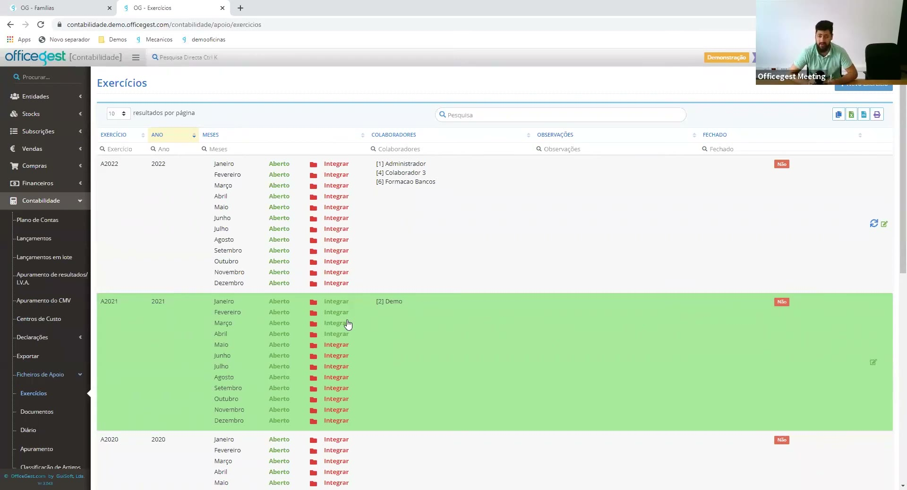

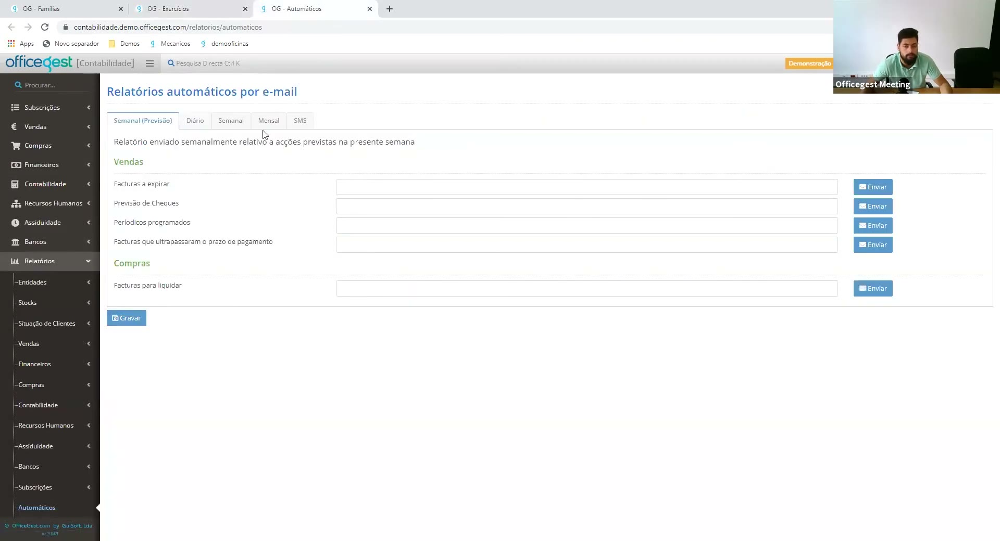

## 7. Lançamentos (≈ 38:45–44:35)

### 7.1 Lançamentos em lote

**Caminho:** Contabilidade → **Lançamentos em lote**. É a forma recomendada de ver **o que ainda falta lançar** e porquê.

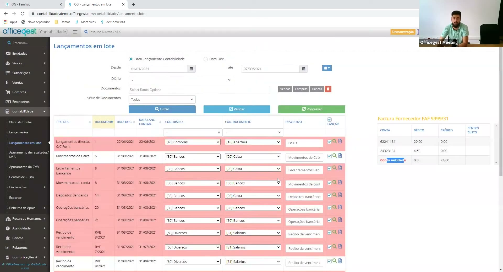

- **Filtros:** Data Lançamento Contabilidade ou Data Doc. (desde / até), Diário, Documentos (com os atalhos **Vendas**, **Compras**, **Bancos**) e Série de Documentos.
- **Filtrar** lista os documentos ainda não lançados. Para cada um, pode mudar-se o Cód. Diário e o Cód. Documento.
- A lupa de cada linha mostra, à direita, a **pré-visualização do lançamento**. No exemplo (Factura Fornecedor FAF 9999/31), a terceira linha diz **"Conta entidade"** em vez de um número: falta a conta do fornecedor.
- **Validar** pinta **a vermelho** os documentos a que falta informação.
- **Processar** lança os que estão marcados e mostra o resultado.

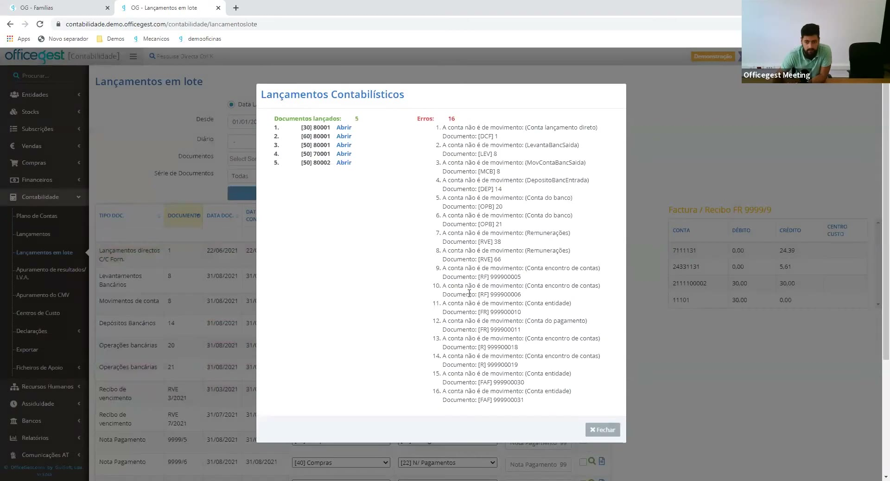

No exemplo ficaram **5 documentos lançados** (cada um com a ligação **Abrir**) e **16 erros**, todos do tipo **"A conta não é de movimento"**, com o que falta entre parênteses: Conta lançamento direto · LevantaBancSaida · MovContaBancSaida · DepositoBancEntrada · Conta do banco · Remunerações · Conta encontro de contas · Conta entidade · Conta do pagamento. Cada erro traz o documento em causa (por exemplo, `[FAF] 999900031`).

O ecrã lista vários tipos de documento além das faturas: movimentos de caixa, levantamentos e depósitos bancários, operações bancárias, **recibos de vencimento** e notas de pagamento.

### 7.2 Lançamentos manuais

**Caminho:** Contabilidade → **Lançamentos**. A lista ("Lançamento de Documentos") tem os botões **Validar lançamentos**, **Opções** e **Novo Lançamento**.

- O **Novo Lançamento** pede Data, Descritivo, Documento, Diário, Origem e Tipo de Lançamento. As contas escolhem-se numa caixa à esquerda e entram numa grelha com Nº de Conta, Título, Débito, Crédito, D/C e Centro Custo.
- Um lançamento já gravado mostra os botões Novo, Editar, Duplicar, Imprimir e Apagar.
- **Validar lançamentos** verifica, segundo a fala, se os lançamentos estão corretos ❓ (não foi demonstrado).

### 7.3 Lançamentos recorrentes

Criam-se em **Contabilidade → Ficheiros de Apoio → Lançamentos recorrentes**: um modelo com as contas e, se se quiser, os valores a débito e a crédito, o documento e o diário ❓ (em 2020 o modelo só tinha as contas; a fala de 2021 diz que também pode levar valores, mas o ecrã do modelo não foi capturado).

No novo lançamento, o botão **Associar** abre **"Associar lançamento recorrente"**, onde se escolhe o modelo. As contas e o documento ficam preenchidos; basta acertar os valores e guardar. **Não há agendamento**: é o utilizador que cria o lançamento em cada mês.

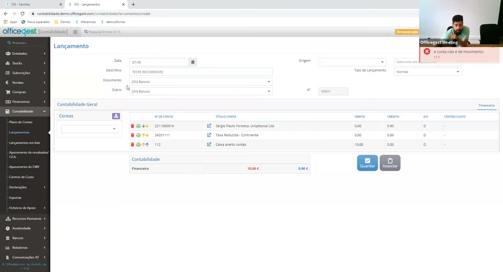

### 7.4 Transferir contas

O botão **Opções** da lista de lançamentos abre uma janela para **mudar em massa** a conta ou o centro de custo de lançamentos já feitos.

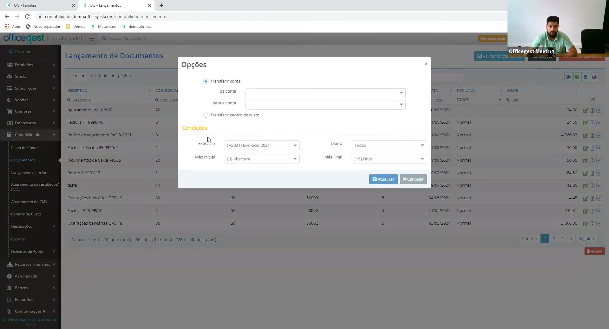

- **Transferir conta:** "da conta" → "para a conta". O exemplo dito: uma conta de refeições que estava dividida por fornecedor e que se quer juntar numa só.
- **Transferir centro de custo.**
- **Condições:** Exercício, Diário, Mês Inicial ([0] Abertura) e Mês Final ([15] Final).

## 8. Apuramentos (≈ 44:35–48:00)

### 8.1 Configuração

**Caminho:** Contabilidade → Ficheiros de Apoio → **Apuramento**. A lista traz os apuramentos de resultados (operacional, financeiro, corrente, extraordinário, antes de impostos, líquido) e o **APUR – Apuramento IVA**, que é o único marcado como apuramento de IVA. Podem criar-se outros (**Novo apuramento**: Cód. Apuramento, Designação, Conta Apuramento e a opção "Apuramento de Iva").

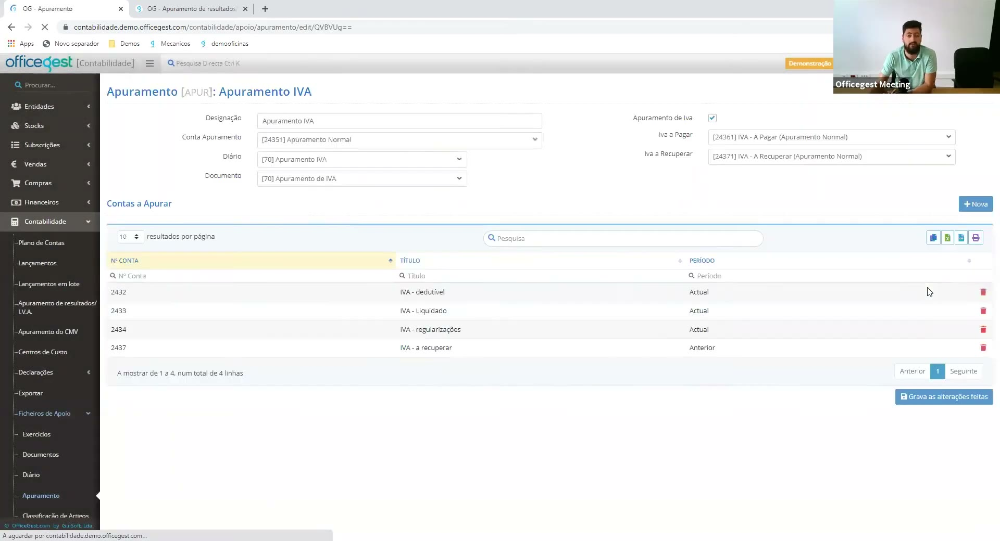

| Campo | Valor no exemplo |
|---|---|
| Conta Apuramento | [24351] Apuramento Normal |
| Diário | [70] Apuramento IVA |
| Documento | [70] Apuramento de IVA |
| Iva a Pagar | [24361] IVA - A Pagar (Apuramento Normal) |
| Iva a Recuperar | [24371] IVA - A Recuperar (Apuramento Normal) |
| **Contas a Apurar** | 2432 IVA - dedutível (Actual) · 2433 IVA - Liquidado (Actual) · 2434 IVA - regularizações (Actual) · 2437 IVA - a recuperar (**Anterior**) |

A coluna **Período** diz se a conta é apurada pelo período atual ou pelo anterior.

### 8.2 Execução

- **Contabilidade → Apuramento de resultados/I.V.A.:** escolhe-se o apuramento e carrega-se em **Executar**. O sistema cria o lançamento com base na configuração.
- **Contabilidade → Apuramento do CMV:** só serve a quem tem o inventário permanente em modo **Mensal** (secção 4.5). Os campos vêm preenchidos dos parâmetros; escolhe-se a Data Lançamento e o Período e carrega-se em **Executar**.

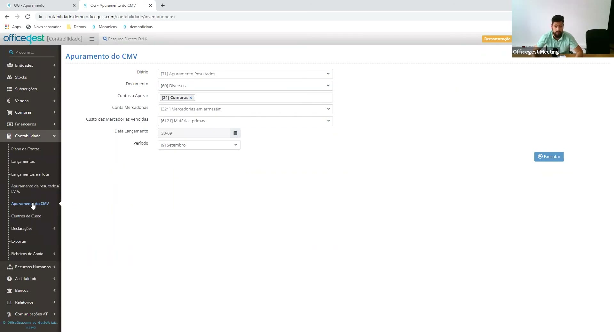

## 9. Declarações (≈ 48:00–57:20)

O menu **Contabilidade → Declarações** tem quatro: **Declaração periódica**, **Declaração Modelo 10**, **Declaração Modelo 22 de IRC** e **Declaração recapitulativa de IVA**. Só as duas primeiras foram mostradas. As outras duas eram novas e, segundo a fala, iam ter um vídeo próprio cada uma.

### 9.1 Declaração periódica de IVA

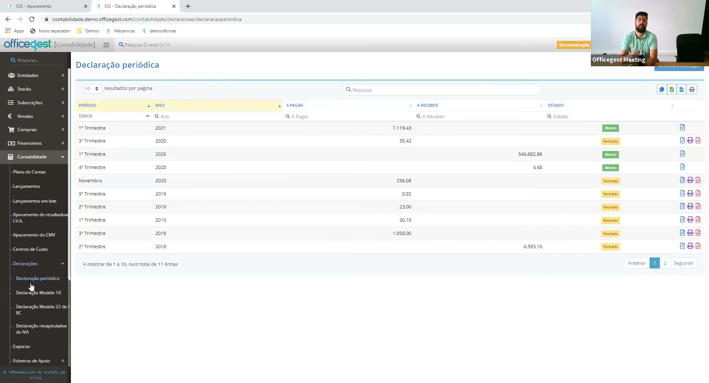

- A lista mostra o Período (trimestre ou mês), o Ano, **A Pagar**, **A Receber** e o Estado (**Aberto** / **Fechado**).
- A declaração abre com o aspeto do modelo da AT. Tem os separadores **Declaração periódica** e **Regularizações do campo 41**, e dentro do primeiro: **Rosto**, **Quadro 09**, **Quadro 10** e **Quadro 13**.
- Cada campo tem uma lupa que abre **"Contas do campo N"**: as contas que o alimentam e, para cada uma, se conta o **Saldo**, o **Débito** ou o **Crédito**, com sinal + ou −. Podem acrescentar-se e retirar-se contas.

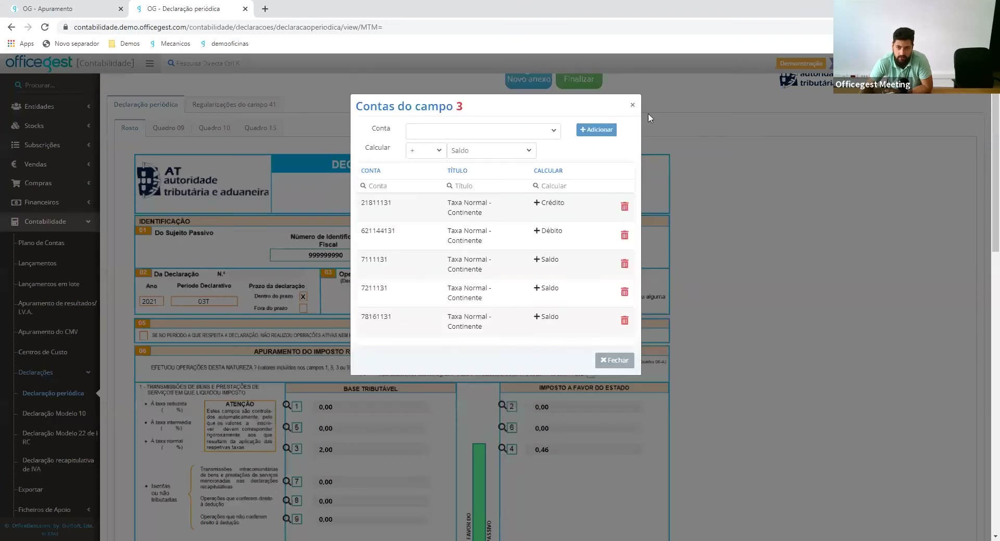

*Contas do campo 3 no exemplo:* 21811131 (+ Crédito) · 621144131 (+ Débito) · 7111131 (+ Saldo) · 7211131 (+ Saldo) · 78161131 (+ Saldo), todas "Taxa Normal - Continente".

- A declaração **atualiza-se em tempo real** com os lançamentos, enquanto estiver aberta.
- **Novo anexo:** "Clientes - Relação de clientes" ou "Fornecedores - Relação de fornecedores", com ano, mês e trimestre.
- **Finalizar** fecha a declaração (pede confirmação). Depois aparecem **Editar**, **Exportar** (ficheiro para submeter nas Finanças) e **Imprimir** (PDF).

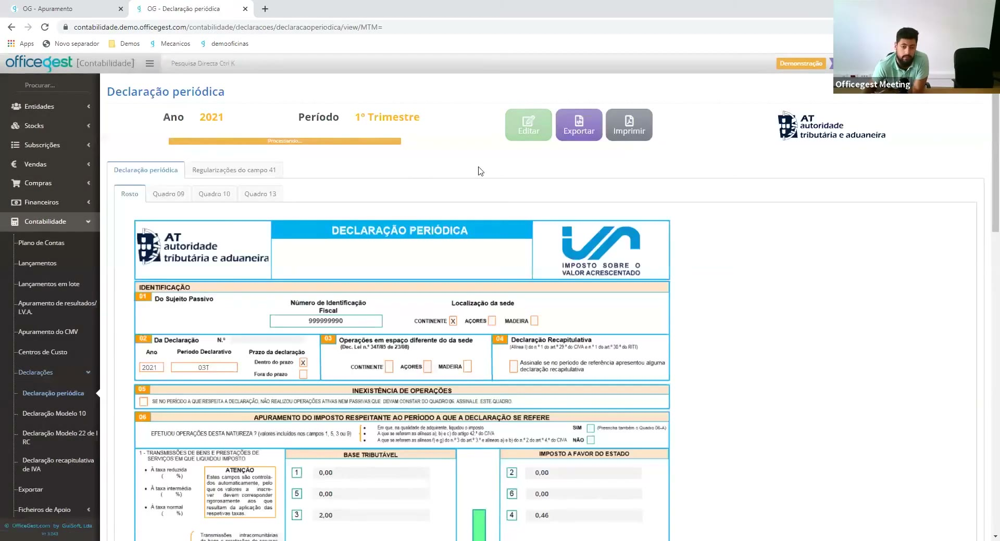

> **Limite dito na formação:** **não é possível escrever valores à mão** nos campos da declaração. Como ela se recalcula em tempo real, um valor escrito seria apagado pelo lançamento seguinte. A OfficeGest disse estar a estudar que campos poderiam vir a ser editáveis. Até lá, a alternativa é exportar e **corrigir os números no portal das Finanças** antes de submeter.

### 9.2 Declaração Modelo 10 (rendimentos e retenções)

O ecrã chama-se **"Declaração Rendimentos e Retenções"**. A **Nova declaração** pede só o ano. Tem os separadores **Rosto**, **Quadro 5**, **Quadro 6** e **Quadro 7**, e os botões **Guardar** e **Finalizar** (depois de finalizada: Editar, Exportar, Imprimir).

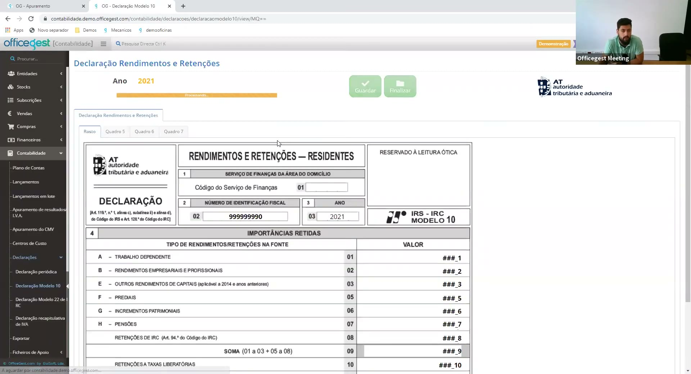

- O preenchimento automático vem das entidades que têm **retenção na fonte** na ficha e movimentos nesse ano.
- No Quadro 5, o botão **Nova Linha** acrescenta contribuintes à mão.

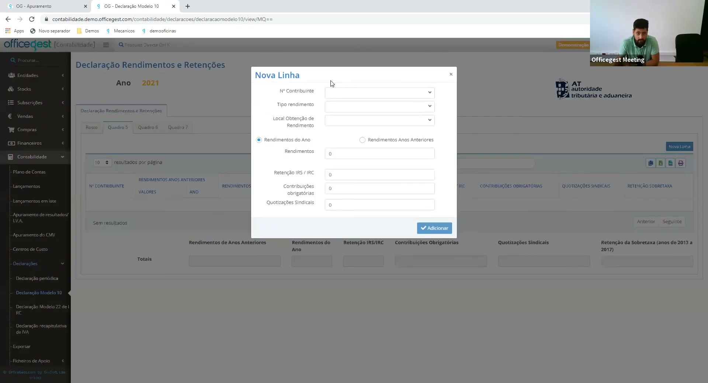

*Campos da Nova Linha:* Nº Contribuinte · Tipo rendimento · Local Obtenção de Rendimento · Rendimentos do Ano / Rendimentos Anos Anteriores · Rendimentos · Retenção IRS / IRC · Contribuições obrigatórias · Quotizações Sindicais.

A origem dos dados é a ficha do fornecedor, separador **Dados Financeiros**: a opção **Retenção Fonte**, a **Conta retenção**, a **% Retenção**, o **Tipo rendimento** e o **Local Obtenção de Rendimento**.

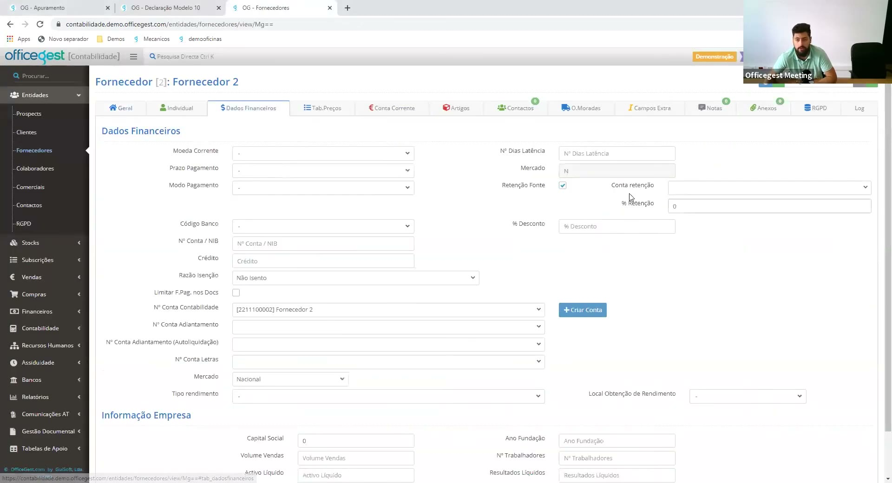

> **Limite respondido a uma participante:** os fornecedores **independentes sem retenção na fonte** não entram sozinhos na Modelo 10. Têm de ser acrescentados à mão, com a Nova Linha.

### 9.3 SAF-T da contabilidade

Tira-se em **Comunicações AT**, no mesmo ecrã do SAF-T de faturação, escolhendo o formato **contabilidade** e o mês inicial e final. A comunicação obrigatória do SAF-T da contabilidade ainda estava a ser trabalhada ❓ (a fala não é clara sobre o estado).

## 10. Centros de custo e contabilidade analítica (≈ 57:20–1:06:30)

### 10.1 Ligar

Em Parâmetros → **Outros Parâmetros**, as opções **Usa Contabilidade Analítica** e **Usar Centros de Custo na Contabilidade Geral**. Pode usar-se só a segunda (centros de custo sem analítica).

### 10.2 Como funciona

1. **O plano de contas da analítica** (classe 9) cria-se no mesmo **Plano de Contas** da contabilidade geral, com **Nova Conta**. No exemplo criaram-se a 9111 "contab. analitica" e a 9999 "Conta inversa".
2. **Os centros de custo** criam-se em **Contabilidade → Centros de Custo** (no exemplo: Be-Fit Leiria, e várias "Obra …"). Cada um tem Designação, Data Início, Data Fim e Activo.
3. **Em cada centro de custo**, a secção **Contabilidade analítica** diz o que fazer quando uma conta da geral é movimentada com esse centro de custo. O botão **Adicionar conta** pede:

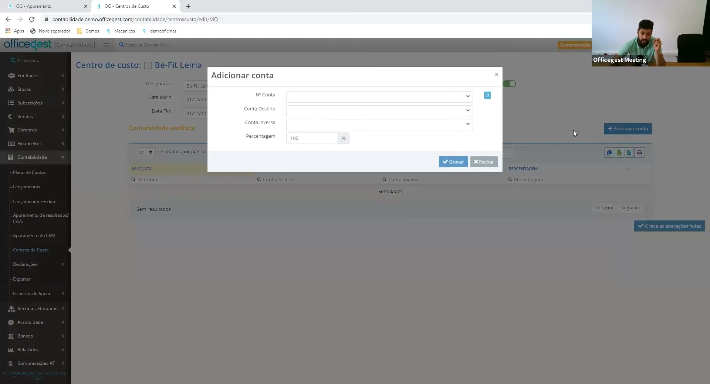

| Campo | Significado |
|---|---|
| Nº Conta | A conta da contabilidade geral (por exemplo, 62) |
| Conta Destino | A conta da analítica que recebe o valor (por exemplo, 9111) |
| Conta inversa | A contrapartida na analítica (por exemplo, 9999) |
| Percentagem | Que parte do valor passa para a analítica (100 % por omissão) |

Ao escolher a conta 62, o sistema criou **744 linhas**: uma por cada conta de movimento abaixo da 62.

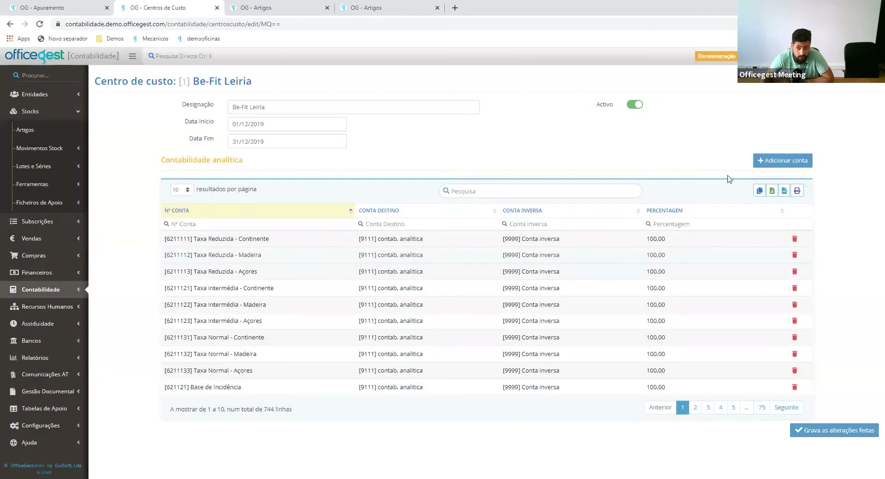

O mesmo quadro existe pelo lado da conta: a ficha de cada conta, no Plano de Contas, tem uma secção **Contabilidade analítica** (Centro de custo, Conta Destino, Conta inversa, Percentagem), além das secções **Declaração do IVA** e **Fluxos de caixa**.

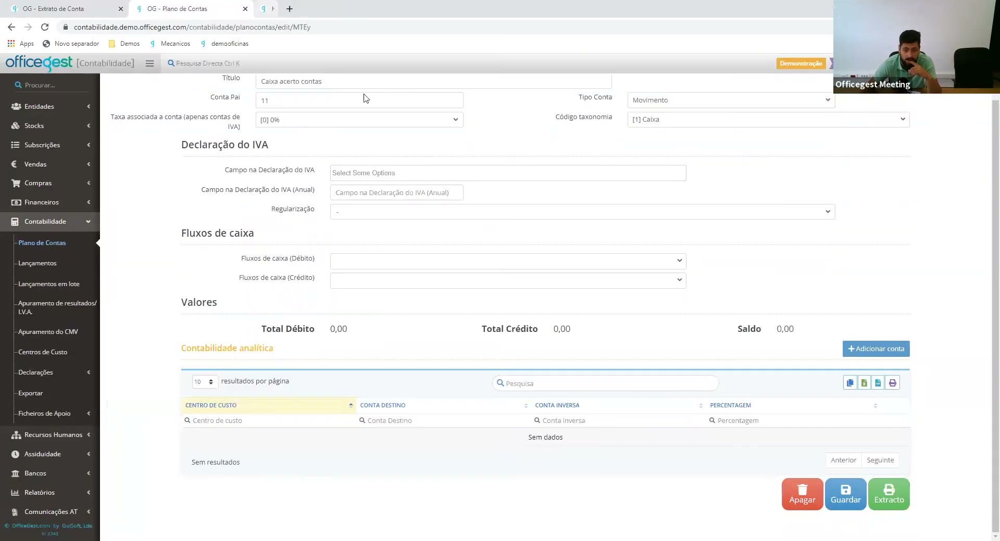

### 10.3 No documento

- A linha do documento de compra ou de venda tem uma coluna **Centro Custo**. Se não aparecer, liga-se em **Configurações → Parâmetros → Valores p/ Defeito**, em "Mostrar/Esconder colunas documentos" (há uma lista para Vendas e outra para Compras).
- Pode tornar-se o centro de custo **obrigatório** nos documentos de compra; nesse caso o documento não grava sem ele ❓ (o ecrã desta opção não foi capturado).

### 10.4 O resultado

O exemplo é uma Factura Fornecedor (FAF 9999/32) de 81,30 € + 18,70 € de IVA, com o centro de custo Be-Fit Leiria. A pré-visualização nos Lançamentos em lote mostra o lançamento da geral e, no meio, as **duas linhas da analítica**:

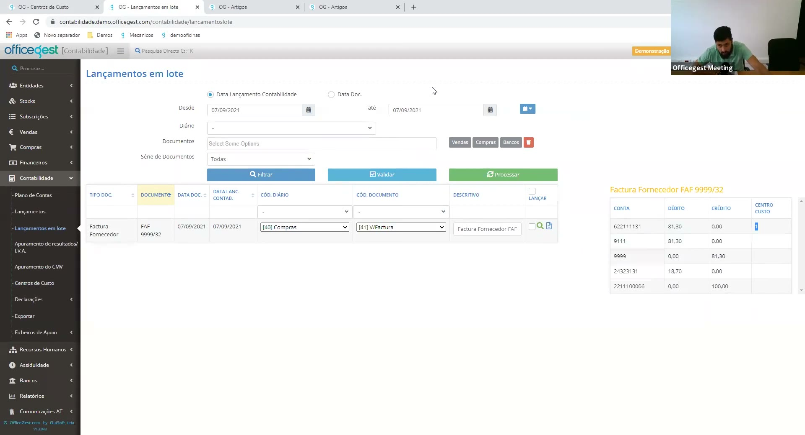

| Conta | Débito | Crédito | Centro Custo |
|---|---|---|---|
| 622111131 (gasto) | 81,30 | 0,00 | 1 |
| **9111** (analítica) | 81,30 | 0,00 | |
| **9999** (conta inversa) | 0,00 | 81,30 | |
| 24323131 (IVA dedutível) | 18,70 | 0,00 | |
| 2211100006 (fornecedor) | 0,00 | 100,00 | |

Em resumo: a analítica **depende sempre da geral**. Só há movimento analítico se o documento tiver centro de custo **e** esse centro de custo tiver uma regra para a conta movimentada.

## 11. Taxonomias e reencaminhamento de contas (≈ 1:06:30–1:14:20)

### 11.1 Taxonomias

Em **Contabilidade → Ficheiros de Apoio → Taxonomias**, o botão de atualizar o plano de contas atribui o código de taxonomia às contas que ainda não o têm. (O detalhe está na dissertação do webinar de 2020.)

### 11.2 Reencaminhamento de contas

**Caminho:** Contabilidade → Ficheiros de Apoio → **Reencaminhamento de contas**.

É uma tabela de regras do tipo "**sempre que a conta de origem for movimentada, lançar também X % do valor na conta de destino**". Serve os casos em que a classificação do artigo não chega.

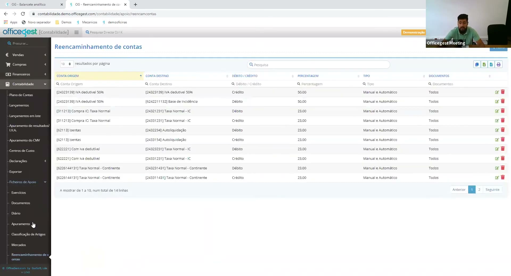

| Conta Origem | Conta Destino | Débito / Crédito | % | Tipo | Documentos |
|---|---|---|---|---|---|
| [24323139] IVA dedutível 50% | [24323139] IVA dedutível 50% | Crédito | 50,00 | Manual e Automático | Todos |
| [24323139] IVA dedutível 50% | [6242211132] Base de Incidência | Débito | 50,00 | Manual e Automático | Todos |
| [311213] Compra IC: Taxa Normal | [24321231] Taxa Normal - IC | Débito | 23,00 | Manual e Automático | Todos |
| [311213] Compra IC: Taxa Normal | [24331231] Taxa Normal - IC | Crédito | 23,00 | Manual e Automático | Todos |
| [62113] Isentas | [2432234] Autoliquidação | Débito | 23,00 | Manual e Automático | Todos |
| [62113] Isentas | [2433154] Autoliquidação | Crédito | 23,00 | Manual e Automático | Todos |
| [622221] Com iva dedutível | [24323231] Taxa Normal - IC | Débito | 23,00 | Manual e Automático | Todos |
| [622221] Com iva dedutível | [24331231] Taxa Normal - IC | Crédito | 23,00 | Manual e Automático | Todos |

(14 regras ao todo; estão aqui as 8 mais claras.)

Os dois usos explicados:

- **Autoliquidação de IVA** (por exemplo, uma compra sem IVA em que é o comprador que o liquida). O documento entra com IVA zero, por isso a classificação do artigo não lança IVA nenhum. A regra pega na **conta de base** (por exemplo, a 62113) e lança **23 % do valor** a débito no IVA dedutível e a crédito no IVA liquidado.
- **IVA do gasóleo dedutível a 50 %.** A fatura do gasóleo entra com os 23 % numa conta própria de IVA ("IVA dedutível 50%"). As duas regras de cima tiram **50 %** dessa conta (a crédito) e passam-nos para a **conta de gasto** (a débito). Fica dedutível só metade.

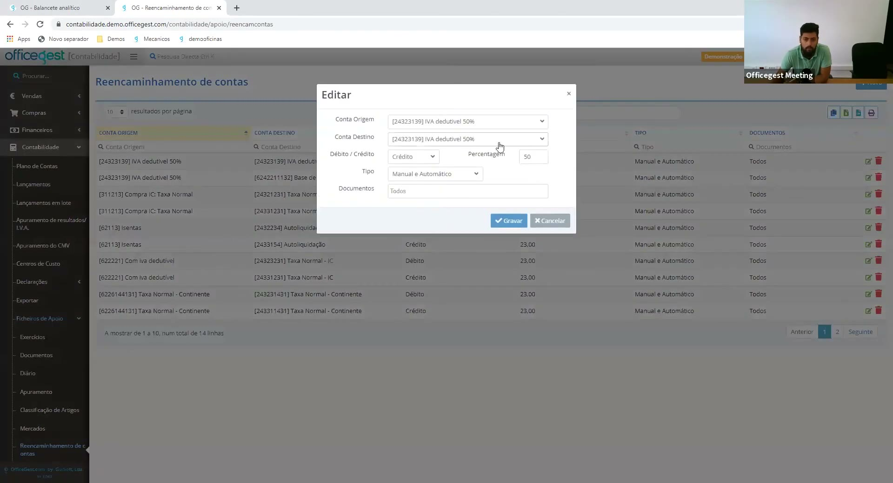

Cada regra tem: Conta Origem, Conta Destino, Débito / Crédito, Percentagem, Tipo (Manual e Automático) e Documentos (Todos, ou só alguns tipos).

> **Problema levantado por uma participante, sem resposta na sessão:** quando o gasóleo tem **centro de custo**, a metade do IVA que passa para gasto pelo reencaminhamento **pode ficar sem centro de custo** ❓. O apresentador não tinha a certeza e pediu que a questão fosse enviada ao suporte, para seguir para o desenvolvimento. Existe no menu um **"Reencaminhamento de centros de custo"**, que não foi aberto.

## 12. Relatórios e mapas (≈ 1:14:20–1:21:15)

Tudo em **Relatórios → Contabilidade**.

- **Balancetes** (Balancete analítico, Balancete Razão e por taxonomia). Filtros: Exercício, seleção de contas por intervalo ou múltipla, Conta inicial e final, Excluir subcontas, Mês inicial e final, Grau. Opções: incluir contas sem movimentos, não incluir contas com saldo zero, excluir terceiros. Tipo de impressão: Mensal, Acumulado, Mensal e acumulado, Anterior mensal e acumulado. Botões: **Filtrar**, **Imprimir** (PDF) e **Imprimir Excel**.

  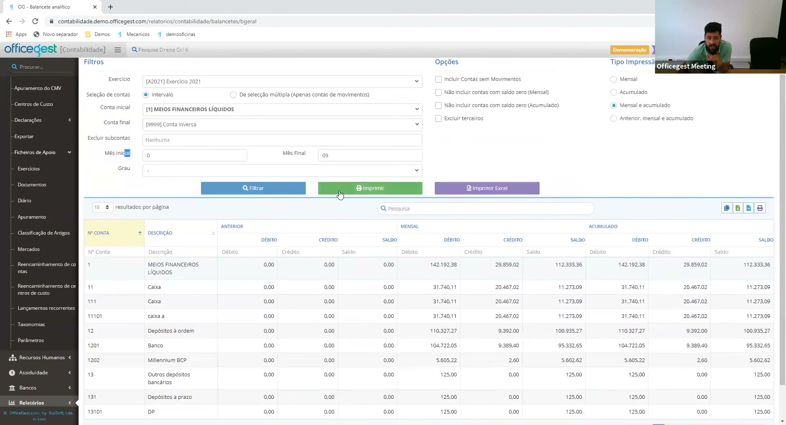

- **Extractos** (Extrato de Conta e Extrato Diário), por intervalo ou seleção múltipla de contas. O extrato de uma só conta também se tira pelo botão **Extracto** da ficha da conta, no Plano de Contas.
- **Balanço** e **Demonstração dos resultados por naturezas:** cada rubrica tem uma **fórmula** sobre saldos de contas, com dois anos lado a lado. Imprimem em PDF e em Excel. A fala refere uma passagem para **taxonomias** ❓, mas o que o ecrã mostra são fórmulas.

  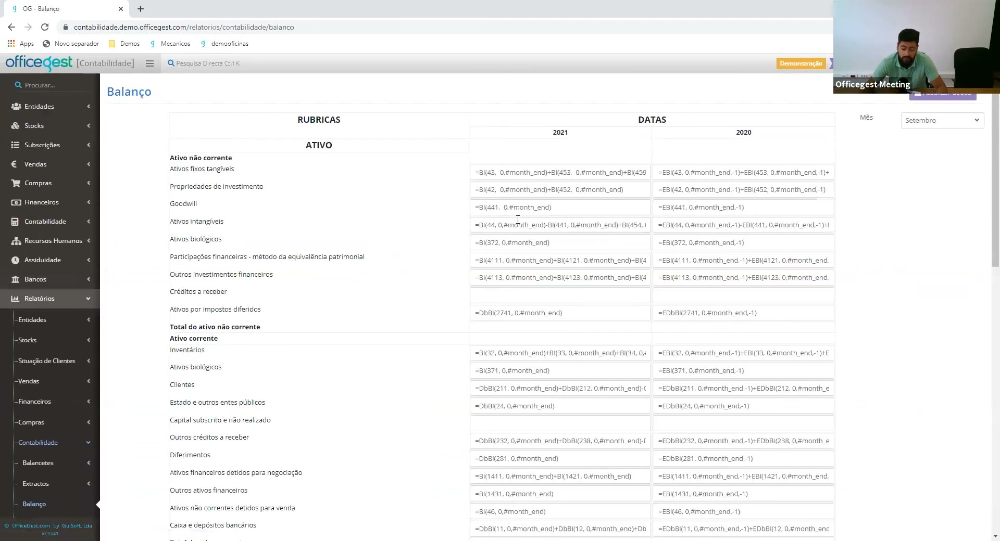

- **Fluxos de caixa:** relatório **novo em 2021**, pelo método directo, com o mesmo sistema de fórmulas. Na demonstração ainda estava **sem fórmulas configuradas**. A ficha de cada conta tem os campos "Fluxos de caixa (Débito)" e "Fluxos de caixa (Crédito)".

  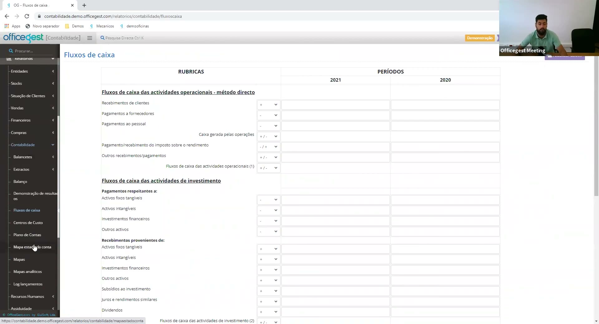

- **Centros de Custo:** valores por centro de custo, com dois separadores (**Gestão Comercial** e **Contabilidade Geral**), filtros por data, documento de origem (Todos, Apenas compras, Apenas vendas, Compras + Vendas) e centro de custo, e os tipos Resumido, Detalhado por documento, Detalhado por artigo e Contabilidade Geral. Em 2021 era o **único** relatório por centro de custo; outros estavam "a ser analisados".

  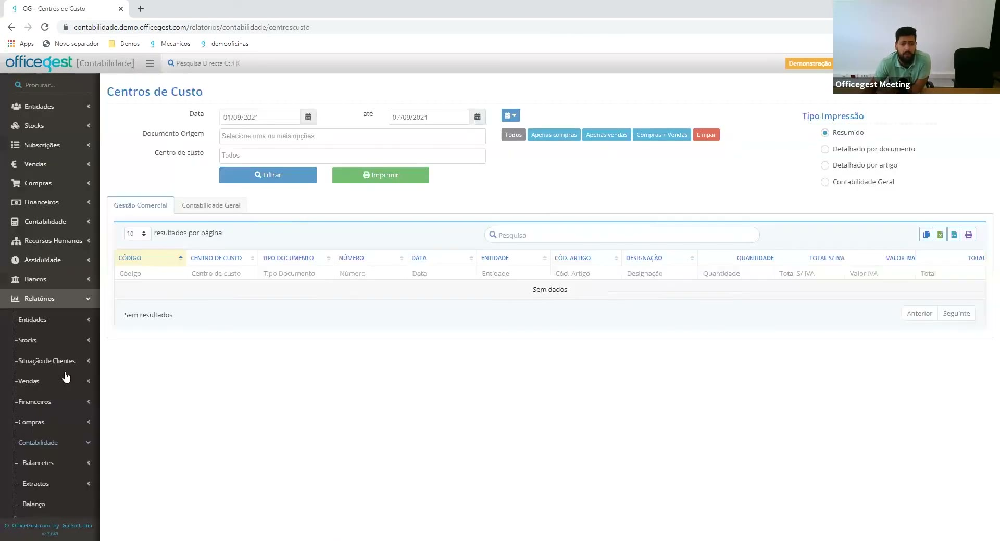

- **Mapas** e **Mapas analíticos:** relatórios desenhados pelo utilizador, numa folha tipo Excel com páginas, linhas e colunas. As células aceitam texto e **funções** que vão buscar o saldo de uma conta num intervalo; o botão **Calcular** preenche os valores. Servem tanto para a contabilidade geral como para a analítica, e exportam.

  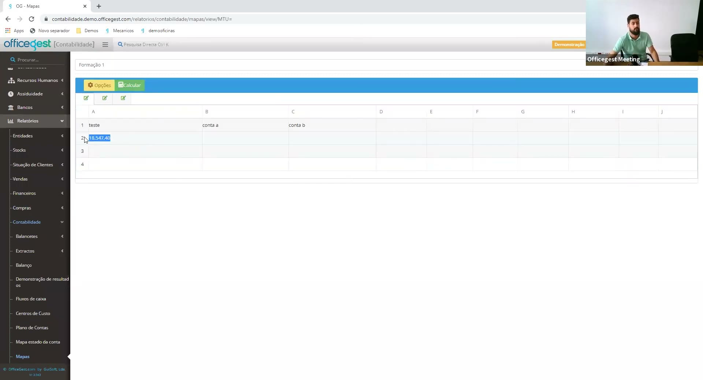

## 13. Fecho da sessão: apoio e manual (≈ 1:21:15–1:27:30)

- O módulo de contabilidade é **um módulo adicional**: não está ativo para todos os clientes e tem de ser comprado. Na ativação, a OfficeGest diz dar apoio na configuração durante o primeiro e o segundo mês.
- Foi partilhado no chat um utilizador de formação para experimentar o módulo na conta de demonstração (as credenciais não se reproduzem aqui).
- **Ajuda → Suporte:** contactos e pedidos de suporte com acompanhamento do estado.
- **Ajuda → Manual:** o "OfficeGest Online Manual", organizado por categorias (00_Introdução OfficeGest, 01_Configuração Geral, 02_Entidades, 03_Compras, 04_Vendas, 05_Stocks, 06_Financeira, 07_CRM, **08_Contabilidade**, 09_Recursos Humanos, 10_Contratos & Assistências, 11_Tickets). A parte da contabilidade **ainda não estava escrita** em 2021.
- Os vídeos das formações ficam em `pt.officegest.com/academia/`.

---

## O que mudou desde o webinar de 2020

Comparação com a dissertação do [Webinar #2 (2020-06, v2.220)](../webinar-2-contabilidade-officegest/dissertacao.md):

| Tema | Em 2020 (v2.220) | Em 2021 (v3.043) |
|---|---|---|
| **Menu Contabilidade** | Um item "Declaração periódica" | Um submenu **Declarações** com quatro: periódica, **Modelo 10**, **Modelo 22 de IRC**, **recapitulativa de IVA**. E um item novo, **Apuramento do CMV** |
| **Parâmetros** | Mostrado só o separador Contas | Oito separadores. São novidade na dissertação: **Classificação por série**, **Centros de custo por série**, **Inventário permanente** e **Outros Parâmetros** |
| **Classificação de artigos** | Por família ou na ficha do artigo | Acresce o valor por omissão **por tipo de artigo** (Normal e Serviços) e a troca de classificação **por série**. Fica explícito que a família só vale para **artigos novos** e que a classificação se cria **uma taxa de IVA de cada vez** |
| **Data do lançamento** | Não referida | Parâmetro com três opções, incluindo lançar tudo no **último dia do mês** |
| **Exercícios** | Só os meses e o "Integrar" | Acresce a **criação do exercício** (o que é copiado), a **mudança dos colaboradores** de exercício e o fecho de meses |
| **Integração automática** | "Todos os dias, de madrugada" | Continua a existir. O apresentador diz que **não sabe a hora** |
| **Erros no lançamento em lote** | "Tem de comutar para um exercício compatível" | "**A conta não é de movimento**", com o nome do que falta (conta da entidade, do banco, do pagamento…) |
| **Contabilidade analítica** | Não existia na demonstração | Existe, por centro de custo, com conta de destino, conta inversa e percentagem |
| **Reencaminhamento de contas** | Só o nome no menu | Explicado: autoliquidação e IVA do gasóleo a 50 % |
| **Lançamentos** | Manuais e recorrentes | Acresce **Opções → Transferir conta / centro de custo** em massa |
| **Relatórios** | Balancetes, extratos, balanço, DR, Mapas | Acrescem **Fluxos de caixa**, **Centros de Custo** e **Mapas analíticos** |
| **Balanço e DR por taxonomias** (anunciado em 2020) | "Vão passar a usar taxonomias" | O ecrã de 2021 **continua a mostrar fórmulas** ❓ |
| **TPA / multibanco como conta própria** (anunciado em 2020) | Anunciado para "uma próxima versão" | Há uma conta bancária "Caixa Multibanco" na lista, e o manual online lista uma entrada "Bancos / Fecho TPA". É **indício** de que passou a existir; não foi demonstrado |

## O que foi anunciado como futuro

Tudo isto foi dito em setembro de 2021. **Falta verificar se existe hoje.**

- Um **vídeo próprio** para a Declaração Modelo 22 e outro para a Declaração recapitulativa de IVA.
- O módulo de **imobilizado**, descrito como "muito recente" e ainda em testes, com vídeo de formação prometido.
- A **comunicação obrigatória do SAF-T da contabilidade**, ainda em desenvolvimento.
- **Campos editáveis à mão** na declaração periódica de IVA (em estudo, sem compromisso).
- As **fórmulas dos Fluxos de caixa** pré-configuradas.
- **Mais relatórios por centro de custo**.
- O **centro de custo no reencaminhamento de contas** (caso do gasóleo), a seguir para o desenvolvimento.
- A parte da **contabilidade no manual online**.

---

## O que este vídeo pode responder no projeto winners-group

Segundo a formação de 2021-09 (versão 3.043), e **ainda por confirmar no OfficeGest atual**. As perguntas são as de `contabilidade/processo-atual/perguntas-em-aberto.md`.

| Pergunta | O que o vídeo mostra |
|---|---|
| **C-2** — o que é "classificar por artigos"? | **Reforça** a hipótese (a classificação é do artigo, por taxa de IVA e mercado) e acrescenta três coisas. (1) Há um valor por omissão **por tipo de artigo**. (2) A família só classifica **artigos novos**. (3) Sobre a pergunta "as despesas entram com artigos genéricos?": a conta de demonstração tem **classificações por conta de gasto** ("6221 - Trabalhos Especializados", "6222 - Publicidade e Propaganda", "6241 - Eletricidade") e artigos do **tipo Contabilístico**, um por tipo de despesa. É a forma prevista pelo produto. Continua a faltar saber como a Winners faz |
| **C-24** — existe lançamento automático? | **Confirma** que em 2021 continuavam a existir o ecrã *Lançamentos em lote* e a integração diária por mês. Acrescenta o parâmetro da **data do lançamento** (data do documento, último dia do mês ou manual) e a lista de erros "A conta não é de movimento". Perguntas novas para a Winners: que opção de data usam? Quem vê os documentos a vermelho? |
| **C-25** — um único acesso para todas as oficinas | **Ponto novo a verificar:** cada utilizador trabalha **num exercício**. Na viragem do ano é preciso criar o exercício e **mudar os colaboradores** para ele; se não, as contas de entidades novas ficam criadas no ano errado. Vale perguntar quem faz isto em cada oficina |
| **C-11** — IVA mensal ou trimestral? | A periodicidade é um parâmetro da contabilidade (separador Iva / Abertura ❓) e a declaração periódica faz-se por mês ou por trimestre. Dá para **ver a resposta no sistema**, oficina a oficina |
| **C-9** — que impostos se registam no fecho? | O OfficeGest tem **apuramento de IVA**, **declaração periódica**, **Modelo 10** (a partir da retenção na fonte da ficha do fornecedor) e contas próprias para IRS e Segurança Social dos vencimentos. **Limite:** a declaração periódica não aceita valores à mão; a Modelo 10 não inclui sozinha os independentes sem retenção |
| **C-16** — salários no OfficeGest? | O módulo de Recursos Humanos **lança os vencimentos na contabilidade** (contas em Configurações → Parâmetros → Recursos Humanos), e os recibos de vencimento aparecem nos Lançamentos em lote |
| **C-18** — leasing / ALD | **Divergência possível com a nota de 01/10:** lá está "são só um modelo de contas; os valores escrevem-se à mão". A fala de 2021 diz que o recorrente **também pode guardar valores** ❓ (o ecrã não o prova). O que se mantém: **não há agendamento** |
| **C-19** — cascos, rappel, devoluções | A classificação de artigos tem contas próprias de **devolução** (de venda, de compra e do respetivo IVA). O **reencaminhamento de contas** é a ferramenta para regras especiais de IVA |
| **C-21** — exporta o balancete? | **Fecha a parte que estava "por confirmar":** o balancete tem **Imprimir** (PDF) e **Imprimir Excel** |
| **C-5** — ficheiro de performance | Além dos Mapas, existem **Mapas analíticos**, o relatório de **Centros de Custo** e a **contabilidade analítica**. Se o ficheiro de performance for por área da oficina (mecânica, chapa, peças…), os centros de custo são o caminho nativo |
| **D-3** — funcionalidades nativas | A acrescentar ao inventário, como perguntas: classificação e centro de custo **por série**, **inventário permanente** e Apuramento do CMV, **reencaminhamento de contas** (o IVA do **gasóleo a 50 %** e a **autoliquidação** são casos típicos de oficina), **Transferir conta** em massa, Modelo 10, Modelo 22, declaração recapitulativa, Fluxos de caixa. **Não demonstra** DMS/OCR, reconciliação bancária, QR Code nem e-Fatura |

## Pontos a verificar no sistema atual

- [ ] Os caminhos de menu acima continuam iguais? (Em especial o submenu **Declarações** e o **Apuramento do CMV**.)
- [ ] Em que exercício está cada utilizador da Winners, em cada oficina? Os exercícios do ano corrente estão criados e com os meses em **Integrar**?
- [ ] Que opção está em **Data Lançamento Contabilidade**?
- [ ] As oficinas usam **inventário permanente**? Em que modo?
- [ ] Existe uma regra de **reencaminhamento** para o gasóleo a 50 % e para a autoliquidação? E o problema do centro de custo na metade não dedutível foi resolvido?
- [ ] O **lançamento recorrente** guarda valores, ou só contas?
- [ ] A declaração periódica já aceita **valores à mão**?
- [ ] A Modelo 10 já inclui os independentes sem retenção?
- [ ] O balanço e a demonstração de resultados usam fórmulas ou taxonomias? Os **Fluxos de caixa** já vêm configurados?
- [ ] Há mais relatórios por **centro de custo**?
- [ ] O **Fecho de TPA** existe? (Entrada vista no manual online.)
- [ ] A secção **08_Contabilidade** do manual online já está escrita? Se sim, é uma fonte mais atual do que estes vídeos.

## Limites desta versão

- Os **ecrãs** são a fonte mais fiável dos nomes e dos valores. A **explicação** do porquê vem de legendas automáticas com muitos erros; onde a fala não era clara, ficou a marca ❓. São **9 pontos** com ❓ (alguns repetidos nas tabelas do fim).
- Não foram capturados abertos: os separadores **Diários** e **Iva / Abertura** dos parâmetros, o modelo de um **lançamento recorrente**, a opção de **centro de custo obrigatório** e o ecrã **Taxonomias**. O que se diz sobre eles vem só da fala.
- As declarações **Modelo 22** e **recapitulativa de IVA**, o **imobilizado** e o **Reencaminhamento de centros de custo** aparecem no menu ou na fala, mas não foram demonstrados.
- A parte de perguntas e respostas só se ouve do lado do apresentador; as perguntas dos participantes foram reconstruídas pelas respostas.
- Os valores e nomes dos ecrãs são da **conta de demonstração**. Os números de conta seguem o plano de contas que o OfficeGest traz de origem; uma oficina com outro plano terá outros.
