# Formação Prática Módulo Financeira

| | |
|---|---|
| **Vídeo** | [youtu.be/f4-690_wd8Y](https://www.youtube.com/watch?v=f4-690_wd8Y) |
| **Canal** | Officegest (canal oficial) |
| **Apresentador** | Pedro Jordão (o nome vem da fala; não aparece escrito no ecrã) |
| **Gravado em** | **2021-08-31** (data no diapositivo de abertura e nas datas dos ecrãs) |
| **Publicado em** | 2022-10-17 |
| **Duração** | 1:10:50 |
| **Processado em** | 2026-10-02 |
| **Fonte do texto** | Legendas automáticas do YouTube (pt), com muitos erros, **corrigidas pelos ecrãs**. Os nomes de menus e campos abaixo foram lidos nos screenshots |
| **Ecrãs** | 142 capturados em [`ecras/`](ecras/); os mais úteis estão embutidos abaixo |
| **Versão do OfficeGest** | **vr 3.042** (rodapé do menu), em ambiente "Demonstração" (`contabilidade.demo.officegest.com`) |

> ⚠️ **Vídeo com 5 anos.** Foi publicado em outubro de 2022, mas a sessão foi gravada em **agosto de 2021**. Tudo o que está abaixo descreve o OfficeGest **como era em agosto de 2021, na versão 3.042**. Trate cada afirmação como **hipótese**, com a forma "segundo a formação de 2021-08", até ser confirmada no sistema atual. Os screenshots servem para comparar: se o ecrã de hoje for diferente, houve mudança.
>
> ❓ = ponto que nem a fala nem o ecrã deixam claro.

> 🔗 **Vídeos relacionados já dissertados:** a [Formação Prática Módulo Contabilidade](../formacao-pratica-modulo-contabilidade/dissertacao.md) foi gravada uma semana depois (2021-09-07, v3.043) e explica o lado contabilístico das contas bancárias. O [Webinar #2 de 2020](../webinar-2-contabilidade-officegest/dissertacao.md) anunciava o fecho de TPA como novidade futura; **este vídeo mostra-o a funcionar**.

---

## Resumo

É uma formação gratuita da OfficeGest Academia sobre a parte **financeira**, centrada no módulo **Bancos**. O apresentador diz que este módulo vem na versão de base. O fio condutor é **saber sempre onde está o dinheiro**: quanto há em cada caixa, quanto está em cada banco, e que entradas e saídas explicam a diferença.

A ordem é esta:

1. **Contas bancárias:** criar os bancos e as contas, com um saldo inicial e uma data de arranque.
2. **Caixas:** a "conta caixa" e os postos, terminais e caixas que lhe pertencem; a caixa de cada colaborador.
3. **Saldos:** o relatório que mostra o dinheiro por caixa e por banco, em tempo real.
4. **Depósitos e levantamentos:** passar dinheiro (e cheques) da caixa para o banco e vice-versa.
5. **Movimentos de conta:** transferências de banco para banco.
6. **Operações bancárias e tipos de despesas:** pagamentos e recebimentos que **não têm documento** (o IVA, os salários, as comissões).
7. **Movimentos de caixa:** o mesmo, mas em numerário, e as transferências entre caixas.
8. **Relatórios:** extrato de movimentos, conta corrente da caixa, despesas do banco e da caixa, fluxos de caixa.
9. **Cheques.**
10. **Fecho de TPA:** juntar os recebimentos por multibanco do dia e lançar a comissão do banco.
11. **Reconciliação bancária:** importar o extrato do banco e emparelhá-lo com o que está registado.

### Onde fica cada coisa (versão 3.042)

- **Bancos** → Reconciliação · Depósitos · Levantamentos · Movimentos de conta · Operações bancárias · Movimentos de Caixa · Cheques · Fecho TPA · Exportação COPE · **Ficheiros de Apoio → Tipos de despesas**
- **Tabelas de Apoio → Financeiros** → Moedas · Séries de Documentos · IVA · Razões de Isenção IVA · Prazos de Pagamento · Modos de Pagamento · Tipos de Movimento de Caixa · **Bancos** · **Contas Bancárias**
- **Tabelas de Apoio → Organizacionais** → Armazéns · **Postos / Terminais / Caixas** · Departamentos · Modos de Expedição · Categorias de anexos
- **Entidades → Colaboradores** (ficha, separador **Definições**)
- **Configurações → Parâmetros**, separador **Bancos**
- **Relatórios → Bancos** → Extrato de movimentos de contas · Conta corrente caixa · Saldos · Despesas do banco · Despesas de caixa
- **Relatórios → Financeiros** → Listagem de caixa · Movimentos de Caixa · **Gestão de fluxos de caixa** · Previsão financeira · Descontos Recibos / Pagamentos (entre outros)

---

## 1. Contas bancárias (≈ 02:40–15:00)

**Caminho:** Tabelas de Apoio → Financeiros → **Contas Bancárias**.

É aqui, e não nos Modos de Pagamento, que se preparam os bancos que depois recebem os pagamentos e os recebimentos. Uma plataforma nova traz duas contas criadas: uma **conta caixa** e uma da Caixa Geral de Depósitos. A recomendação é criar **todas as contas bancárias que a empresa tem abertas**.

### 1.1 Criar o banco (se faltar)

A lista de bancos já vem preenchida com os mais comuns. Se faltar um, cria-se em **Tabelas de Apoio → Financeiros → Bancos → Novo Banco**, com um **Código Banco** e uma **Designação**. Passa logo a estar disponível na criação da conta.

### 1.2 Criar a conta

O botão **Cria Conta** pede:

| Campo | Para que serve |
|---|---|
| Descrição | Nome interno da conta |
| Banco | O banco a que a conta pertence |
| Cód. Conta Bancária | Um código à escolha. Serve só para distinguir **várias contas no mesmo banco**; não pode repetir-se dentro do banco |
| Nº Conta / IBAN, Tipo Conta, Moeda, Cód. País | Dados da conta |
| **Saldo inicial:** Data Início e Saldo | O ponto de partida da conta (ver abaixo) |

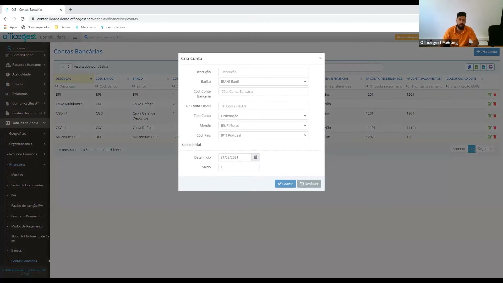

> **Regra do saldo inicial.** A partir da **Data Início**, a conta fica com o **Saldo** indicado, e só contam os movimentos dessa data em diante. **Tudo o que foi registado antes é ignorado** nos saldos. Quem já usa o OfficeGest pode começar a usar os bancos em qualquer dia: basta pôr o saldo real desse dia.

### 1.3 A ficha da conta

Ao editar a conta aparecem mais opções.

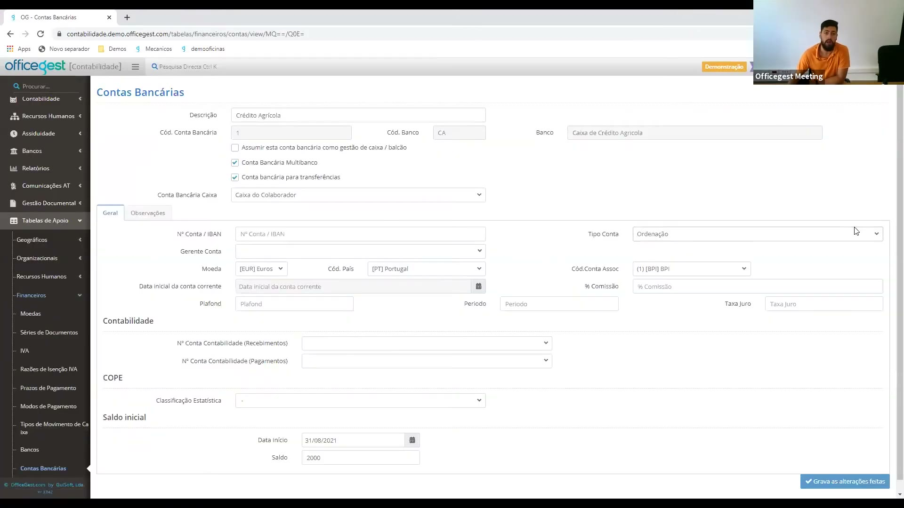

| Campo | O que faz |
|---|---|
| **Assumir esta conta bancária como gestão de caixa / balcão** | Transforma a conta numa **conta caixa** (ver secção 2). Só deve haver uma |
| **Conta Bancária Multibanco** | A conta pode receber pagamentos por multibanco |
| **Conta bancária para transferências** | A conta pode receber pagamentos por transferência |
| Conta Bancária Caixa | No exemplo, "Caixa do Colaborador" |
| Cód.Conta Assoc, Gerente Conta, % Comissão, Plafond, Periodo, Taxa Juro | Dados complementares |
| **Contabilidade:** Nº Conta Contabilidade (Recebimentos) e (Pagamentos) | A conta do plano de contas que o lançamento movimenta (detalhe na dissertação da contabilidade) |
| **COPE:** Classificação Estatística | Para a exportação COPE |
| **Saldo inicial** | Data Início e Saldo |

Com as duas opções de multibanco e transferência, pode ter-se uma conta só para os pagamentos por multibanco e outra só para as transferências, ou uma para ambos.

No exemplo criou-se a conta **Crédito Agrícola** com saldo inicial de **2.000 €** a 31/08/2021.

## 2. Caixas (≈ 10:00–21:40)

### 2.1 A conta caixa e os postos

A **conta caixa** é uma conta bancária "virtual" que representa o dinheiro em caixa. Normalmente há **uma só**. Dentro dela criam-se as caixas reais, uma por posto de venda, em **Tabelas de Apoio → Organizacionais → Postos / Terminais / Caixas**. O exemplo dito é uma loja de peças com quatro postos de venda: quatro caixas, todas dentro da mesma conta caixa.

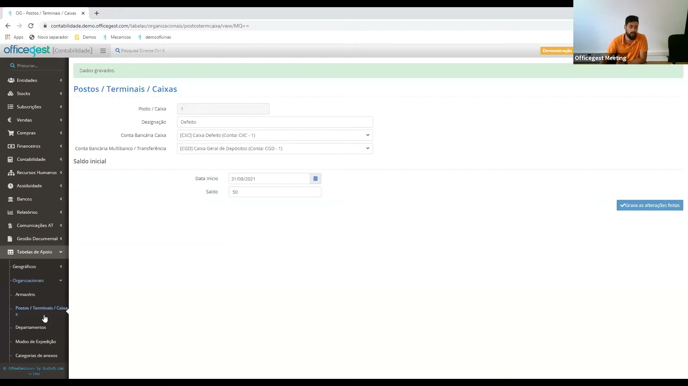

| Campo | Valor no exemplo |
|---|---|
| Posto / Caixa | 1 |
| Designação | Defeito |
| Conta Bancária Caixa | [CXC] Caixa Defeito (Conta: CXC - 1) |
| Conta Bancária Multibanco / Transferência | [CGD] Caixa Geral de Depósitos (Conta: CGD - 1) |
| Saldo inicial | Data Início 31/08/2021, Saldo 50 |

- O segundo campo diz **para que banco vão**, por omissão, os recebimentos por multibanco e transferência feitos nesse posto.
- O saldo de uma conta caixa **não se altera na ficha da conta bancária**: define-se posto a posto, aqui.
- No exemplo ficaram duas caixas: **[1] Defeito** com 50 € e **[2] Caixa Central** com 100 €.

### 2.2 A caixa de cada colaborador

**Caminho:** Entidades → Colaboradores → ficha → separador **Definições**.

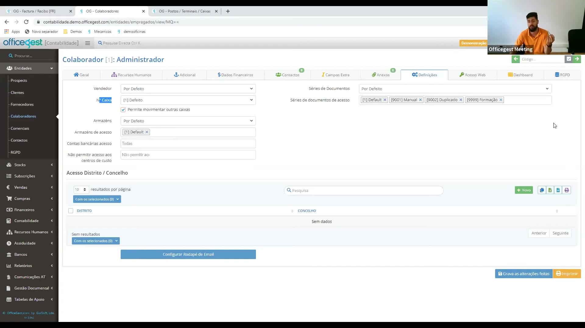

- **Nº Caixa:** a caixa por omissão do colaborador.
- **Permite movimentar outras caixas:** se estiver ligado, ao receber em numerário o colaborador **escolhe a caixa**; se não, o recebimento vai sempre para a caixa dele, sem pergunta.
- **Contas bancárias acesso:** as contas a que o colaborador tem acesso.
- No mesmo separador: Vendedor, Armazéns, Séries de documentos de acesso, "Não permitir acesso aos centros de custo".

### 2.3 O que acontece ao receber

Ao terminar uma Factura / Recibo, a janela **Pagamento** mostra os modos **[CHQ] Cheque**, **[MUL] Multibanco**, **[NUM] Numerário** e **[TRA] Transferência Bancária**. Em numerário, o campo **Caixa entrada** deixa escolher a caixa (se o colaborador tiver permissão).

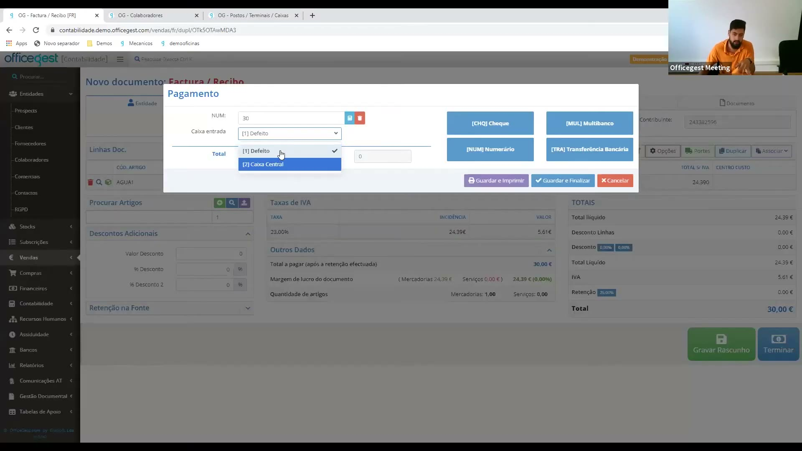

No exemplo, uma fatura-recibo de 30,00 € recebida em numerário na Caixa Central fez o saldo dessa caixa passar de 100 para 130 **no mesmo instante**. O mesmo vale para as compras e para qualquer documento com pagamento associado.

## 3. O relatório de Saldos (≈ 16:50–22:00)

**Caminho:** Relatórios → Bancos → **Saldos**.

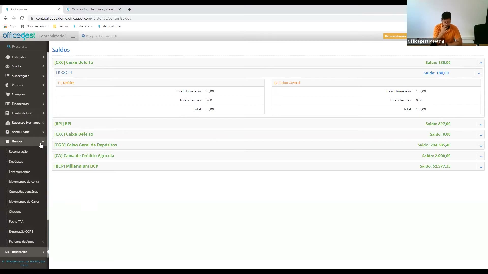

Mostra, em tempo real, o saldo de cada conta. A conta caixa abre-se e mostra cada posto com o **Total Numerário**, o **Total cheques** e o **Total**. É o ecrã a que o apresentador volta depois de cada operação, para mostrar o efeito.

## 4. Depósitos e levantamentos (≈ 22:00–32:00)

Funcionam da mesma forma e são o inverso um do outro: o **depósito** tira dinheiro da caixa e põe-no no banco; o **levantamento** tira do banco e põe na caixa. O apresentador chama a isto "fazer o fecho de caixa".

### 4.1 Depósito

**Caminho:** Bancos → **Depósitos** → Novo depósito (Referência, Banco, Data).

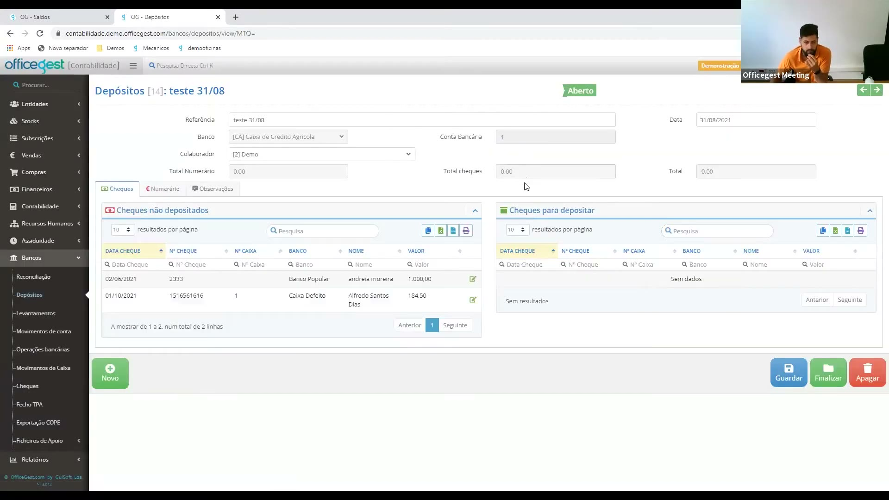

- Separador **Cheques:** à esquerda, os **cheques não depositados**; passam-se para a direita, "Cheques para depositar". Só aparecem os cheques recebidos depois da data de início do saldo.
- Separador **Numerário:** à esquerda, o saldo de cada caixa; escolhe-se quanto se deposita de cada uma.
- Botões **Guardar**, **Finalizar** e **Apagar**. O Finalizar pede confirmação, com o aviso de que **a operação é irreversível**, e o depósito passa a **Fechado**.

No exemplo depositaram-se 55 € da Caixa Central no Crédito Agrícola: a caixa ficou com 75 € e o banco com 2.055 €.

### 4.2 Levantamento

**Caminho:** Bancos → **Levantamentos** → Novo levantamento. Escolhe-se o banco e, por caixa, o valor que entra. No exemplo levantaram-se 50 € do Crédito Agrícola para a caixa Defeito.

### 4.3 A "conta intermédia", para quem não vai ao banco todos os dias

Sugestão do apresentador para as empresas que guardam o dinheiro e só o depositam no fim da semana:

1. Criar uma **conta bancária fictícia** (por exemplo "Caixa intermédia"), que não pertence a nenhum banco.
2. Todos os dias, fazer um **depósito** da caixa para essa conta, deixando na caixa só o fundo para o dia seguinte.
3. No dia em que se vai ao banco, fazer um **movimento de conta** (secção 5) da conta fictícia para o banco real.

Assim sabe-se sempre quanto está em caixa, quanto está guardado fora da caixa e quanto já está no banco.

### 4.4 Relatório do dia: Gestão de fluxos de caixa

**Caminho:** Relatórios → Financeiros → **Gestão de fluxos de caixa**.

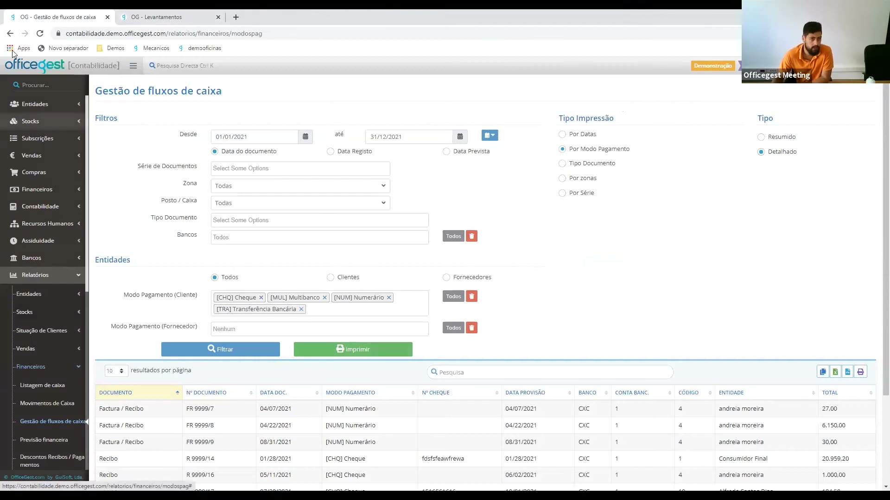

Lista os documentos recebidos e pagos num intervalo, com filtros por série, zona, posto / caixa, tipo de documento, banco e modo de pagamento (de cliente e de fornecedor). O **Tipo Impressão** agrupa por datas, por modo de pagamento, por tipo de documento, por zonas ou por série, em versão resumida ou detalhada. Serve de "folha de caixa": quanto se recebeu em numerário, em cheque e em multibanco.

## 5. Movimentos de conta (≈ 34:40–37:50)

**Caminho:** Bancos → **Movimentos de conta** → Movimento de conta.

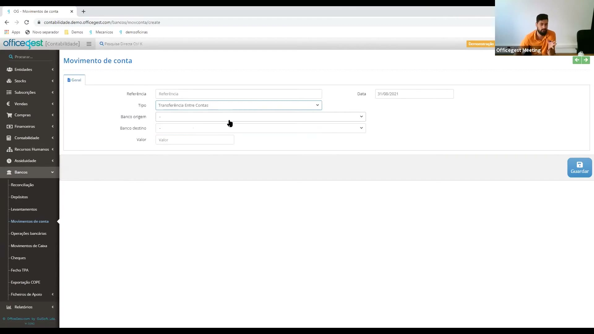

- Campos: Referência, Data, **Tipo**, Banco origem, Banco destino, Valor.
- O **Tipo** tem "Transferência Entre Contas" e também pagamento e recebimento. **A recomendação é usar este ecrã só para transferências** de banco para banco, e deixar os pagamentos e recebimentos para as Operações bancárias.
- No exemplo: 1.005 € do Crédito Agrícola para o BPI.

## 6. Operações bancárias e tipos de despesas (≈ 37:50–43:40)

### 6.1 Para que servem

As **operações bancárias** registam saídas e entradas de uma conta bancária que **não têm documento emitido no OfficeGest**. Os exemplos ditos: o **pagamento do IVA** e o **pagamento de salários**.

**Caminho:** Bancos → **Operações bancárias** → Nova operação bancária.

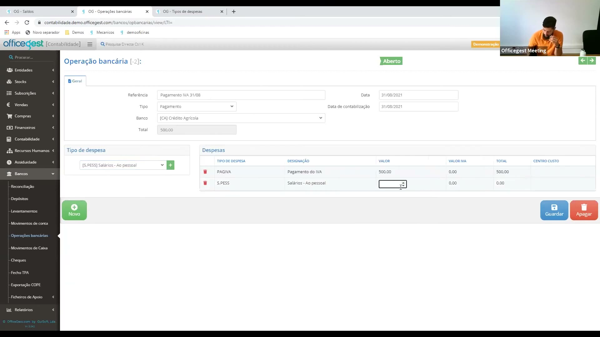

- Cabeçalho: Referência, **Tipo** (Pagamento ou recebimento), **Banco**, Data e **Data de contabilização**.
- Linhas: escolhe-se um **Tipo de despesa** e acrescenta-se com o botão **+**. Cada linha tem Valor, Valor IVA, Total e Centro Custo.
- **Uma operação pode ter vários tipos de despesa.** No exemplo: Pagamento do IVA 500 € e Salários - Ao pessoal 200 €, numa só operação de 700 €.
- Depois de gravada, a operação fica **Fechado** e tem um botão **Contabilidade**.

### 6.2 Tipos de despesas

**Caminho:** Bancos → Ficheiros de Apoio → **Tipos de despesas**.

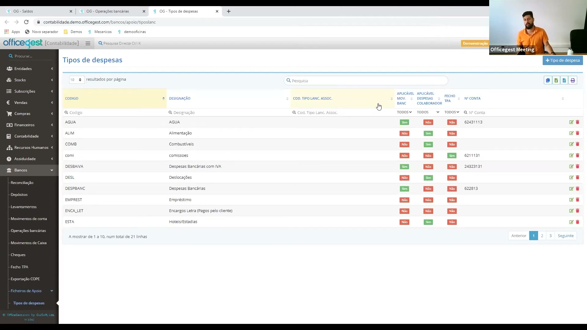

Cada tipo diz **onde pode ser usado** (três colunas) e, opcionalmente, a **conta da contabilidade**:

| Código | Designação | Aplicável Mov. Banc | Aplicável Despesas Colaborador | Fecho TPA | Nº Conta |
|---|---|---|---|---|---|
| AGUA | AGUA | Sim | Não | Não | 62431113 |
| ALIM | Alimentação | Não | Sim | Não | |
| COMB | Combustíveis | Não | Sim | Não | |
| comi | comissoes | Não | Não | **Sim** | 6211131 |
| DESBAIVA | Despesas Bancárias com IVA | Sim | Não | Não | 24323131 |
| DESL | Deslocações | Não | Sim | Não | |
| DESPBANC | Despesas Bancárias | Sim | Não | Não | 622813 |
| EMPREST | Empréstimo | Não | Não | Não | |
| ENCA_LET | Encargos Letra (Pagos pelo cliente) | Não | Não | Não | |
| ESTA | Hoteis/Estadias | Não | Sim | Não | |

(21 tipos ao todo; estão aqui os 10 primeiros.)

- **Aplicável Mov. Banc:** o tipo aparece nas operações bancárias e nos movimentos de caixa. **Um tipo que não tenha esta opção não aparece na lista**, mesmo que exista.
- **Aplicável Despesas Colaborador:** o tipo é usado nas despesas dos colaboradores (outro módulo).
- **Fecho TPA:** o tipo é usado para a comissão no fecho de TPA (secção 9). Só deve haver um.

O formulário de um tipo de despesa tem Código, Designação, **Tipo Lançam. Assoc.**, **Nº Conta**, **Cód. IVA** e as três opções.

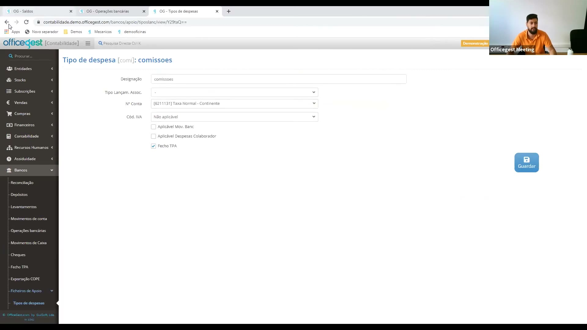

No vídeo criou-se o tipo **PAGIVA – Pagamento do IVA**, sem IVA, aplicável aos movimentos bancários.

## 7. Movimentos de caixa (≈ 43:40–46:50)

**Caminho:** Bancos → **Movimentos de Caixa**.

É o equivalente das operações bancárias para o **numerário**. O campo **Tipo** tem:

- **Transferência:** passa dinheiro de uma caixa para outra (Caixa entrada, Caixa saída, Total). No exemplo: 50 € da caixa Defeito para a Caixa Central.
- **Saída / pagamento** e **Entrada / recebimento:** pede o tipo de despesa (os mesmos da secção 6.2) e a caixa.

O movimento gravado fica **Fechado** e tem os botões Imprimir, Duplicar e Contabilidade.

## 8. Relatórios de bancos (≈ 46:50–53:15)

### 8.1 Extrato de movimentos de contas

**Caminho:** Relatórios → Bancos → **Extrato de movimentos de contas**.

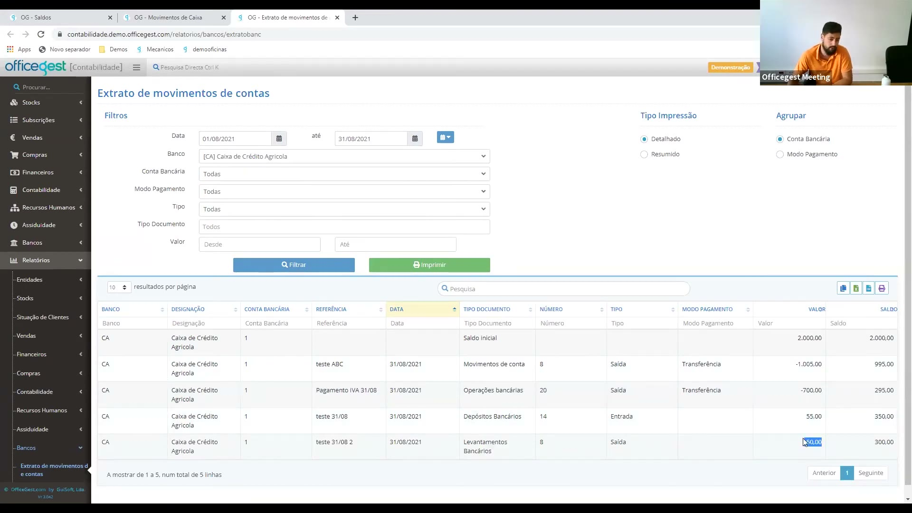

É o "extrato" do banco **visto pelo OfficeGest**. No exemplo, para o Crédito Agrícola em agosto de 2021:

| Tipo Documento | Referência | Tipo | Modo Pagamento | Valor | Saldo |
|---|---|---|---|---|---|
| Saldo inicial | | | | 2.000,00 | 2.000,00 |
| Movimentos de conta | teste ABC | Saída | Transferência | -1.005,00 | 995,00 |
| Operações bancárias | Pagamento IVA 31/08 | Saída | Transferência | -700,00 | 295,00 |
| Depósitos Bancários | teste 31/08 | Entrada | | 55,00 | 350,00 |
| Levantamentos Bancários | teste 31/08 2 | Saída | | -50,00 | 300,00 |

Filtros: Data, Banco, Conta Bancária, Modo Pagamento, Tipo, Tipo Documento, Valor. Pode agrupar-se por Conta Bancária ou por Modo Pagamento, em versão detalhada ou resumida.

### 8.2 Conta corrente caixa

O mesmo, por posto / caixa. Mostra o saldo inicial (numerário e cheque), os depósitos, os movimentos de caixa e as faturas-recibo que entraram nessa caixa. Tem um tipo de impressão **Balancete**.

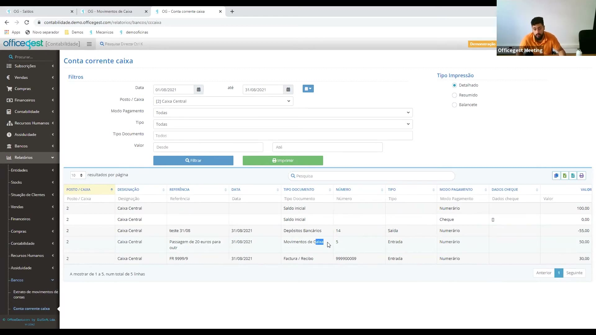

### 8.3 Despesas do banco e Despesas de caixa

Somam as operações bancárias (ou os movimentos de caixa) **por tipo de despesa**. Respondem a perguntas como "quanto paguei de IVA este ano?". Têm uma **Listagem** e um **Mapa anual**, ordenados por banco ou por tipo de despesa.

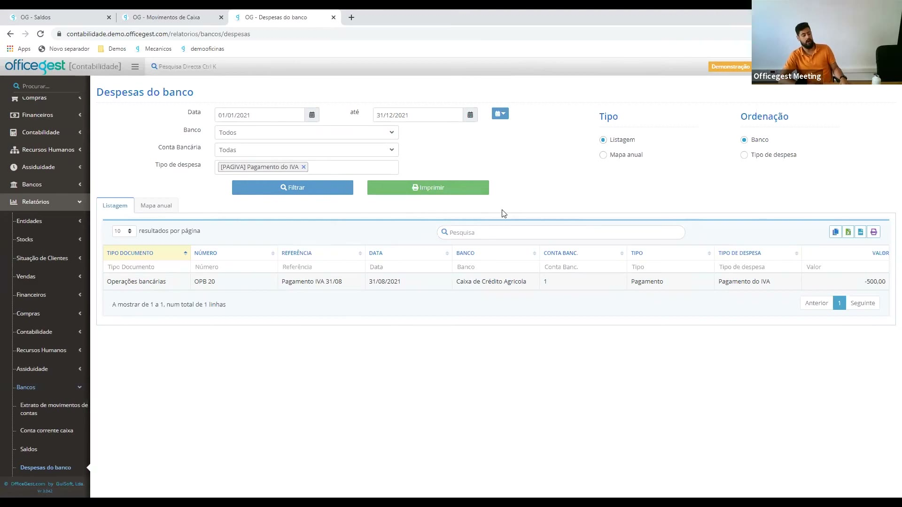

Outro uso sugerido: criar o **cartão de refeição** como conta bancária, e ver por estes relatórios quanto se pagou em vales de refeição e em que caixa ou banco.

### 8.4 Cheques

**Caminho:** Bancos → **Cheques**. Lista os cheques recebidos e emitidos, com Data Cheque, Nº Cheque, Banco, Valor, Estado (**Recebido** / **Emitido**), **Conciliado**, Nº Talão Dep. e Data Depósito. Os que não têm talão nem data de depósito são os que ainda estão por depositar. Editar um cheque mostra o cliente e o documento a que pertence.

## 9. Fecho de TPA (≈ 54:20–1:03:15)

O TPA é o terminal de multibanco. O banco não entrega o valor de cada venda: entrega **o total do dia, menos a comissão**. O Fecho TPA serve para o OfficeGest ficar com o mesmo valor que aparece no extrato do banco.

**Caminho:** Bancos → **Fecho TPA** → Novo fecho TPA (Referência, Caixa, Banco, Data).

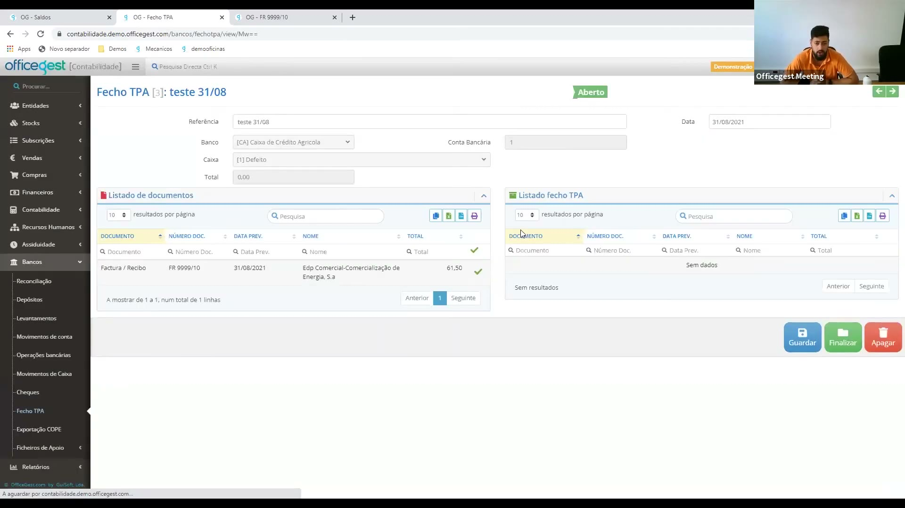

**Passos:**

1. À esquerda, o **Listado de documentos**: todos os recebimentos por **multibanco** dessa caixa e desse banco que ainda não entraram num fecho. No exemplo, uma fatura-recibo de 61,50 €.
2. "Picam-se" os documentos (um a um, ou todos) e passam para a direita, **Listado fecho TPA**. O Total fica em 61,50 €.
3. **Finalizar** abre a janela **Gerar movimentos**:

   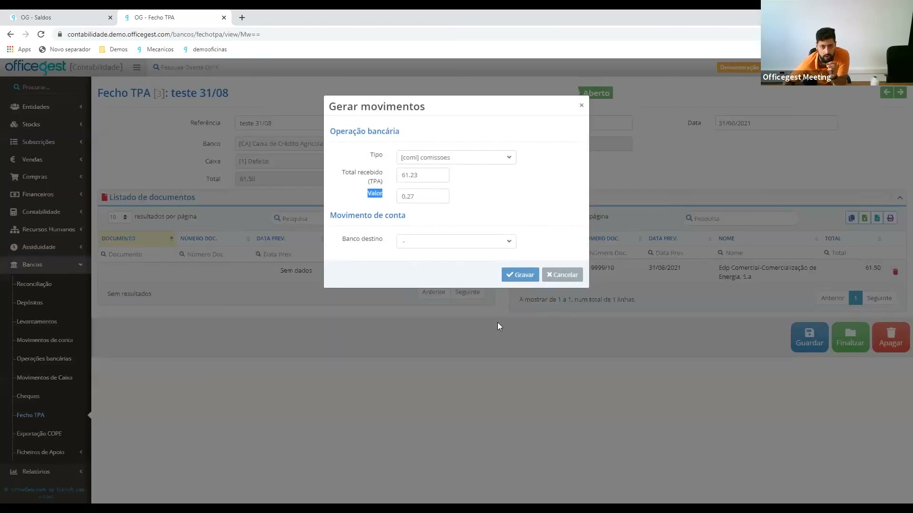

   - **Operação bancária:** Tipo (o tipo de despesa marcado como "Fecho TPA", no exemplo "[comi] comissoes"), **Total recebido (TPA)** e **Valor**. Escreve-se o valor que **realmente entrou no banco** (61,23) e o sistema calcula a diferença como comissão (0,27).
   - **Movimento de conta:** Banco destino. É opcional (ver abaixo).

4. Ao confirmar, o fecho passa a **Fechado**, com o total já líquido (61,23), e o sistema cria sozinho uma **operação bancária** com a comissão.

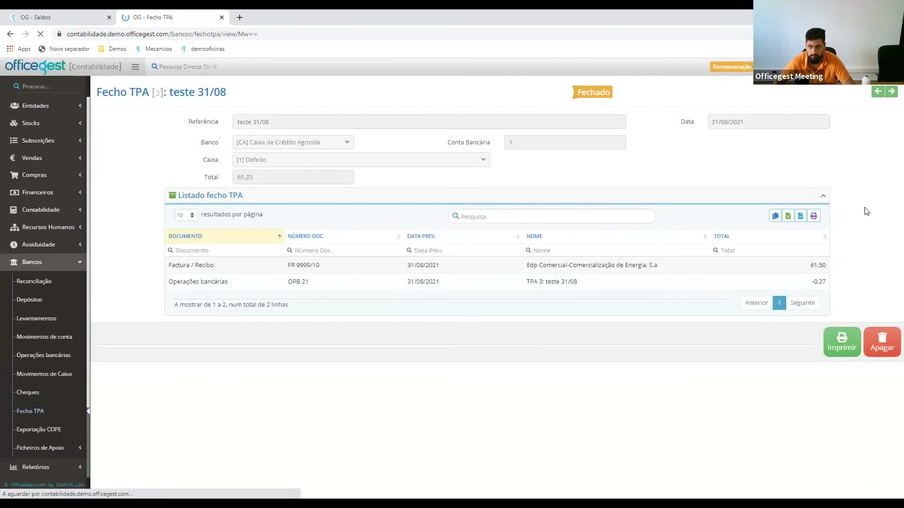

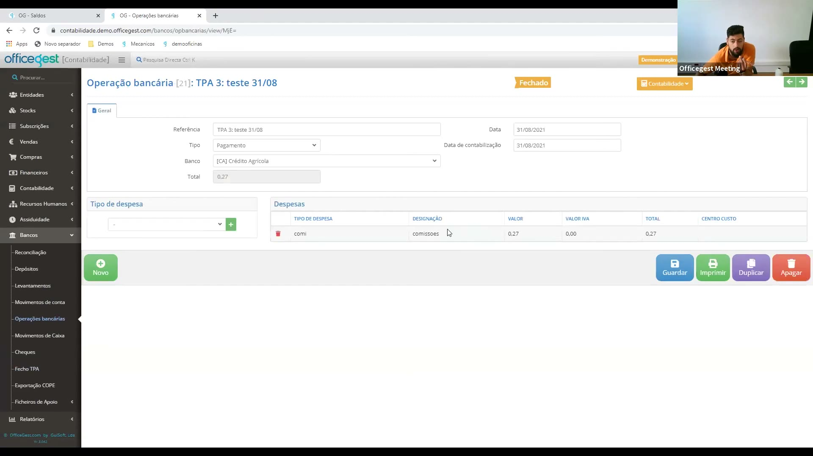

**O movimento de conta opcional.** Serve a quem recebe o multibanco numa **conta intermédia** (uma conta bancária "Multibanco", ligada na contabilidade a uma conta de caixa) e só passa o valor para o banco real no fecho. Com o **Banco destino** preenchido, o fecho cria também a transferência dessa conta para o banco. A opção liga-se em **Configurações → Parâmetros → Bancos**: **"Criar movimento de conta no fecho do TPA"**.

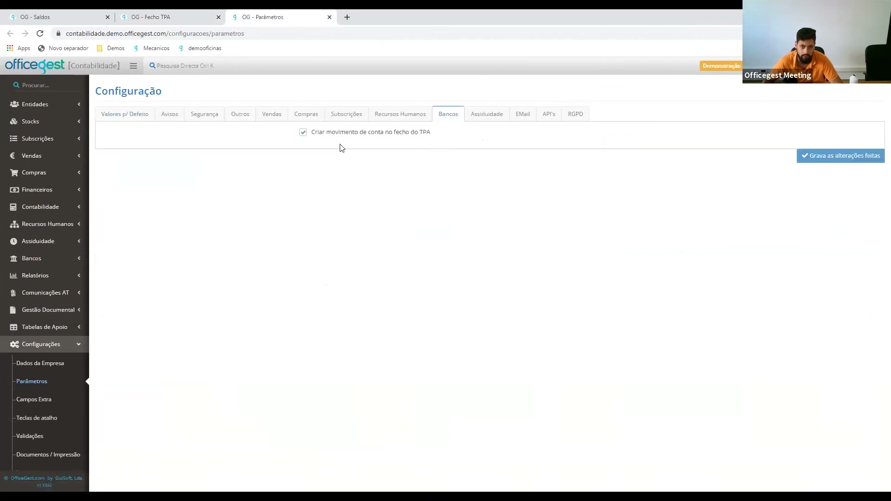

## 10. Reconciliação bancária (≈ 1:03:15–1:10:05)

Serve para confirmar que os movimentos que estão **no banco** estão refletidos **no OfficeGest**.

**Caminho:** Bancos → **Reconciliação** → **Extracto Bancário**.

### 10.1 Importar o extrato

O ficheiro é um **CSV**, tirado do banco online ou pedido ao banco. O botão **Exemplo** descarrega um ficheiro-modelo.

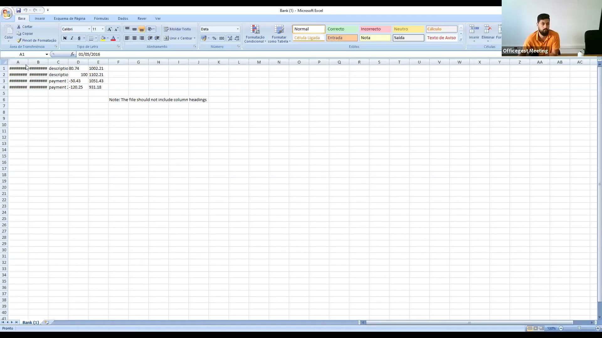

- O exemplo tem cinco colunas: duas datas, a descrição, o valor (positivo ou negativo) e o saldo.
- O próprio exemplo avisa: **"The file should not include column headings"**. O ficheiro não leva linha de títulos.

Na janela **Extracto Bancário** indica-se a Data Ini. Período, a Data Fim Período, uma Referência e o **Banco**, e larga-se o ficheiro. O sistema mostra as primeiras linhas e pede que se diga **o que é cada coluna**.

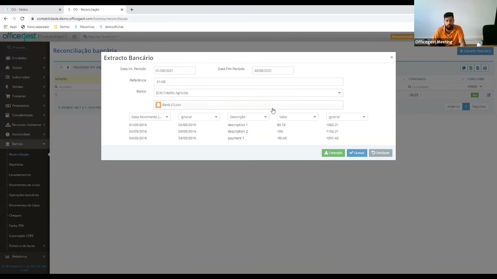

As opções vistas para cada coluna são **Data Movimento**, **Descrição**, **Valor** e **Ignorar**. No exemplo: 1.ª coluna = Data Movimento, 2.ª = Ignorar, 3.ª = Descrição, 4.ª = Valor, 5.ª (saldo) = Ignorar.

### 10.2 O ecrã da reconciliação

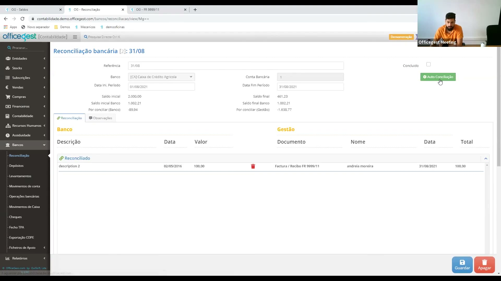

O cabeçalho mostra dois saldos lado a lado e o que falta emparelhar em cada um:

| | Gestão (OfficeGest) | Banco (extrato) |
|---|---|---|
| Saldo inicial | 2.000,00 | 1.002,21 |
| Saldo final | 461,23 | 1.002,21 |
| Por conciliar | -1.638,77 | -89,94 |

Em baixo há duas zonas: **Reconciliado** (os pares já feitos) e **Não reconciliado**, esta com duas listas.

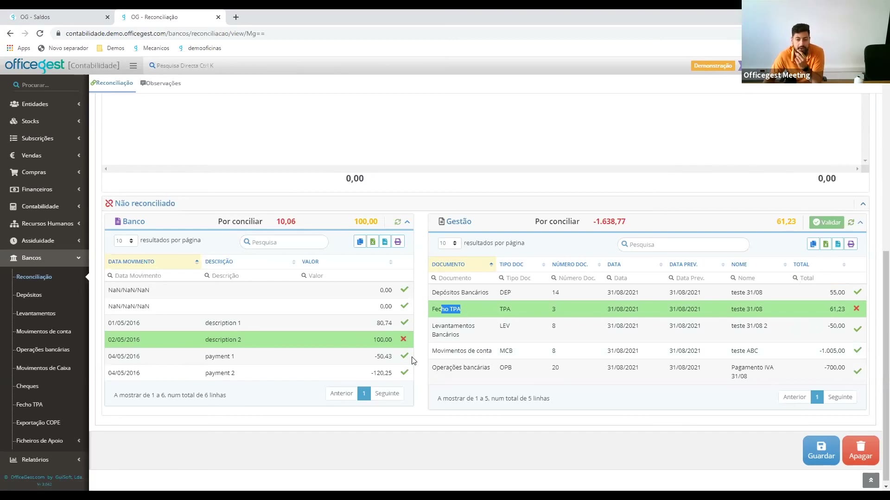

- **Banco** (esquerda): as linhas do extrato importado, com Data Movimento, Descrição e Valor.
- **Gestão** (direita): **todos os movimentos registados no OfficeGest** para esse banco no período. No exemplo: Depósitos Bancários, **Fecho TPA**, Levantamentos Bancários, Movimentos de conta e Operações bancárias. Os documentos recebidos por transferência também aparecem aqui.
- **Emparelhar à mão:** marca-se uma linha do banco e uma **ou várias** linhas da gestão, e carrega-se em **Validar**. O par passa para a zona Reconciliado. Uma linha do banco pode corresponder a vários documentos (o exemplo dito é um valor de 123 do banco que corresponde a três documentos).
- **Auto Conciliação:** o botão verde emparelha sozinho as linhas cujos **valores são iguais** dos dois lados. Fica por fazer à mão só o que sobra.
- Um par reconciliado pode desfazer-se com o ícone do caixote.
- No exemplo, uma fatura-recibo de 100 € recebida por transferência foi emparelhada com a linha "description 2" de 100,00 do extrato.

> **Detalhe visível no ecrã:** na lista do banco aparecem duas linhas com a data **"NaN/NaN/NaN"** e valor 0,00. Vêm das linhas do ficheiro de exemplo que não são movimentos (a linha vazia e a linha da nota). O ficheiro deve trazer **só movimentos**.

### 10.3 Fechar e imprimir

- A reconciliação **pode ficar aberta** e continuar-se noutro dia (botão **Guardar**).
- Quando está terminada, marca-se **Concluído**. Passa a haver um botão **Imprimir**, que pergunta qual relatório se quer: **Relatório Reconciliado** ou **Relatório Não reconciliado**.

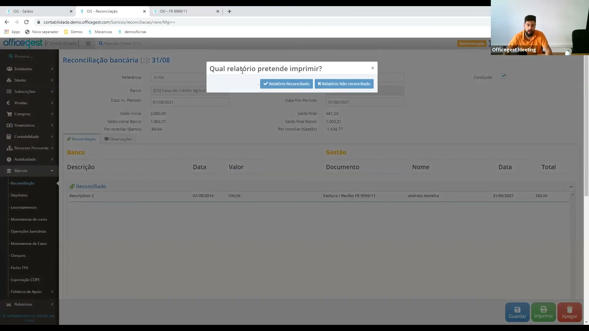

## O que foi anunciado como futuro

Dito em agosto de 2021. **Falta verificar se existe hoje.**

- Na "próxima versão", um **caixote do lixo nas linhas do banco**, para apagar linhas do extrato importado que entraram por engano (por exemplo, de outro banco). Até aí, só a OfficeGest as podia eliminar.

A descrição do vídeo refere também **SEPA**, "Automatismos, Notificações e Alarmística"; **nada disso foi demonstrado**. O menu **Exportação COPE** também não foi aberto.

---

## O que este vídeo pode responder no projeto winners-group

Perguntas consultadas em 2026-10-02 (revisão; a versão anterior era de 2026-10-02, feita com leitura parcial) em: `docs/dependencias-externas.md`, `docs/pendentes.md` e `contabilidade/processo-atual/perguntas-em-aberto.md` do projeto `C:\projetos\winners-group`, lidos por inteiro, mais o registo de vídeos `docs/fontes-videos.md`. A tabela é o retrato desse dia: se as perguntas mudarem, pede-se nova revisão.

Tudo o que está na coluna do meio é **segundo a formação de 2021-08 (versão 3.042)** e continua **por confirmar no OfficeGest atual**. Os instantes entre parênteses são ecrãs guardados em [`ecras/`](ecras/). O projeto já absorveu este vídeo a 02/10/2026; as perguntas C-26 e C-27 nasceram dele.

| Pergunta (código e texto no projeto) | O que o vídeo mostra | O que ficou por ver |
|---|---|---|
| **OG-3** — O OfficeGest tem importação de extratos e reconciliação bancária? | Extrato **só em CSV**, sem linha de títulos, com identificação das colunas, e **Auto Conciliação por valor igual**. Uma linha do banco pode emparelhar com **vários** documentos; a reconciliação pode ficar aberta; há relatórios do reconciliado e do não reconciliado. Novo nesta revisão: (1) a lista "Gestão" tem as colunas **Data** e **Data Prev.** ([1:08:14](ecras/1-08-14.jpg)); (2) no emparelhamento **à mão**, uma linha do extrato com data de 02/05/2016 foi aceite com uma fatura-recibo de 31/08/2021 ([1:09:20](ecras/1-09-20.jpg)): à mão, a data não é verificada; (3) o extrato de exemplo, de 2016, foi importado num período de agosto de 2021 sem aviso ([1:05:56](ecras/1-05-56.jpg)); (4) as duas listas do "Não reconciliado" têm botões de copiar, **Excel**, **CSV** e imprimir. | Como trata dois documentos com o mesmo valor: **não responde**. Que data a *Auto Conciliação* usa, e com que tolerância: não se vê. Se há API de movimentos: **não responde**. |
| **C-26** — Como regista a equipa os movimentos do banco sem documento? Os tipos de despesa têm conta da contabilidade? | O caminho do produto é a **operação bancária** com um ou vários **tipos de despesa** ([43:20](ecras/43-20.jpg)); só depois de registada aparece no lado "Gestão". Novo nesta revisão: na demo, **só 4 dos 10 primeiros tipos** têm conta da contabilidade (AGUA, comissoes, Despesas Bancárias com IVA, Despesas Bancárias) ([40:57](ecras/40-57.jpg)); a fala diz que a conta se preenche "caso tenham o módulo" de contabilidade ativo. Cada linha da operação tem também um **Centro Custo**. | O lançamento gerado pelo botão *Contabilidade* não foi aberto. O que a Winners faz é pergunta para a Winners. |
| **C-27** — As oficinas fazem o Fecho de TPA? Quem o faz? | O *Fecho TPA* junta os recebimentos por multibanco de uma caixa e de um banco, pede o valor que entrou e lança a diferença como comissão, numa operação bancária criada sozinha ([1:03:09](ecras/1-03-09.jpg)). No lado "Gestão" da reconciliação fica **uma linha "Fecho TPA"** com o valor líquido ([1:08:14](ecras/1-08-14.jpg)). | Se as oficinas o fazem e quem: pergunta para a Winners. |
| **C-9** — Que impostos são registados no fecho? Os pagamentos aparecem como movimentos sem documento? | Sim, do lado do produto: o **pagamento do IVA** e o dos **salários** são os exemplos de operação bancária. O relatório *Despesas do banco* soma por tipo de despesa, com mapa anual. | Retenções, Segurança Social e PEC/PPC não são referidos. |
| **AT-3** — De onde vêm os dados dos pagamentos de impostos? | **Não responde.** O valor é escrito à mão na operação bancária. | — |
| **B-1** — Com que bancos trabalham as oficinas, e em que formato chega o extrato? | Do lado do OfficeGest: **CSV, sem títulos, só com movimentos**. O ficheiro tira-se do banco online ou pede-se ao banco (fala, ≈ 1:04:20–1:04:55). As linhas que não são movimentos entram como "NaN/NaN/NaN" ([1:08:14](ecras/1-08-14.jpg)) e em 2021 não se podiam apagar. | O que cada banco entrega: pergunta para a Winners. |
| **B-2** — Quem obtém o extrato? Faz sentido um agregador (PSD2)? | **Não responde.** Só se vê o carregamento de ficheiro; nenhuma importação direta do banco. | A "EBank" vista na demo de 2026. |
| **C-5** — O que é o ficheiro de performance? | Relatórios do menu *Relatórios → Bancos*: *Extrato de movimentos de contas*, *Conta corrente caixa*, *Saldos*, *Despesas do banco*, *Despesas de caixa* ([51:42](ecras/51-42.jpg)), e *Gestão de fluxos de caixa*. Centro de custo nas linhas das operações bancárias. | Se o ficheiro de performance usa números de tesouraria. |
| **C-16** — O processamento salarial é feito no OfficeGest? | Só uma frase: o formador diz que o processamento de salários se pode fazer dentro do OfficeGest (≈ 03:45–04:15), e mesmo assim o **pagamento** regista-se como operação bancária. | Não é mostrado. |
| **OG-10** — Que funcionalidades estão licenciadas e em uso? | A fala diz que o módulo Bancos vem "de base" ❓ e que há módulos a que os clientes "ainda não têm acesso" (≈ 00:00–02:00). Os *Parâmetros* desta demo (pacote Contabilidade) têm separadores de Subscrições, Recursos Humanos, **Bancos** e Assiduidade ([1:02:30](ecras/1-02-30.jpg)). | O que a Winners e as oficinas têm. |
| **OG-9** e **OG-6** — importador do e-Fatura; DMS | **Não responde.** *Comunicações AT* e *Gestão Documental* veem-se no menu ([1:02:30](ecras/1-02-30.jpg)), mas não são abertos. | — |
| **D-3** — Que funcionalidades nativas a Winners já usa? | Para o inventário: Fecho TPA, operações bancárias com tipos de despesa, depósitos e levantamentos, movimentos de conta e de caixa, e os relatórios de bancos. | O uso é pergunta para a Winners. |
| Sem código: **regra do risco irreversível** (citada nas notas do projeto) | Finalizar um depósito pede confirmação com o aviso de que é **irreversível**. ⚠️ **Divergência com o projeto:** o projeto regista que as operações bancárias ficam "Fechado" e não se desfazem. No ecrã, uma operação bancária **Fechado** e um movimento de caixa **Fechado** têm os botões *Guardar*, *Imprimir*, *Duplicar* e **Apagar** ([1:03:09](ecras/1-03-09.jpg), [51:42](ecras/51-42.jpg)). O botão não foi carregado. Um par reconciliado desfaz-se no caixote; a reconciliação inteira também tem *Apagar*. | Se "Apagar" funciona num registo fechado, e o que acontece ao lançamento. |

As restantes perguntas em aberto (OG-4, OG-5, OG-7, OG-8, API-1 a API-3, AT-1, AT-2, AT-4, COM-1, C-2, C-3, C-11, C-12, C-18, C-19, C-21, C-24, D-1, D-2 e as perguntas de volume e de âmbito) não são tocadas por este vídeo.

**Perguntas sugeridas** (o vídeo levanta, o projeto ainda não tem):

- As contas bancárias das oficinas têm **data de início e saldo inicial** preenchidos? Sem isso, os saldos e a reconciliação partem de um valor errado (≈ 08:30–10:00).
- As oficinas guardam o dinheiro e só o depositam de vez em quando? Usam uma **conta intermédia**, como o formador sugere? (≈ 24:10–26:15)
- A lista que a equipa manda à oficina com os movimentos por explicar é o **Relatório Não reconciliado** do OfficeGest, ou é feita à mão?

**A rever no texto acima** (não corrigido nesta revisão, que só mexe na ligação): as secções 6.1 e 7 dizem que a operação bancária e o movimento de caixa ficam "Fechado", sem referir que o ecrã mostra um botão **Apagar**; a secção 10.2 não refere a coluna **Data Prev.**, os botões de exportação das duas listas nem o separador *Observações*; a secção 10.1 não refere que o período pedido e as datas do ficheiro não são confrontados.

O projeto winners-group **não foi editado**: é ele que decide o que absorve.

## Pontos a verificar no sistema atual

- [ ] O menu **Bancos** continua com estas entradas? Existe agora uma importação direta do banco ("EBank")? (B-2)
- [ ] A reconciliação continua a aceitar **só CSV sem títulos**? Que colunas pede hoje? (B-1)
- [ ] Já existe o **caixote do lixo** nas linhas do banco, anunciado em 2021?
- [ ] A Auto Conciliação continua a emparelhar **só por valor igual**? O que faz com dois movimentos do mesmo valor? (OG-3)
- [ ] As oficinas têm as **contas bancárias com saldo inicial** e data de início preenchidos?
- [ ] As oficinas fazem **Fecho TPA**? Existe o tipo de despesa das comissões, com conta da contabilidade? (C-27)
- [ ] Como regista a Winners os pagamentos de **IVA, salários e Segurança Social**: por operação bancária, ou direto na contabilidade? (C-26)
- [ ] Que **tipos de despesas** existem em cada oficina, e quais têm conta da contabilidade? (C-26)
- [ ] O módulo Bancos vem mesmo em todas as licenças? (OG-10)
- [ ] A *Auto Conciliação* compara a **Data** ou a **Data Prev.**, e com que tolerância? O emparelhamento à mão continua a aceitar qualquer data? (OG-3)
- [ ] Uma operação bancária, um movimento de caixa ou um fecho de TPA **Fechado** pode ser apagado? O que acontece ao lançamento da contabilidade? (regra do risco irreversível)
- [ ] As listas do "Não reconciliado" ainda exportam para **Excel e CSV**?
- [ ] O que lança na contabilidade o botão *Contabilidade* de uma operação bancária cujo tipo de despesa **não tem conta**? (C-26)

## Limites desta versão

- Os **ecrãs** são a fonte mais fiável dos nomes e dos valores. A **explicação** do porquê vem de legendas automáticas com muitos erros; onde a fala não era clara, ficou a marca ❓. Há **1 ponto** com ❓ (se o módulo Bancos vem na versão de base), repetido na checklist.
- Não foram demonstrados: **SEPA**, **Exportação COPE**, a **Previsão financeira**, os **Modos de Pagamento** e as despesas de colaboradores.
- Os lançamentos contabilísticos gerados por cada operação (o botão **Contabilidade**) não foram abertos neste vídeo; o apresentador remete para a formação de contabilidade.
- A reconciliação foi mostrada com o **ficheiro de exemplo** (datas de 2016, quatro linhas), e não com um extrato real. O comportamento com centenas de linhas e com valores repetidos não se vê.
- Os nomes de clientes e os valores dos ecrãs são da **conta de demonstração**.
