# Webinar #2: Contabilidade OfficeGest

> 🔁 **Há um vídeo mais recente sobre o mesmo tema:** [Formação Prática Módulo Contabilidade](../formacao-pratica-modulo-contabilidade/dissertacao.md) (gravado em 2021-09, v3.043). Repete a parametrização com mais detalhe e acrescenta as declarações (Modelo 10), a contabilidade analítica e o reencaminhamento de contas. A secção "O que mudou desde o webinar de 2020" dessa dissertação lista as diferenças. Esta continua a ser a melhor fonte para o botão de contabilização na fatura, o SAF-T e as taxonomias.

| | |
|---|---|
| **Vídeo** | [youtu.be/vW9GhkTXmNU](https://www.youtube.com/watch?v=vW9GhkTXmNU) |
| **Canal** | Officegest (canal oficial) |
| **Apresentador** | Pedro Jordão (nome no ecrã) |
| **Publicado em** | 2020-06-03 |
| **Duração** | 46:37 |
| **Processado em** | 2026-10-01 |
| **Fonte do texto** | Legendas automáticas do YouTube (pt), com muitos erros, **corrigidas pelos ecrãs**. Os nomes de menus e campos abaixo foram lidos nos screenshots |
| **Ecrãs** | 194 capturados em [`ecras/`](ecras/); os mais úteis estão embutidos abaixo |
| **Versão do OfficeGest** | **vr 2.220** (rodapé do menu), em ambiente "Demonstração", exercício A2020 |

> ⚠️ **Vídeo com mais de 6 anos.** Tudo o que está abaixo descreve o OfficeGest **como era em junho de 2020, na versão 2.220**. Trate cada afirmação como **hipótese**, com a forma "segundo o webinar de 2020-06", até ser confirmada no sistema atual. Os screenshots servem para comparar: se o ecrã de hoje for diferente, houve mudança.
>
> ❓ = ponto que nem a fala nem o ecrã deixam claro.

---

## Resumo

É uma formação do canal oficial sobre o **módulo de contabilidade** do OfficeGest, feita como demonstração ao vivo na conta de demonstração. O fio condutor é **parametrizar uma vez para que os documentos de vendas e compras passem sozinhos para a contabilidade**. A ordem é esta:

1. **Classificação de artigos.** Cada artigo tem uma classificação, e essa classificação diz em que contas de venda, compra, IVA e devolução o artigo é lançado, por taxa de IVA e por mercado.
2. **Contas de terceiros.** As contas de clientes (211…) e de fornecedores (221…) são criadas automaticamente.
3. **Contas bancárias e caixa.** Definem a conta de recebimentos e de pagamentos de cada banco.
4. **Lançamentos.** Há três formas de lançar: na própria fatura, em massa pelo ecrã **Lançamentos em lote**, ou por **integração automática diária**, configurada por mês no exercício, com relatório de erros por email. Existem também lançamentos manuais e lançamentos recorrentes.
5. **Declaração periódica de IVA.** Cada campo da declaração soma as contas associadas a ele. A declaração exporta em XML e imprime.
6. **SAF-T e taxonomias.**
7. **Relatórios e Mapas** personalizáveis, exportáveis para Excel.
8. **Apuramento de IVA e de resultados.**

### Onde fica cada coisa (versão 2.220)

Todo o módulo de contabilidade está no menu lateral **Contabilidade**:

- Plano de Contas · Lançamentos · **Lançamentos em lote** · **Apuramento de resultados/I.V.A.** · Centros de Custo · **Declaração periódica** · Exportar
- **Ficheiros de Apoio** → Exercícios · Documentos · Diário · Apuramento · **Classificação de artigos** · **Mercados** · Reencaminhamento de contas · Reencaminhamento de centros de custo · **Lançamentos recorrentes** · **Taxonomias** · **Parâmetros**

Fora dele ficam:

- **Stocks → Ficheiros de Apoio → Famílias**
- **Tabelas de Apoio → Financeiros → Contas Bancárias**
- **Relatórios → Contabilidade** (balancetes, extratos, balanço, demonstração de resultados, mapas)
- **Relatórios → Automáticos**
- **Comunicações AT** → Exportar SAFT-PT · Inventário · Importação E-fatura

---

## 1. Classificação de artigos (≈ 04:00–12:40)

**Caminho:** Contabilidade → Ficheiros de Apoio → **Classificação de artigos**.

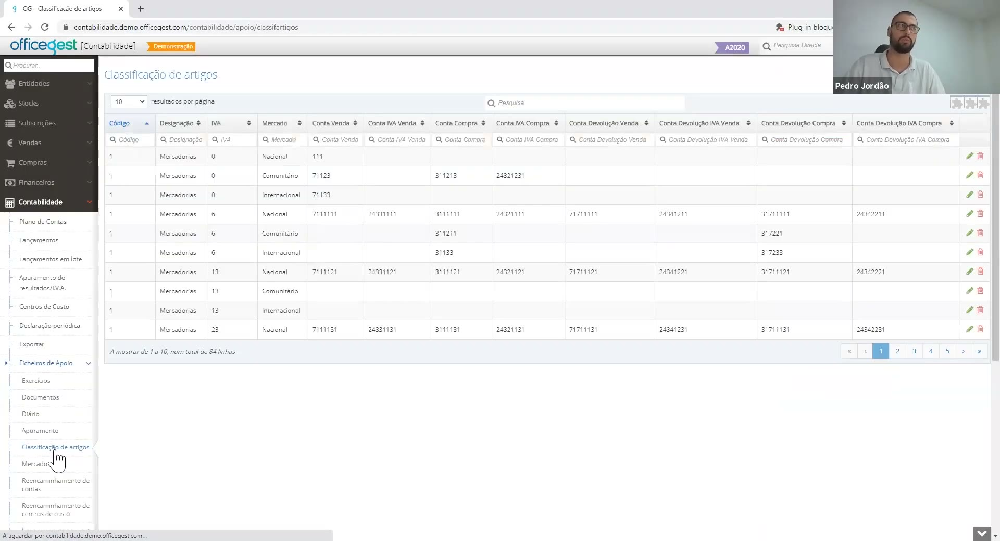

- A classificação é atribuída **por artigo**, e não por documento. Numa mesma fatura, cada linha pode ir para contas diferentes.
- O OfficeGest traz **um plano de contas próprio** (SNC), e as classificações iniciais vêm feitas sobre ele. Quem usar **um plano de contas seu** tem de refazer as classificações. Importar o SAF-T da contabilidade de outro programa com um plano diferente também traz dificuldades.
- Para criar uma classificação, usa-se o botão de nova classificação. O formulário tem **Classificação** (por exemplo, "[1] Mercadorias"), **IVA** (a taxa) e três separadores:
  - **Vendas:** Conta Venda · Conta IVA Venda · Conta Devolução Venda · Conta Devolução IVA Venda;
  - **Compras:** Conta Compra · Conta IVA Compra · Conta Devolução Compra · Conta Devolução IVA Compra;
  - **Inventário permanente.**
- Em cada separador há uma linha por **mercado**: **Nacional**, **Comunitário** e **Internacional**.

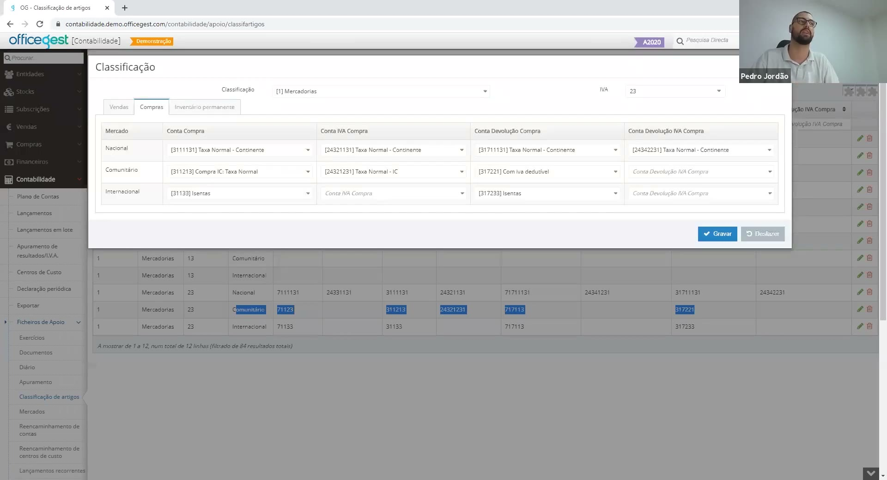

*Exemplo no ecrã (Mercadorias, 23 %, Compras):*

| Mercado | Conta Compra | Conta IVA Compra | Conta Devolução Compra | Conta Devolução IVA Compra |
|---|---|---|---|---|
| Nacional | 3111131 Taxa Normal – Continente | 24321131 Taxa Normal – Continente | 31711131 Taxa Normal – Continente | 24342231 Taxa Normal – Continente |
| Comunitário | 311213 Compra IC: Taxa Normal | 24321231 Taxa Normal – IC | 317221 Com IVA dedutível | — |
| Internacional | 31133 Isentas | — | 317233 Isentas | — |

Na lista, a mesma classificação nas **vendas, a 23 %, nacional** usa **7111131** (venda) e **24331131** (IVA liquidado).

**Como se atribui a classificação ao artigo:**

- **Por família** (o caminho recomendado para começar): em **Stocks → Ficheiros de Apoio → Famílias**, ao editar a família há um campo **Classificação do artigo**. Os artigos criados nessa família herdam a classificação.

  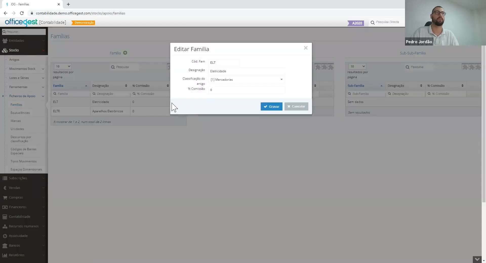

- **Por artigo:** na ficha do artigo existe o separador **Contabilidade**. A ficha também mostra o **Tipo Artigo** (por exemplo, "Contabilístico") e o **IVA**.

  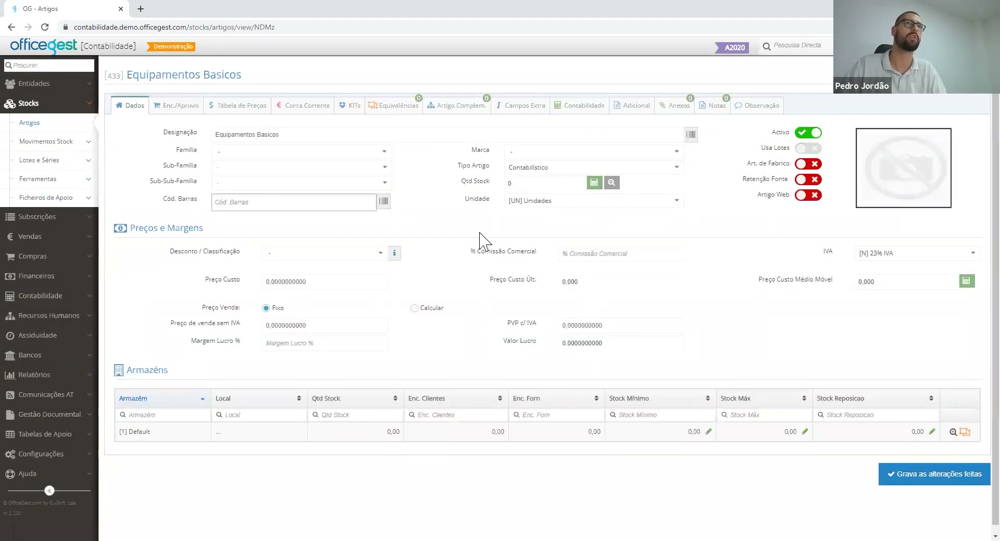

## 2. Contas de clientes e fornecedores (≈ 12:15–17:00)

O objetivo é que a conta de terceiro seja **criada automaticamente quando se cria a entidade**. São dois passos.

**Passo 1. Contabilidade → Ficheiros de Apoio → Parâmetros** (ecrã "Configuração", separador **Contas**):

- **Conta Base Clientes C/C = 211** e **Conta Base Forn. C/C = 221**, ambas com **Nº Digs. = 5** e a opção **Criar conta automaticamente**;
- no mesmo ecrã: as contas de descontos e proveitos financeiros (686 e 7822), os arredondamentos (7888 e 68888) e a retenção na fonte nas compras (2422).

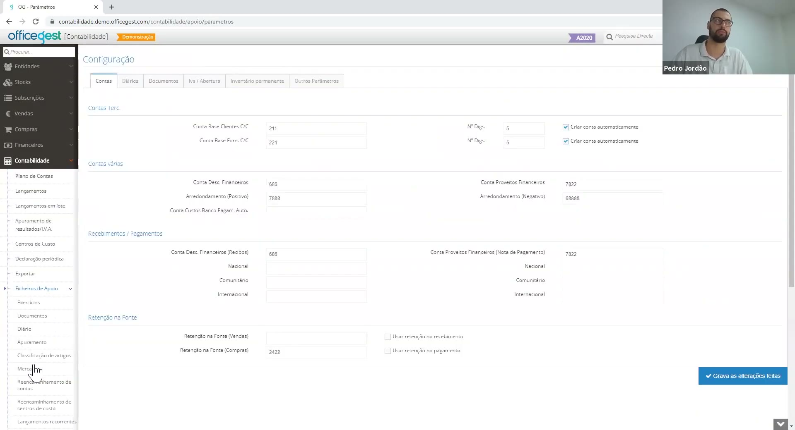

**Passo 2. Contabilidade → Ficheiros de Apoio → Mercados:** a conta base de clientes e de fornecedores **por mercado**. No ecrã: Nacional **21111 / 22111**, Comunitário **21112**, Internacional **21113 / 22113**.

- **Resultado:** a conta do cliente é a conta base do mercado mais o número do cliente. No ecrã aparecem, por exemplo, **2111100022** (cliente 22, nacional) e **2111100003**.
- Quem importou um plano de contas diferente terá de fazer uma **transferência de contas**.
- **Para entidades que já existem sem conta:** o botão **Criação de contas** abre uma janela com as opções **Clientes** e **Fornecedores** e um intervalo de datas de documentos emitidos, e cria as contas em falta. No exemplo, a resposta foi "Nenhuma conta foi criada", porque já existiam todas.

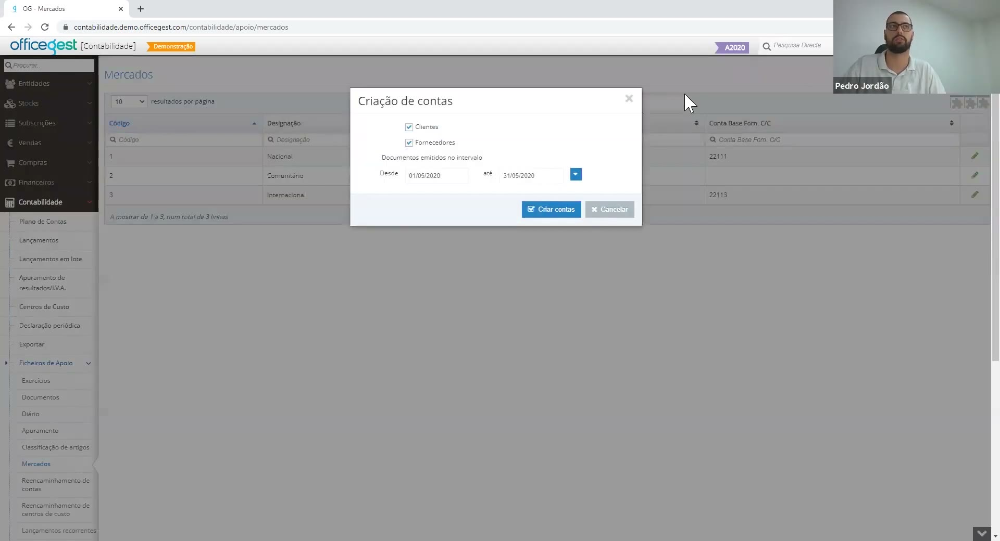

## 3. Contas bancárias e caixa (≈ 17:00–20:45 e 45:00–46:30)

**Caminho:** **Tabelas de Apoio → Financeiros → Contas Bancárias**.

- Cada conta (no exemplo: CGD, CXC – Caixa Defeito, Millennium BCP) tem, na secção **Contabilidade**, o **Nº Conta Contabilidade (Recebimentos)** e o **Nº Conta Contabilidade (Pagamentos)**. No exemplo: Caixa → **111**, Millennium BCP → **1201**.
- Existe a opção **"Assumir esta conta bancária como gestão de caixa / balcão"**.
- Os recebimentos em numerário vão para a caixa. Os recebimentos por multibanco ou transferência vão para o banco escolhido.

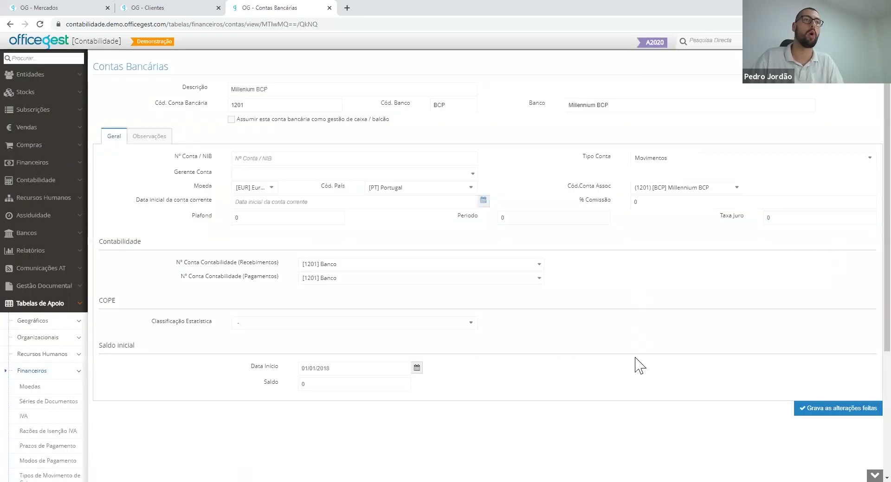

- **Banco novo:** primeiro cria-se a conta em **Contabilidade → Plano de Contas → Nova Conta** (o exemplo é a 1202). Depois, na conta bancária, escolhe-se essa conta.
- **Anunciado para "uma próxima versão" (2020):** tratar o TPA ou multibanco como uma conta de caixa própria e transferir para o banco no **fecho do TPA**. **Falta verificar se isto existe hoje.**

## 4. Lançamentos contabilísticos (≈ 20:45–30:15)

### 4.1 Na própria fatura

- Uma fatura emitida (no exemplo, **FT 9999/33**: cliente [22] Pedro, artigo a 23 %, 10,00 € + 2,30 € de IVA) tem no canto superior direito um botão laranja **"Contabili…"** ❓ (o nome está tapado pela imagem da câmara), que faz o lançamento.
- Se faltar conta no artigo, na entidade ou no banco (no caso do recibo), o sistema avisa e não lança.

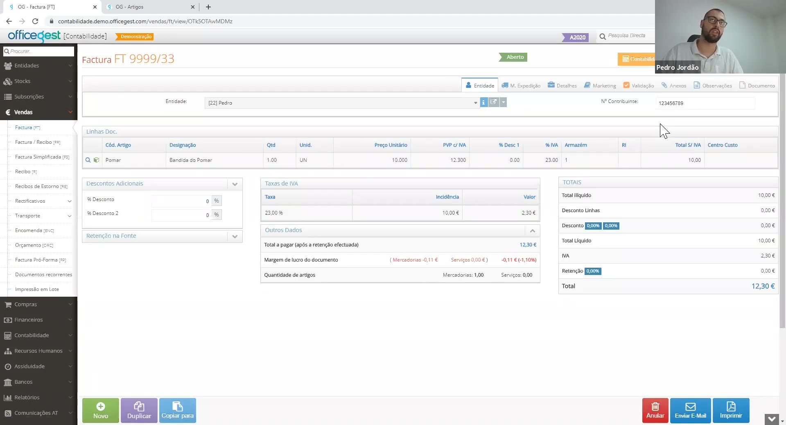

O lançamento resultante fica no **Diário [50] Vendas**, com o **Documento [51] N/Factura** e a origem FT 9999/33:

| Conta | Título | Débito | Crédito |
|---|---|---|---|
| 7111131 | Taxa Normal – Continente | | 10,00 |
| 24331131 | Taxa Normal – Continente | | 2,30 |
| 2111100022 | Pedro | 12,30 | |

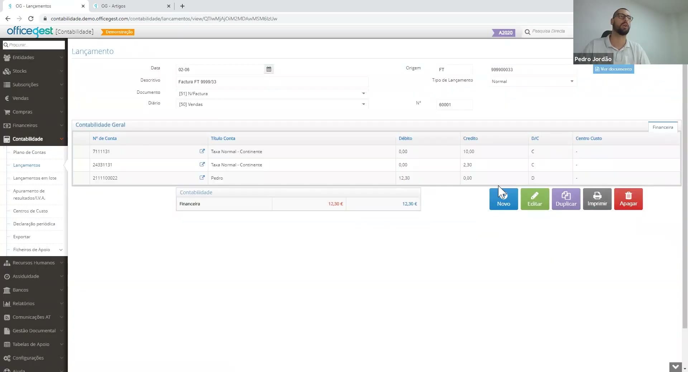

### 4.2 Em massa: **Lançamentos em lote**

**Caminho:** Contabilidade → **Lançamentos em lote**.

- **Filtros:** Data Lançamento Contabil. ou Data Doc. (desde / até), Diário, Documentos (com atalhos **Vendas**, **Compras** e **Bancos**) e Série de Documentos.
- **Botões:** **Filtrar**, **Validar** e **Processar**.
- A lista mostra os documentos ainda não lançados, com Tipo Doc., Documento, datas, Cód. Diário, Cód. Documento, Descritivo e uma caixa **Lançar**. À direita aparece a **pré-visualização** do lançamento do documento selecionado.
- **Validar** pinta **a vermelho** os documentos com problemas. **Processar** lança os documentos marcados e mostra o resultado, com o número de documentos lançados e a lista de erros.

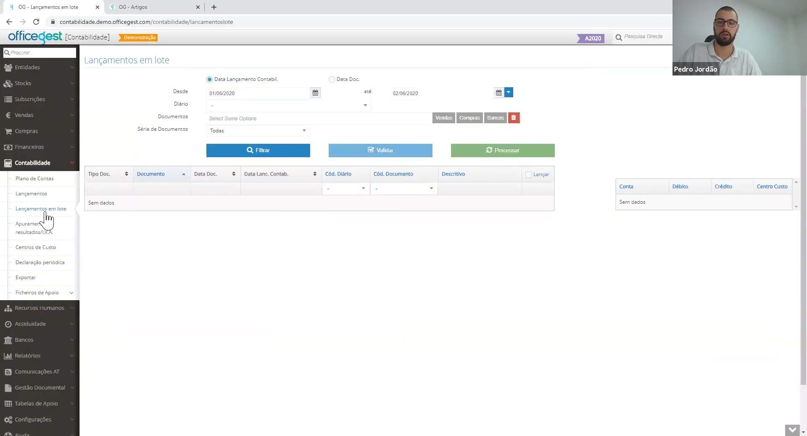

- **Regra vista no ecrã:** com o exercício A2020 ativo, os documentos de 2018 dão o erro **"Tem de comutar para um exercício compatível"**. O exercício tem de corresponder à data do documento.

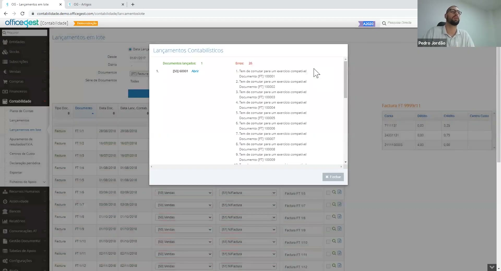

### 4.3 Integração automática diária

- **Contabilidade → Ficheiros de Apoio → Exercícios:** cada mês de cada exercício tem o estado (Aberto ou fechado) e uma opção **Integrar**. No exemplo, todos os meses de 2020 estão marcados. Segundo a fala, a integração corre **todos os dias, de madrugada**, e lança os documentos dos meses marcados que ainda não estão na contabilidade.

  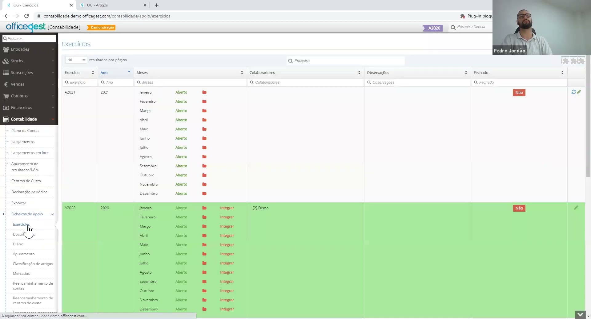

- Os documentos com contas em falta não são lançados. Os erros vão por email, configurados em **Relatórios → Automáticos** ("Relatórios automáticos por e-mail"), separador **Diário**, secção Contabilidade → **Integração Contabilidade**, onde se escolhe o destinatário (no exemplo, o Administrador).

  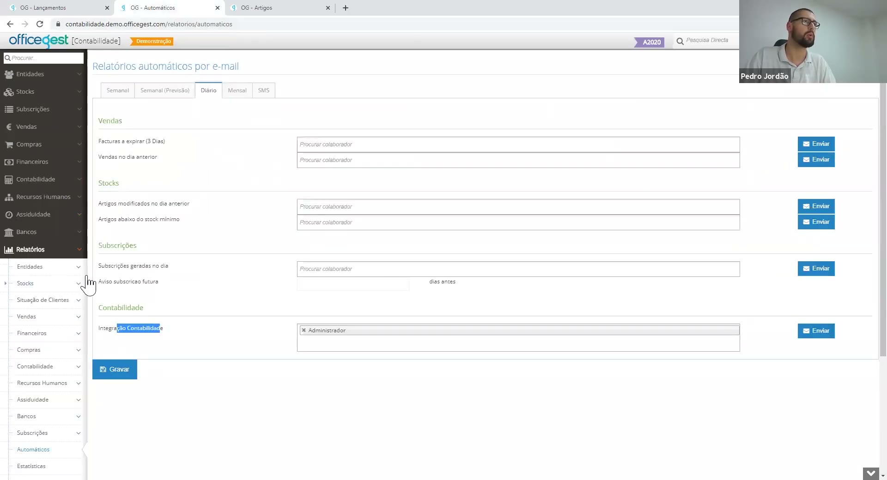

### 4.4 Lançamentos manuais e recorrentes

- **Contabilidade → Lançamentos → novo:** Data, Descritivo, Documento, Diário, Origem e Tipo de Lançamento (Normal), e as linhas de conta com débito e crédito. Os botões são **Guardar** e **Associar**.
- **Lançamentos recorrentes** (Contabilidade → Ficheiros de Apoio): cria-se um modelo com uma designação e uma lista de contas (no exemplo, 111 Caixa, 24331111 Taxa Reduzida – Continente e uma conta de fornecedor). Se a conta não existir no exercício, aparece o erro "Não existe essa conta no exercício".

  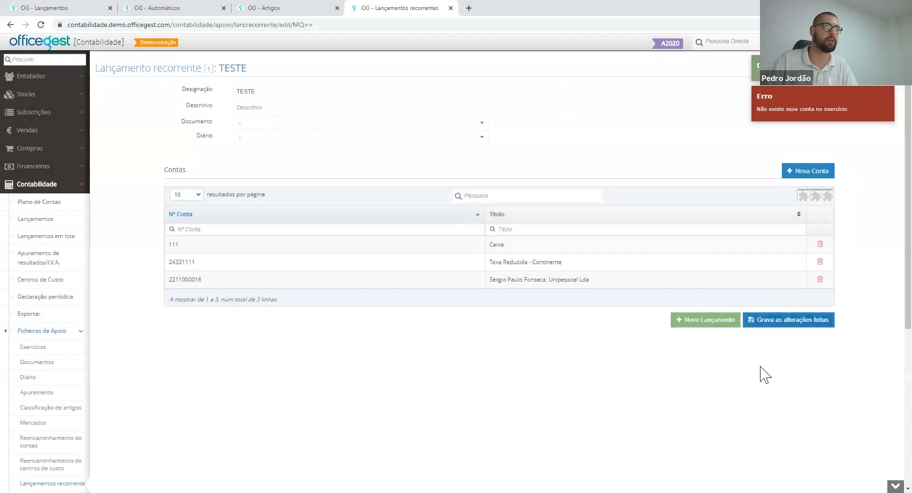

- No novo lançamento, o botão **Associar** → **"Associar lançamento recorrente"** preenche as contas. Só faltam os valores.

## 5. Declaração periódica de IVA (≈ 30:15–33:20)

**Caminho:** Contabilidade → **Declaração periódica**.

- A lista mostra o Período (por exemplo, "1º Trimestre"), o Ano, **A Pagar**, **A Recuperar** e o Estado (**Aberto** / **Fechado**). A **Nova declaração** pede o ano e o mês ou trimestre.
- A declaração é apresentada **com o aspeto do modelo oficial da AT**. Cada campo tem uma lupa que abre **"Contas do campo N"**: a lista de contas e, para cada uma, **Calcular = Saldo, Débito ou Crédito**. Podem retirar-se contas ou **adicionar** novas.

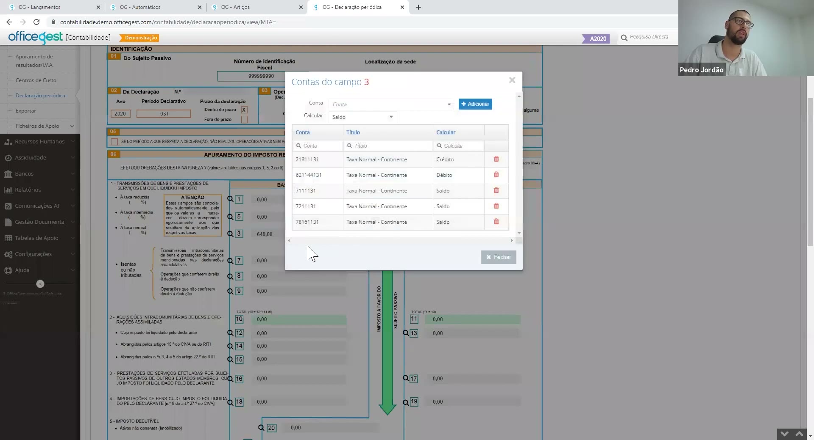

- **A ligação também se faz pela conta.** Em **Plano de Contas**, cada conta tem os campos **Campo na Declaração do IVA**, **Campo na Declaração do IVA (Anual)** e **Regularização**. É aqui que, segundo a fala, se indicam as contas dos **campos 40 e 41**. Cada conta tem ainda a **Taxa associada**, o **Tipo Conta** (Integração ou Movimento) e o **Código taxonomia**.

  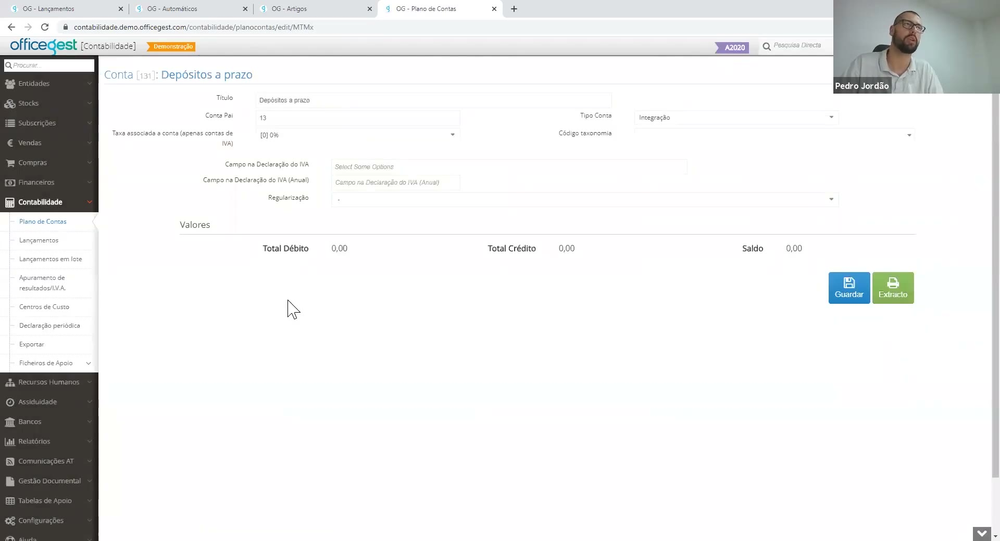

- Com as classificações e a integração bem feitas, os campos preenchem-se sozinhos.
- O botão **Finalizar** fecha a declaração. Depois aparecem os botões **Editar**, **Exportar** (gera o ficheiro `declaracao_periodica_….xml` para submeter nas Finanças) e **Imprimir** (PDF).

  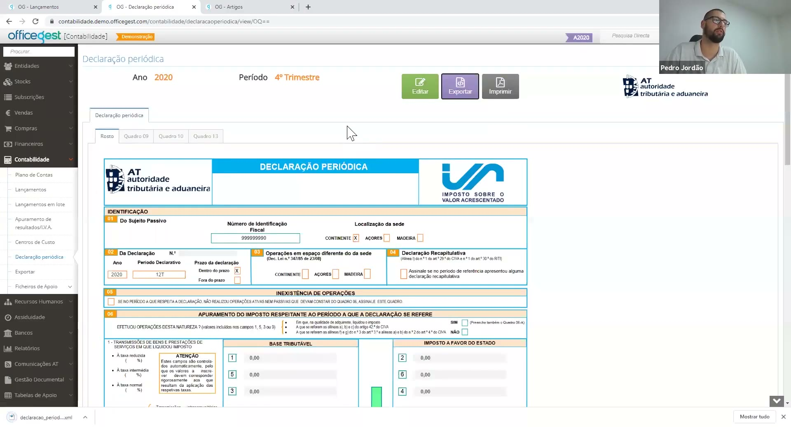

- Os **reembolsos** constavam da agenda, mas não foram demonstrados ❓.

## 6. SAF-T e taxonomias (≈ 33:20–36:00)

- **Comunicações AT → Exportar SAFT-PT** ("SAFT-PT: Gerar ficheiro"). Os passos são:
  1. o **formato**: Auditoria, Comunicação de documentos (envio mensal pelo portal das Finanças) ou **Contabilidade**, com a versão 1.04_01 (Portaria n.º 302/2016);
  2. o **período**: ano e **mês**. Segundo a fala, antes só se podia extrair por ano;
  3. o **formato de envio**: Ficheiro, ou Ficheiro & E-Mail.

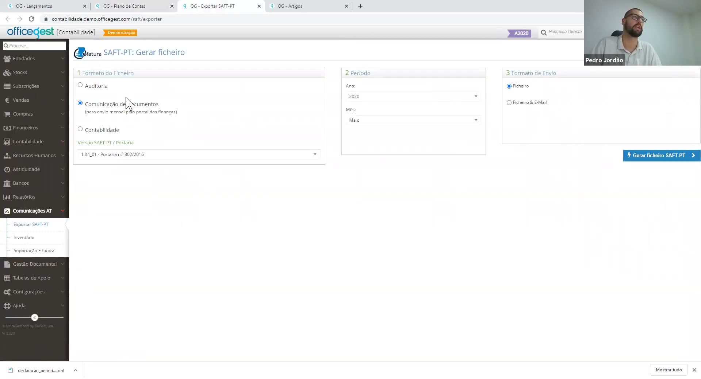

- No mesmo menu existe **Importação E-fatura** (não foi demonstrada).
- Os contabilistas que submeteram o SAF-T da contabilidade tiveram **erros de taxonomia**. A solução mostrada:
  - em **Contabilidade → Ficheiros de Apoio → Taxonomias** está a tabela (Código, Código SNC Base, Descrição), que depende do regime (por exemplo, microentidades);
  - **"Atualizar plano de contas"** atribui o código de taxonomia a cada conta de movimento. Depois, filtra-se o Plano de Contas pelas contas de movimento **sem** código e completa-se à mão.

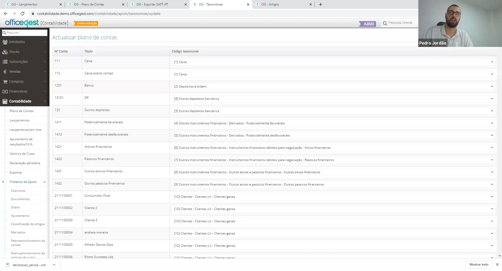

## 7. Relatórios (≈ 36:00–38:40)

Os relatórios estão em **Relatórios → Contabilidade**:

- **Balancetes:** Balancete analítico, Balancete razão e Balancete por taxonomia. Filtram-se por exercício, intervalo ou seleção de contas, mês inicial e final e grau, com tipo de impressão Mensal, Acumulado ou Mensal e acumulado. Podem **imprimir-se** ou exportar-se para **Excel**.

  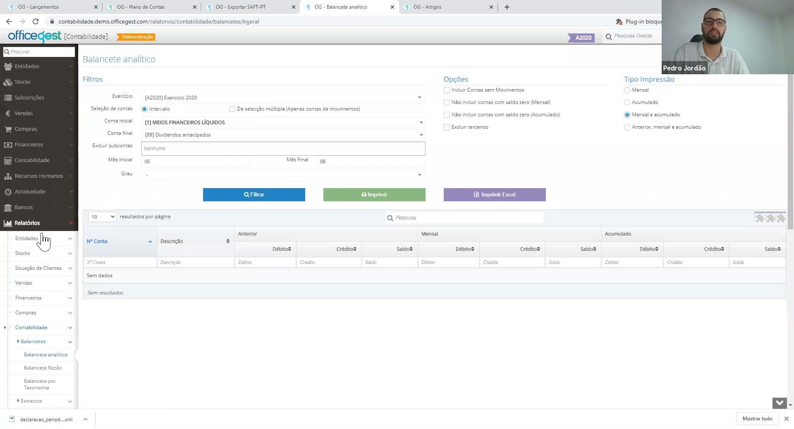

- **Extratos:** Extrato de Conta e Extrato Diário. O extrato de uma conta também se abre pelo botão **Extracto** da própria conta, no Plano de Contas.
- **Balanço** e **Demonstração dos resultados por naturezas:** em 2020 calculavam-se por **fórmulas sobre contas** editáveis em cada rubrica, com comparação de dois anos. Foi anunciado que passariam a usar as **taxonomias**. **Falta verificar** como funciona hoje.

## 8. Mapas, novidade em 2020 (≈ 38:40–43:10)

- **Relatórios → Contabilidade → Mapas → Novo mapa:** Designação, **Novo** ou **Baseado em** (um mapa existente), e o número de **Páginas**, **Linhas** e **Colunas**. Cada página vira uma folha do Excel.

  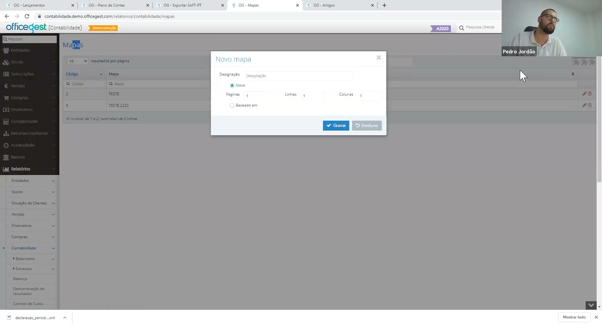

- O editor funciona como uma folha de cálculo, com texto, formatação e **fórmulas**, por exemplo o saldo de uma conta num intervalo de datas. O botão **Calcular** preenche os valores, e o mapa exporta para Excel.

  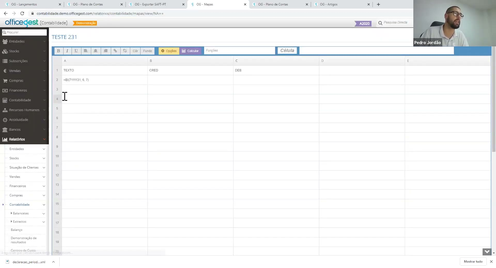

## 9. Apuramentos de IVA e de resultados (≈ 43:10–45:00)

- **Contabilidade → Ficheiros de Apoio → Apuramento:** lista os apuramentos configurados, como o **APUR – Apuramento IVA** (conta 24351) e os apuramentos de resultados (resultado operacional, financeiro, corrente, antes de impostos, líquido). Cada um tem as contas a apurar.

  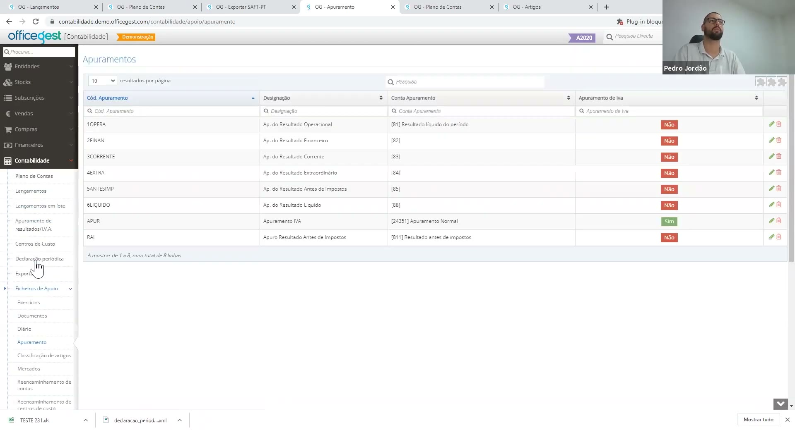

- **Contabilidade → Apuramento de resultados/I.V.A.**, separadores **IVA** e **Resultados**: escolhe-se o apuramento, a conta, o Diário e o Documento ([70] Apuramento IVA), a data e o período (por exemplo, "2º Trimestre"). O botão **Executar** cria o lançamento de apuramento.

  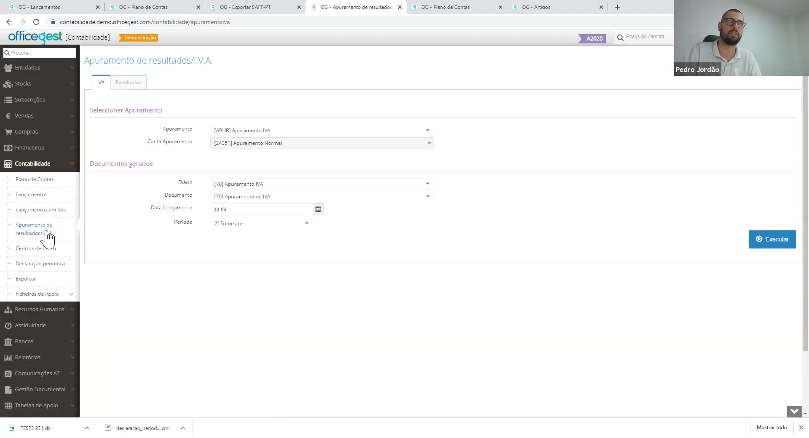

---

## O que este vídeo pode responder no projeto winners-group

Segundo o webinar de 2020-06 (versão 2.220), e **ainda por confirmar no OfficeGest atual**:

| Pergunta | O que o vídeo mostra |
|---|---|
| **C-2** — o que é "classificar por artigos"? | Confirma a hipótese registada a 30/09. A classificação é atribuída **ao artigo** (por família ou no separador Contabilidade da ficha) e define as contas de compra, venda, IVA e devolução **por taxa de IVA e por mercado** (Nacional, Comunitário, Internacional). O ecrã mostra os números das contas. |
| **C-24** — existe lançamento automático, e como funciona? | Sim, de **três formas**: o botão na fatura, o ecrã **Lançamentos em lote** (Filtrar → Validar → Processar, com os erros a vermelho) e a **integração diária** (Exercícios → Integrar por mês), com relatório de erros por email. Continua por saber **se a Winners usa** esta funcionalidade. |
| **D-3** — que funcionalidades nativas existem? | Mostra classificação de artigos, integração automática, declaração periódica, SAF-T com taxonomias, mapas e apuramentos. **Não demonstra** DMS/OCR, reconciliação bancária nem QR Code. |
| **e-Fatura** | Em 2020 já existia o menu **Comunicações AT → Importação E-fatura**, mas não foi demonstrado. Vale verificar, porque a API não tem nada sobre o e-Fatura. |

## Pontos a verificar no sistema atual

- [ ] Os caminhos de menu acima continuam iguais?
- [ ] A integração automática (Exercícios → Integrar) e o relatório "Integração Contabilidade" ainda existem nestes moldes?
- [ ] O que faz hoje a **Importação E-fatura**, e se serve para a conferência das compras?
- [ ] O TPA ou multibanco como conta própria, anunciado em 2020, chegou a existir? → Sim, em agosto de 2021 já existia o **Fecho TPA**: ver a secção 9 da [Formação Prática Módulo Financeira](../formacao-pratica-modulo-financeira/dissertacao.md). Falta confirmar no sistema atual.
- [ ] O balanço e a demonstração de resultados já são calculados a partir das taxonomias?

## Limites desta versão

- Os **ecrãs** são a fonte mais fiável dos nomes. A **explicação** do porquê vem de legendas automáticas com muitos erros; onde a fala não era clara, ficou a marca ❓.
- O vídeo anuncia uma sessão de perguntas e respostas, mas a gravação termina na demonstração.
